# Dusk Lake · 暮色湖畔

一个可以自由行走的 3D 私人湖畔世界：250 × 250 m 连续地图、针叶林、湖泊、码头、一座 A 字形木屋，以及一座带泳池的玻璃泳池馆——从池底潜下去能游进地下水族馆。所有室内都和室外处在同一坐标系里（进屋不切场景、不传送、不黑屏）。

- 引擎：**Godot 4.7.2 Standard**（GDScript，Forward+，Jolt Physics），Windows 单机优先
- 需求规格：[docs/DEVELOPMENT_SPEC.md](docs/DEVELOPMENT_SPEC.md)（唯一需求来源）；阶段指令：[docs/AGENT_HANDOFF.md](docs/AGENT_HANDOFF.md)
- 当前进度：**M0、M1、第一轮正式美术、M2 天气系统、方块人物、泳池馆与地下水族馆、小动物、雷暴/彩虹/风、聊天框、小地图、开发者模式、第一人称双手、木屋生活、独木舟与湖上探索、性能优化、可潜水的海洋大缸、木屋国际象棋、动作轮盘、世界地图与全屏、联机（最多 4 人）与中英界面、自动更新、新立牌、夜里的仙境林地、东北角雪山、内存与卡顿优化、图腾山洞与任务、星座与图鉴、石头小屋、跨世界旅行、画面闪动优化、小溪瀑布与裂谷、启动画面与开场过场、云海浮岛与琥珀沙丘、解说卷轴、新建游戏设定与存档、亚特兰蒂斯与六个新玩法、划船人的信与石头小屋、第一章收尾（新星座、暮烬之夜、终章与剧情过场）已完成**，自动检查 126/126、启动流程 6/6、联机检查 12/12 通过。见 [docs/QA_M0_M1.md](docs/QA_M0_M1.md)、[docs/ART_PASS.md](docs/ART_PASS.md)、[docs/M2_WEATHER_CHARACTER.md](docs/M2_WEATHER_CHARACTER.md)、[docs/POOLHOUSE_FAUNA.md](docs/POOLHOUSE_FAUNA.md)、[docs/CHAT.md](docs/CHAT.md)、[docs/MINIMAP_DEVMODE.md](docs/MINIMAP_DEVMODE.md)、[docs/CABIN_LIFE_CANOE.md](docs/CABIN_LIFE_CANOE.md)、[docs/PERFORMANCE.md](docs/PERFORMANCE.md)、[docs/AQUARIUM_DIVE.md](docs/AQUARIUM_DIVE.md)、[docs/CHESS.md](docs/CHESS.md)、[docs/INTERACTIONS_WORLDMAP.md](docs/INTERACTIONS_WORLDMAP.md)、[docs/COOP.md](docs/COOP.md)、[docs/V0_3.md](docs/V0_3.md)、[docs/SNOW_PEAK.md](docs/SNOW_PEAK.md)、[docs/MEMORY_STUTTER.md](docs/MEMORY_STUTTER.md)、[docs/CAVE_QUESTS.md](docs/CAVE_QUESTS.md)、[docs/NATURE_FLICKER.md](docs/NATURE_FLICKER.md)、[docs/BOOT_INTRO_HANDS.md](docs/BOOT_INTRO_HANDS.md)、[docs/V0_5.md](docs/V0_5.md)、[docs/ATLANTIS.md](docs/ATLANTIS.md)、[docs/LETTERS_COTTAGE.md](docs/LETTERS_COTTAGE.md)、[docs/FLICKER_BRIDGE.md](docs/FLICKER_BRIDGE.md)、[docs/STORY_EMBERS.md](docs/STORY_EMBERS.md)

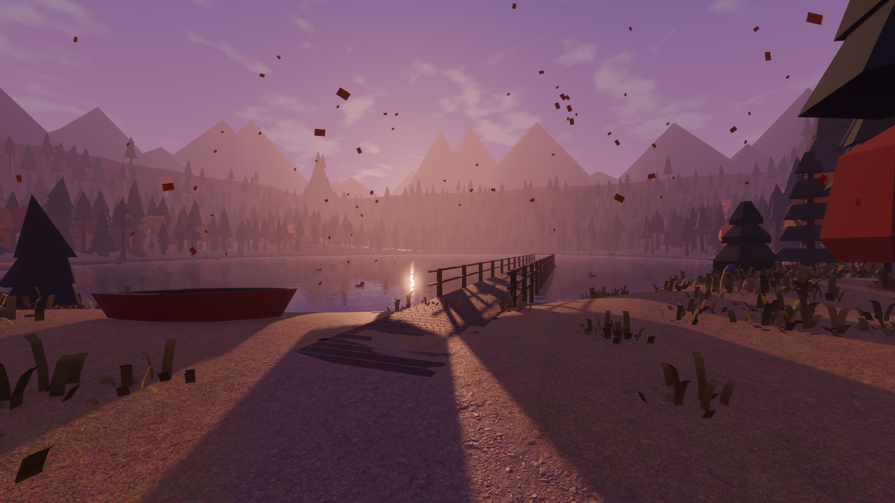

| 木屋外观 | 木屋室内（窗外是真实的室外场景） |
|---|---|
| 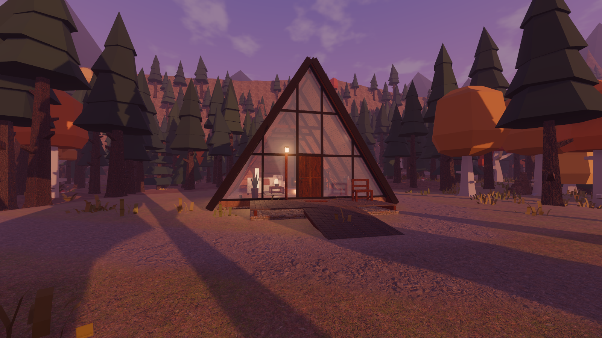 | 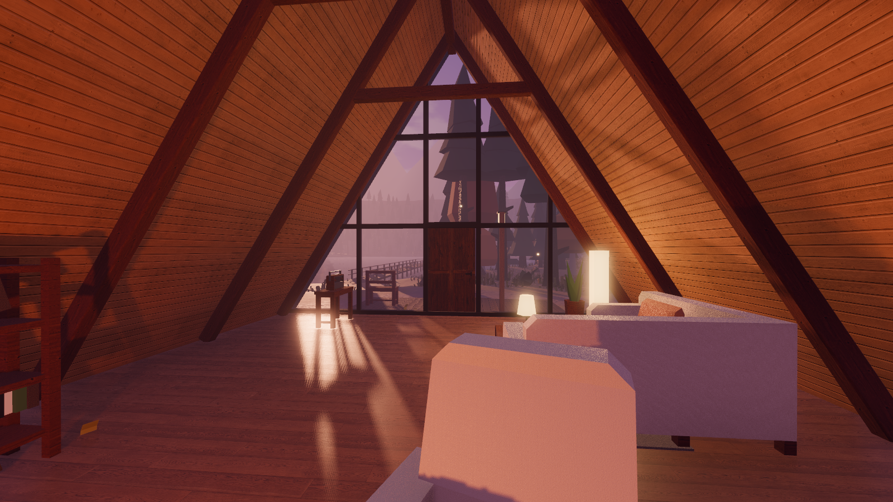 |
| 码头望向木屋 | 湖面倒影 |
| 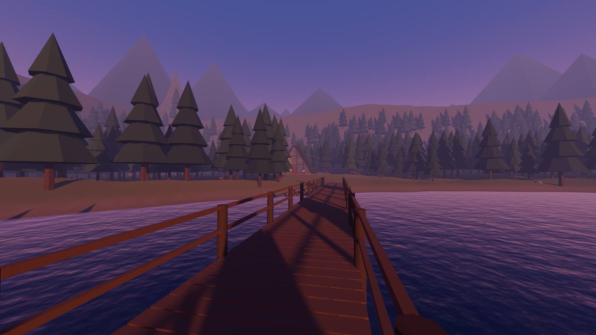 | 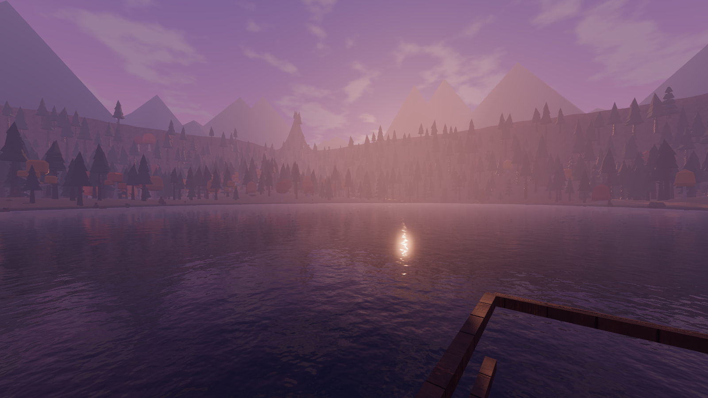 |
| 秋夜大雨（屋内无雨） | 冬日下雪 |
| 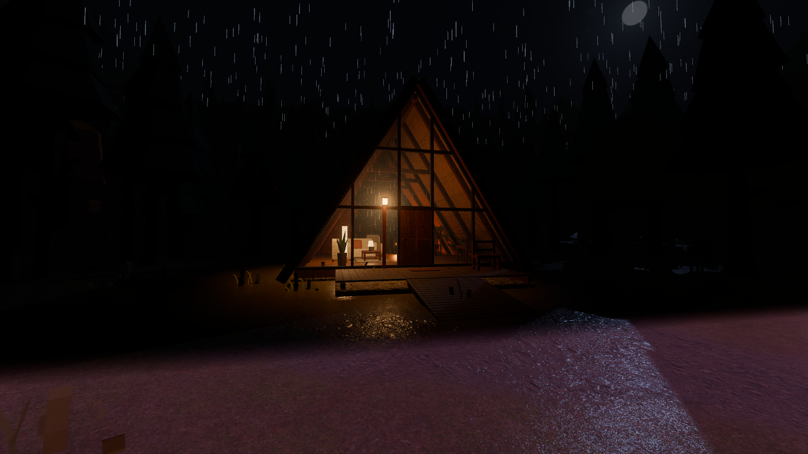 | 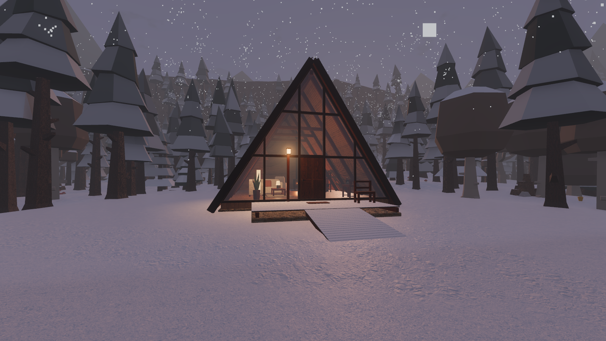 |
| 方块人物 | 换装 |
| 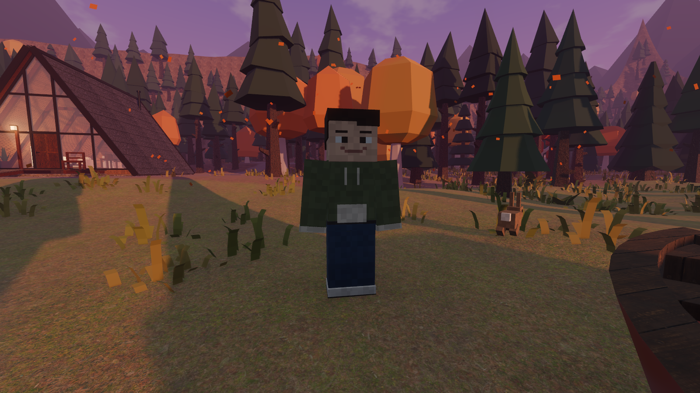 | 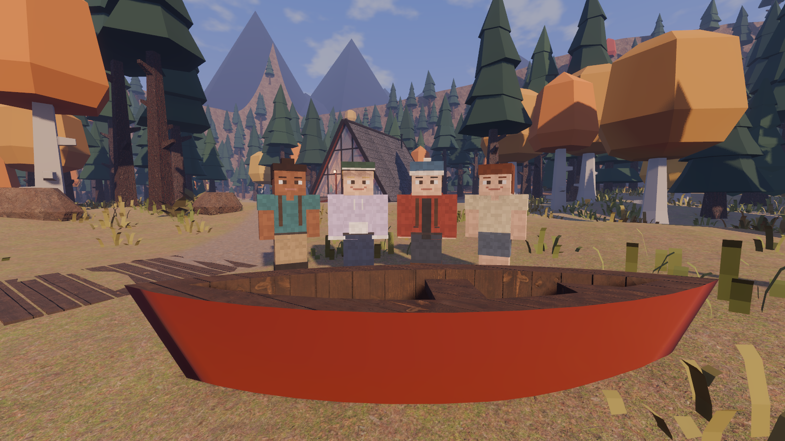 |
| 泳池馆 | 地下水族馆 |
| 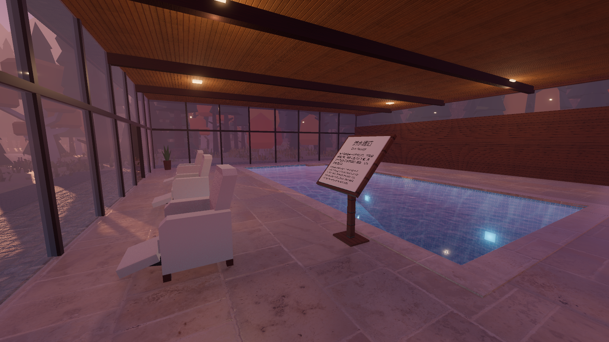 | 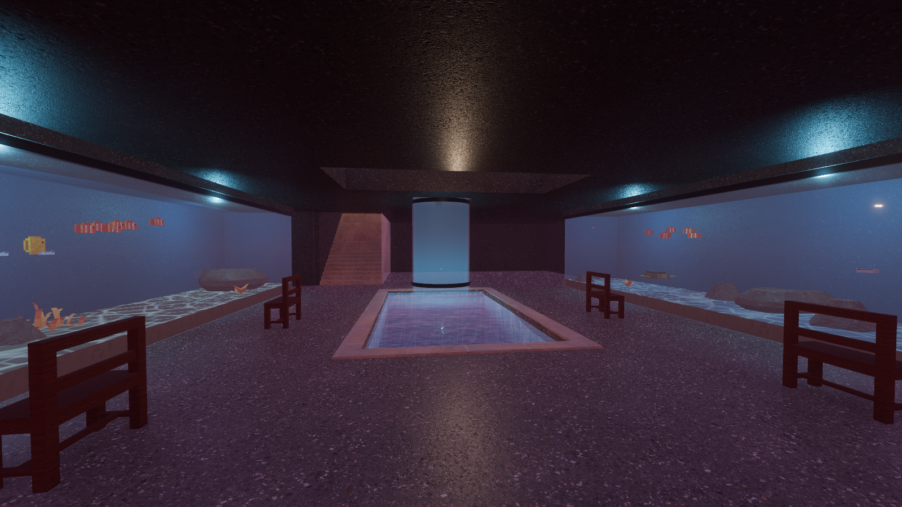 |
| 雨后彩虹 | 林间的兔子 |
| 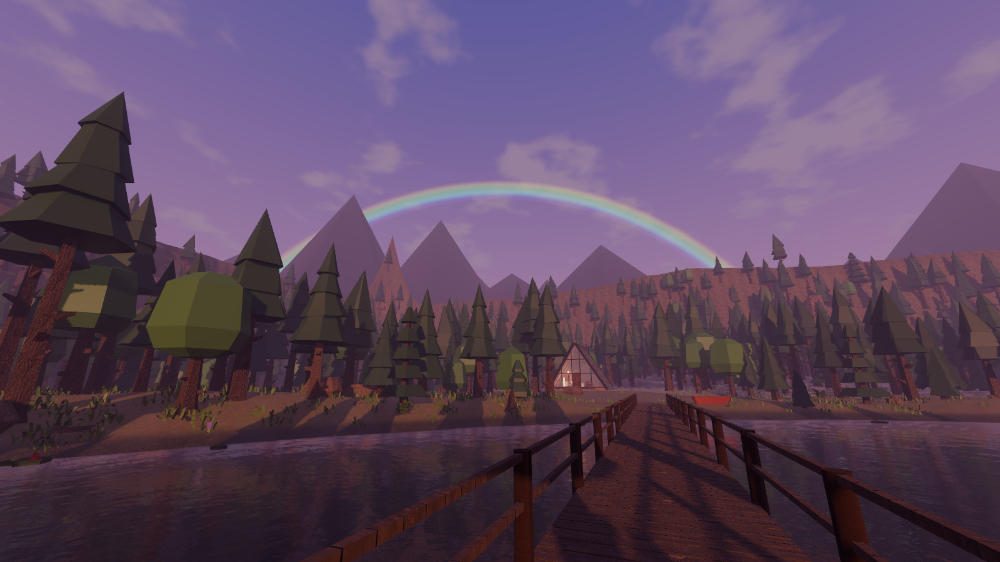 | 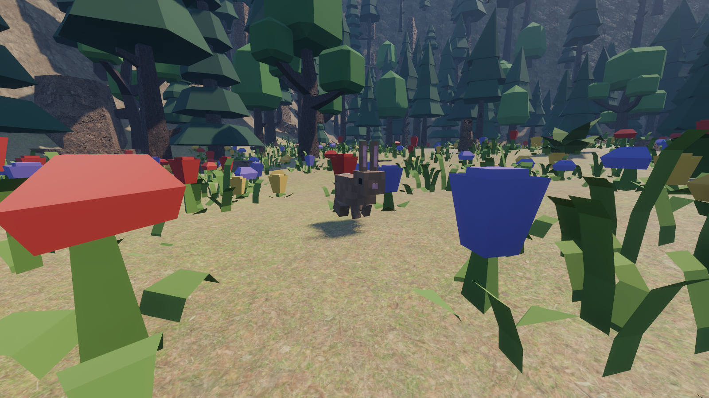 |

## 下载

Windows 版：到 [Releases](https://github.com/stloendays/Myworld/releases/latest) 下载 `DuskLake.exe`，放在任意文件夹双击运行。游戏启动时会自动检查新版本，在大厅或 设置 → 关于 里一键更新。

## 运行

1. 下载 Godot 4.7.2 Standard（Windows）：https://godotengine.org/download/windows/
2. 打开 Godot → 导入 → 选择本目录的 `project.godot` → 按 **F5** 运行（主场景 `scenes/main/Main.tscn`）。

命令行（把 `godot` 换成你本机的 Godot 可执行文件路径）：

```bash
godot --path . 
```

```bash
godot --headless --path . --fixed-fps 60 res://tests/TestRunner.tscn
```

第二条是自动检查，退出码 0 表示全部通过。重新生成文档截图（会弹出窗口约 10 秒）、测帧率：

```bash
godot --path . --resolution 1600x900 res://devtools/CaptureShots.tscn
```

```bash
godot --path . --resolution 1920x1080 --disable-vsync res://devtools/Benchmark.tscn
```

重新生成木屋模型（需要 Blender 5.2）、重新下载贴图：

```bash
blender --background --factory-startup --python devtools/blender/build_cabin.py
```

```bash
pwsh -File devtools/fetch_polyhaven.ps1
```

## 按键

| 操作 | 按键 |
|---|---|
| 移动 | W / A / S / D（或方向键） |
| 环视 | 鼠标 |
| 奔跑 | Shift（步行 3.2 m/s，奔跑 5.2 m/s） |
| 跳跃 | 空格（水中：上浮；靠池壁按空格爬上岸） |
| 下潜 | C 或 Ctrl（水中） |
| 交互 | E（准星中心射线 2.5 m）：开关门、生火 / 熄火、开关灯、坐下 / 站起、睡觉、上 / 下独木舟、读信、看石头小屋的门锁 |
| 右键 | 用手：准星对着东西就和 E 一样去用；什么都没对着就挥挥右手（联机时别人看得到） |
| 划独木舟 | W / S 划、A / D 转向、Shift 用力划、E 下船（靠码头或岸边） |
| 国际象棋 | 看着木屋茶几上的棋盘按 E；鼠标点子再点格子；Esc 关闭 |
| 动作轮盘 | G（按住往方向推、松开选中；或轻点后用鼠标点）：休息（坐下 → 躺下 → 起身）、挥手、跳舞、鼓掌；快捷键 1–4 |
| 拍照 | F12（存到“图片\Dusk Lake”）；画面中央有摄影清单上的东西（小动物、地标、天鲸、彩虹、星空……）就记进旅行日志 |
| 世界地图 | Tab（当前世界的整张地图 + 世界总览，列表里点另一个世界可以直接前往；Esc 或 Tab 关闭） |
| 旅行日志 | J（任务、图鉴、收藏、活动（鱼、纪录、寻宝线索）、传说（划船人的信、亚特兰蒂斯的石板）、成就；Esc 或 J 关闭） |
| 和老图腾说话 | 北边山洞里看着图腾按 E；E / 空格继续，1–3 选选项，Esc 离开 |
| 解说卷轴 | 走近 3.6 m 自动展开、走远卷起；第三人称面朝展开的卷轴时镜头拉近到肩后 |
| 全屏 | F11 或 Alt + Enter |
| 开局 | 启动大厅：“继续上次的世界”；“单人游戏 / 创建房间”先到“新建游戏”设定页（玩法模式、出生世界与出生点、季节时刻天气、一天长度、天气变化、小动物、仙境、任务图鉴、小地图罗盘、体力、夜晚亮度、种子，9 个一键预设） |
| 别的世界 | 图腾山洞尽头的光门 → 云海浮岛；南部草甸西边的沙之门 → 琥珀沙丘；泳池馆地下海洋大缸底部的石环（潜下去游过去）→ 亚特兰蒂斯；那边的光门回湖畔。掉出浮岛会被风托回最后站稳的地方 |
| 罗盘 / 体力 | 屏幕上方的罗盘条（方位、探索点、收集品、光门）；开了“奔跑体力 / 游泳体力”时下方有体力条 |
| 钓鱼 | R 甩竿（准星越高甩得越远），鱼漂沉下去时 1.5 秒内再按 R 收竿；湖、绿洲、浮岛池塘、亚特兰蒂斯水环各有自己的鱼 |
| 打水漂 | 湖边或码头上按住 Q 蓄力、松开扔（平着扔、用力扔、跑起来扔弹得多） |
| 寻宝 | B 在脚下挖；线索在旅行日志「活动」页，按世界种子每个世界埋一只宝箱，挖错了会说离得远近 |
| 烹饪 | 木屋铸铁炉顶上的铁锅、沙丘营地篝火上的铁锅：看着按 E，1 / 2 / 3 做烤鱼、鱼汤、海鲜拼盘（吃了有效果） |
| 计时挑战 | 走（游）进金色起点环开始计时：林道奔跑、绳桥穿越、云海跳台、沙丘冲刺、潜水环 |
| 亚特兰蒂斯 | 穹顶外屏幕下方是氧气条，气泡泉补满；看着捧镜雕像按 E 转 45°；走进漩涡泉坐洋流水渠；看着大蝠鲼按 E 骑上去（E 松手） |
| 联机 | 启动时的大厅里“创建房间 / 加入房间”（输入房间号）；游戏中 Esc →“多人房间”；访客照房主的本局设定走 |
| 界面语言 | 默认跟随系统（中文系统显示中文）；大厅或 设置 → 操作 里可改 English / 中文 |
| 第一 / 第三人称 | V（第一人称能看到自己的双手，大小在 设置 → 视角 → 手的大小 里调） |
| 小地图 | M（右上角圆形小地图，随朝向旋转，下方显示区域名） |
| 暂停 / 释放鼠标 | Esc（“设置”：画面、视角、操作、小地图、开发者，自动保存；“人物外观”换发型和衣服） |
| 坐标信息 | F3（日期时间天气、帧率、世界坐标、朝向、所在区域、室内/室外） |
| 聊天 | T 或 Enter 打开，/ 直接输入命令（/help 查看），↑↓ 翻历史，Esc 取消；/tp 在云海浮岛、琥珀沙丘里用那个世界的坐标 |
| 开发者模式 | F2（左侧开发者面板：天气、季节、时间、传送；F 飞行，N 穿墙，F4 收起面板） |

## 如何验证坐标与室内外连续性

- **坐标**：按 F3。左上角显示 `X / Y / Z`（米）与朝向（0° = 北 = −Z）。出生点在湖岸 (−50, 29)，木屋中心 (−69, 37)，码头从 (−46, 26) 延伸到 (−1, 26)，湖心 (35, −2)。所有坐标都来自 `data/world/world_layout.json`。
- **连续性**：从出生点沿土路走到木屋门廊，按 E 开门走进去，F3 中“区域”会出现 `cabin_interior`、状态变为“室内”；整个过程中画面不黑屏、不跳帧、不加载。透过三角窗能看到码头和湖面——那是实时渲染的室外场景，不是贴图。
- **地图边界**：四周是逐渐变陡的山坡和密林，走到约 |114| m 处会因坡度超过 45° 而上不去，不存在空气墙。
- **湖水**：可以走进浅水，水深约 0.7 m 处停下（湖里不做深水游泳）；码头入水段有栏杆。
- **泳池馆与水族馆**：从出生点旁的岔路沿步道往南走到 (4, 84)，推开西墙的门进大厅，F3 区域显示 `poolhouse`。下楼梯或从泳池深水区池底的洞口潜下去（C 下潜），穿过玻璃水管就到了地下水族馆（区域 `aquarium`，地面 Y ≈ −5）。水下画面会变成蓝绿色。

## 目录与文件用途

| 路径 | 用途 |
|---|---|
| `project.godot` | 工程配置：主场景、Autoload、物理层命名、Forward+、Jolt Physics |
| `data/world/world_layout.json` | **世界布局唯一数据源**：边界、地形参数、湖泊、木屋、码头、区域 zone_id、步道、森林密度、M1 光照、出生点 |
| `scenes/main/Main.tscn` + `scripts/main/Main.gd` | 主场景：常驻 World、Cabin、Player 与 UI；放置出生点 |
| `scenes/world/World.tscn` | 室外世界：光照、地形、湖、森林、码头、远景、区域触发器 |
| `scenes/world/Terrain.tscn` + `scripts/world/TerrainBuilder.gd` | 257×257 高度场网格与碰撞；顶点色写入五层地表的混合权重 |
| `shaders/terrain.gdshader` | 地形五层 PBR 混合：草地 / 林下落叶 / 土路 / 岩石（三平面）/ 湖岸；预留季节、积雪、湿润参数 |
| `scenes/world/Lake.tscn` + `scripts/world/LakeBuilder.gd` | 水面（顶点色水深）、湖面反射探针、涉水上限（水下挡墙，码头处压低） |
| `scenes/world/Forest.tscn` + `scripts/world/ForestBuilder.gd` | 固定种子摆放约 2500 棵 Kenney 针叶树与秋色阔叶树、250 块岩石（每种模型一个 MultiMesh + 树干/岩石碰撞） |
| `scripts/world/GroundCoverBuilder.gd` | 地被层：草丛、灌木、野花（南部草甸）、蘑菇、树桩倒木、小石块、睡莲；40 m 区块 + 可见距离 |
| `scripts/world/Vegetation.gd` | 植被分布规则（林地密度、空地、步道走廊），地形、树木、地被共用 |
| `scripts/art/ArtMaterials.gd` | 材质库：Poly Haven 贴图按真实尺寸平铺；Kenney 模型与自制 GLB 按材质名换成项目配色 |
| `scripts/world/DockBuilder.gd` | 码头木板、桩、栏杆与碰撞 |
| `scripts/world/DistantBackdrop.gd` | 地图外的远山与台地（无碰撞） |
| `scripts/world/ZoneArea.gd`、`ZonesBuilder.gd` | 区域触发器，按 zone_id 记录角色进出 |
| `scripts/world/MeshUtil.gd` | 程序化几何工具（远山、碰撞用凸棱柱） |
| `shaders/water.gdshader` | 湖面：不透明 + 屏幕空间反射，滚动法线波纹，按水深渐变颜色 |
| `scenes/buildings/Cabin.tscn` + `scripts/buildings/Cabin.gd` | A 字形木屋：载入 Blender 模型与 Kenney 家具、灯光、碰撞、室内区域 `cabin_interior` |
| `devtools/blender/build_cabin.py` | 用 Blender 脚本生成木屋与门板 GLB（尺寸与碰撞一致，米制 UV） |
| `assets/imported/cabin/`、`assets/source/cabin_aframe.blend` | 木屋与门板模型（GLB）及可编辑的 Blender 源文件 |
| `assets/imported/kenney/`、`assets/imported/textures/` | Kenney 模型（CC0，78 个 GLB）与 Poly Haven 贴图（CC0，16 组 1k PBR） |
| `scenes/props/InteractableDoor.tscn` + `scripts/interactions/InteractableDoor.gd` | 铰链门（AnimatableBody3D，门板为 Blender 模型），uid = `cabin_front_door` |
| `scripts/interactions/Interactable.gd`、`InteractionSystem.gd` | 可交互物基类与统一 `interact(actor, target)` 契约 |
| `scenes/player/Player.tscn` + `scripts/player/FirstPersonController.gd` | 第一人称 CharacterBody3D，眼高 1.65 m，FOV 75° |
| `scenes/ui/HUD.tscn`、`PauseMenu.tscn`、`DebugOverlay.tscn` 及 `scripts/ui/` | 准星与交互提示、Esc 菜单、F3 坐标信息 |
| `scripts/core/EventBus.gd` | 事件总线（Autoload），信号名按规格第 08 章 |
| `scripts/core/WorldState.gd` | 世界状态唯一权威（Autoload）：可交互物状态、角色所在区域 |
| `scripts/core/GameSettings.gd` | 设置与按键表（Autoload），运行时注册按键 |
| `scripts/buildings/CabinLife.gd`、`scripts/interactions/`（InteractableToggle、Seat、Bed） | 木屋生活：炉火与炊烟、灯和开关、座位、床 |
| `scripts/vehicles/Canoe.gd` | 独木舟：划桨、四点取水面高度的浮动、搁浅、上下船、位置存档 |
| `scripts/systems/PerformanceDirector.gd` | 画质分级、帧率上限、动态分辨率（FSR）、局部灯距离淡出、地下关太阳阴影 |
| `devtools/Profile.tscn` | 性能剖析：逐项关特性，看帧时、CPU / GPU、绘制调用、三角形 |
| `devtools/MemProbe.tscn` | 内存与卡顿探针：加载计时、内存 / 显存 / 进程占用、走遍全图的帧时分布和卡顿帧 |
| `scripts/world/Exploration.gd` | 湖上探索点（`world_layout.json → lake_pois`）：发现记录、营火帐篷芦苇睡莲摆件 |
| `scripts/core/WorldLayout.gd`、`WorldTerrain.gd`、`PhysicsLayers.gd` | 布局数据读取、解析式地形高度函数、物理层常量 |
| `scripts/systems/WorldClock.gd`、`SeasonController.gd`、`WeatherController.gd`、`ClimateSystem.gd` | 世界时间、季节、天气规则与过渡、预设入口（Main/Systems） |
| `scripts/systems/EnvironmentDirector.gd` | 把时间/季节/天气合成为太阳月亮、天空、雾、湿润积雪、降水、植被季节色 |
| `scripts/world/Precipitation.gd` | 雨雪粒子 + 跟随相机的屋顶/地面高度场碰撞（室内不下雨雪） |
| `shaders/sky.gdshader`、`glass.gdshader`、`snow_overlay.gdshader` | 天空（星空、月亮、云）、带雨痕的玻璃、积雪覆盖层 |
| `data/seasons/seasons.json`、`data/weather/weather.json` | 四季与六类天气的全部参数、测试预设 |
| `scripts/character/`（CharacterModel、CharacterAppearance、Wardrobe） | 方块人物：部位、外观插槽与挂点、动画；外观数据；衣橱目录 |
| `data/characters/wardrobe.json`、`default_appearance.json` | 所有发型/帽子/衣服/鞋/背饰款式（像素盒子），默认外观 |
| `scripts/core/PlayerProfile.gd`、`scripts/ui/WardrobePanel.gd` | 本地玩家外观（存 user://appearance.json）、外观编辑面板 |
| `scripts/ui/ChatBox.gd`、`ChatCommands.gd` | 聊天框（左下角消息记录与输入行、系统消息）与 / 命令 |
| `scripts/ui/DevPanel.gd` | F2 开发者面板：天气、季节、时间、飞行、穿墙、传送（地点在布局文件 `dev_spots`） |
| `scripts/ui/Minimap.gd` | 右上角圆形小地图：湖畔底图后台烘焙并缓存，步道和建筑矢量绘制；别的世界由那个世界提供底图、图形和标记 |
| `scripts/player/FirstPersonArms.gd` | 第一人称的双手（随外观变化，走路、跳跃、交互、游泳都有动作） |
| `scripts/core/GameSettings.gd` | 设置与按键（Autoload），保存在 `user://settings.json` |
| `scripts/systems/AudioDirector.gd` | M3 的**接口占位**（未运行） |
| `scripts/systems/SaveManager.gd` | 世界存档（Autoload）：`user://saves/world.json`（v4，临时文件 + 原子替换），新建 / 继续、自动存、旧档迁移 |
| `scripts/core/GameRules.gd` | 本局玩法与设定（Autoload）：23 个选项、5 种玩法模式、9 个预设；各系统按它调整，联机以房主为准 |
| `scripts/worlds/MiniWorld.gd`、`World02.gd`、`World03.gd`、`WindBeacon.gd`、`RelicAltar.gd`、`data/worlds/cloudsea.json`、`dunes.json` | 湖畔以外的世界：共用底座（地形、界面、收集品、探索点、掉落回岸）；云海浮岛、琥珀沙丘；风灯、祭坛 |
| `scripts/worlds/World04.gd`、`LightStatue.gd`、`MantaHandle.gd`、`scripts/world/ShapedWater.gd`、`AtlantisRing.gd`、`data/worlds/atlantis.json`、`shaders/seafloor.gdshader`、`bubble_dome.gdshader`、`water_flow.gdshader` | 亚特兰蒂斯：同心环城、穹顶与海、雕像谜题、蝠鲼、湖畔大缸里的入口石环；海床焦散、气泡穹顶、流动水面 |
| `scripts/play/Play.gd`、`PlayActivities.gd`、`RailRide.gd`、`CookPot.gd`、`CookingPanel.gd`、`TrophyCabinet.gd`、`data/play/*.json` | 更多玩法：规则与记录（Autoload）、每个世界的钓鱼 / 打水漂 / 挖宝 / 挑战、沿路线带人走（洋流、蝠鲼）、铁锅与烹饪面板、木屋收藏柜；鱼、菜、宝藏点、挑战路线、成就 |
| `scripts/world/DuneGate.gd` | 南部草甸的沙之门（去琥珀沙丘） |
| `scripts/ui/CompassBar.gd`、`scripts/core/PhotoList.gd`、`data/photo/subjects.json` | 罗盘条与体力条；摄影清单（F12 认出画面中央的东西） |
| `shaders/cloud_sea.gdshader`、`sky_waterfall.gdshader` | 云海与浮岛瀑布 |
| `scripts/buildings/PoolHouse.gd` | 泳池馆与地下水族馆：大厅、泳池、池底洞口与玻璃水管、楼梯、鱼缸、灯光、碰撞、水体与区域（全部程序生成，坐标来自布局） |
| `scripts/buildings/ReefTank.gd` | 地下水族馆的海洋大缸：落地玻璃、水下通道、礁石海带沉船、气泡与光束、灯光 |
| `scripts/games/`（ChessGame、ChessAI、ChessPanel、ChessTable） | 国际象棋：完整规则（perft 验证）、电脑对手、2D 棋盘界面、茶几上的 3D 棋盘 |
| `scripts/world/WaterVolume.gd`、`scripts/ui/UnderwaterOverlay.gd`、`shaders/underwater.gdshader` | 可游泳水体（盒形 / 圆柱）、水下滤镜 |
| `shaders/pool_tiles.gdshader`、`pool_water.gdshader`、`caustic_sand.gdshader`、`foliage.gdshader`、`include/` | 泳池马赛克与焦散、池水、缸底沙、随风摆动的植被、雨点涟漪与焦散函数 |
| `scripts/animals/`（FaunaData、FaunaSpawner、Animal、BlockyModel、BlockyMesh、FishSchool） | 小动物：出没规则、生成、行为、方块模型、鱼群 |
| `data/animals/species.json` | 所有动物的部件、配色、速度、出没规则与生成点、萤火虫 |
| `scripts/world/SignBoard.gd`、`SignsBuilder.gd`、`data/world/signs.json` | 中英双语解说卷轴（立架 / 斜案 / 挂墙，纸面按文字自动定尺寸、逐行断好；走近展开、走远卷起）；室外卷轴位置在布局文件 `signs` 里 |
| `scripts/ui/ActionBar.gd` | G 动作轮盘（平时不显示）：休息、挥手、跳舞、鼓掌，F12 拍照（动作本身在 `FirstPersonController.do_emote()` 与 `CharacterModel` 的姿势和手势里） |
| `scripts/ui/WorldMap.gd`、`scripts/core/WorldRegistry.gd`、`data/worlds/worlds.json` | Tab 世界地图；世界注册表（世界列表、状态、根场景、到达位置） |
| `scripts/core/WorldTravel.gd`、`scenes/worlds/World02.tscn`、`World03.tscn` | 跨世界旅行（Autoload）：先卸载当前世界、清缓存，再在后台线程加载下一个世界 |
| `scenes/boot/Boot.tscn`、`scripts/ui/BootLoader.gd`、`LoadingScreen.gd`、`IntroCutscene.gd`、`ScreenFade.gd` | 启动流程（工程主场景）：加载画面 → 开场过场 → 主菜单；加载画面跨世界旅行也用；`Fade` 转场黑幕（Autoload） |
| `scripts/world/Cave.gd`、`scripts/interactions/CaveTotem.gd` | 图腾山洞：沿中线生成的洞道与岩丘、石厅、篝火、水晶、尽头光门；会说话的老图腾 |
| `scripts/core/QuestLog.gd`、`data/quests/quests.json`、`scripts/ui/DialoguePanel.gd`、`scripts/ui/JournalPanel.gd` | 任务与图鉴（Autoload）：任务目标检查、图鉴记录、`user://journal.json`；图腾对话框；J 旅行日志与左上角任务追踪 |
| `scripts/world/StarField.gd`、`data/sky/constellations.json` | 夜空里的原创星座：湖畔原有五个，盯着看就认出；三个世界点亮后各多一个（天鲸座、石拱座、蝠鲼座），第一次一颗颗亮起来 |
| `scripts/buildings/StoneCottage.gd`、`scripts/interactions/CottageDoor.gd` | 南部草地的石头小屋（划船人的家）：三环转锁的门，读完三封信才能打开；屋里书桌、星图、台灯、床、书架、船桨 |
| `scripts/story/PaddlerStory.gd`、`scripts/story/LetterSpot.gd`、`scripts/ui/LetterPanel.gd`、`data/story/letters.json` | 划船人的三封信（世界观落地①）：信的内容与开锁规则、湖边两处放信的地方（`world_layout.json → letters`）、读信界面和没画完的星图（新星座出现后补进空位）；暮烬之夜以后书桌上的第四封信 |
| `scripts/story/Cutscene.gd`、`data/story/cutscenes.json` | 过场动画：黑边、分段镜头、中英字幕与标题、任意键跳过；开场过场与六段剧情过场共用（三个世界点亮、新星座、暮烬之夜、终章） |
| `scripts/story/StoryDirector.gd`、`scripts/story/EmberField.gd` | 第一章收尾（世界观落地②）：湖畔的新星座、暮烬之夜（湖面暮烬 + 原版红点）、图腾最后的故事后的终章、小屋台灯与第四封信 |
| `scripts/world/Streams.gd`、`shaders/stream_water.gdshader`、布局 `terrain.channels` 与 `nature.bridges` | 西岭小溪（河床是地形沟槽）、小瀑布与水雾、溪边石头芦苇；北岭裂谷；木板桥和原木桥 |
| `shaders/cover_flat.gdshader`、`foliage.gdshader` 的 fade 参数 | 草、花、蘑菇远处逐株缩小消失（不再整块抖动淡出） |
| `devtools/FlickerProbe.tscn`、`devtools/flicker_report.py` | 画面闪动探针：固定机位连续渲染，逐像素统计闪烁、画热力图；jiggle 模式比较抗锯齿方案；dynres / legacy / quality= / scale= 按玩家设置对比修复前后 |
| `data/weather/seasonal_fx.json` | 季节飘落物方案：落叶、花瓣，以及保留的“原版红点”（`legacy_red_motes`） |
| `tests/TestRunner.tscn` | 自动检查（101 项：卷轴、新建游戏规则、存档 v4、云海浮岛、琥珀沙丘、QA-01、QA-02、QA-10、天气、人物、泳池馆、游泳、动物、聊天框、小地图、开发者模式、设置、国际象棋、动作轮盘、世界地图等；`DUSK_TEST_ONLY=_test_xxx` 只跑某几项） |
| `scripts/core/Updater.gd` | 自动更新（Autoload）：查 GitHub Releases、下载核对、退出后替换 exe 并重启 |
| `scripts/world/FairyGlade.gd`、`scripts/interactions/FairyPortal.gd`、`shaders/fairy_portal.gdshader` | 仙境林地：只在晴朗夜里出现的特殊事件（仙树、蘑菇圈、水晶、漂浮小岛、月光石门） |
| `scripts/world/SnowPeak.gd` | 雪山顶：石堆、旗杆、面朝湖的长椅、常年小雪（山体是地形 hills 里的 snow_peak，雪线、林线在布局文件里；远处主峰在 `DistantBackdrop`） |
| `export_presets.cfg` | Windows 导出设置（单文件 exe，资源打包在里面），输出到 `dist/` |
| `tests/NetTest.tscn` | 联机检查（两个进程本机回环，11 项：房主规则同步、加入、同步人物与动作、门、聊天、独木舟、天气时间、房主离开、版本不一致） |
| `scripts/net/`（NetworkManager、RemotePlayer、RemotePlayers、RoomCode）、`scripts/ui/LobbyMenu.gd` | 联机：房主自建房间（ENet）、房间号、远端玩家显示与同步；启动大厅 |
| `locale/en.tsv`、`locale/en.po`、`devtools/make_po.sh` | 英文翻译表（界面原文是中文） |
| `devtools/CaptureShots.tscn` | 按预设机位截图到 `docs/screenshots/` |
| `devtools/Benchmark.tscn` | 固定机位测帧率、帧时、绘制调用与显存 |
| `devtools/fetch_polyhaven.ps1` | 下载 Poly Haven 贴图并核对 md5，写清单 |
| `assets/licenses.csv` | 外部素材许可登记表 |
| `docs/` | 规格、阶段指令、架构说明、QA 记录、地图草图、截图 |

## 已实现（M0 + M1）

- Godot 4.7.2 工程与目录结构；Autoload：GameSettings、EventBus、WorldState
- 250 × 250 m 连续地形（X/Z ∈ [−125, 125]，北 = −Z），湖盆、木屋地基、码头岸边平台、西北观景山丘、自然封闭的边缘陡坡
- 湖面（屏幕空间反射 + 盒投影反射探针，远岸树林倒映在水中）、涉水上限；码头（木板贴图、可走到尽头、带栏杆）、岸边独木舟
- Kenney 针叶林与秋色阔叶树、岩石、草丛野花蘑菇树桩等地被，步道走廊与空地自动避让
- 地表五层 PBR 材质混合，自定义天空（渐变、太阳光晕、薄云）、SSAO、雾
- 正式美术的木屋：Blender 脚本建模（石板瓦屋面、梁架、窗框、门廊坡道、铸铁炉），Kenney 家具（L 形沙发、茶几、书架、落地灯、扶手椅等）
- A 字形木屋：真实门窗、可进入的室内（沙发、茶几、书架、铸铁炉、落地灯、暖光），可开关的木门；同一场景、同一坐标系
- 第一人称控制：WASD、鼠标、Shift、空格、E、Esc、F3；FOV / 灵敏度可调
- 区域 zone_id、室内外判定（为 M3 的音区准备）
- **M2 天气系统**：世界时钟（一天 = 现实 48 分钟）与昼夜、四季（每季 12 天，植被与地表随季变色）、六类天气（晴/阴/小雨/大雨/雾/雪）及平滑过渡；雨雪粒子不进室内，窗上有雨痕，地面会变湿、积雪；F4 调试面板与四个测试预设
- **方块人物**：脸、发型、帽子、上衣、下装、鞋、背饰七个外观插槽和四个挂点，款式全部写在 JSON 里；Esc 菜单“人物外观”实时预览与保存；V 切换第一/第三人称；走跑摆臂摆腿
- **泳池馆与地下水族馆**：玻璃大厅与泳池（深水区 3.1 m），池底洞口接玻璃水管通到地下水族馆的下潜池，也可以走楼梯下去；三个鱼缸里有 59 只鱼、海龟和水母；可以游泳（浮力、下潜、爬上岸）和看到水下画面
- **小动物**：兔子、狐狸、松鼠、绿头鸭、知更鸟、蝴蝶、萤火虫，按季节、昼夜、天气出没，兔子和松鼠见人就跑
- **天气细化**：雷暴（闪电照亮天地）、风（植被摆动，带阵风）、雨后彩虹、地面水坑与雨点涟漪、雨滴溅水花、秋季落叶与春季花瓣
- **解说立牌**：步道、泳池馆、鱼缸前的中英双语立牌，场景里没有悬空文字
- **聊天框**：T 打开，可写消息、用 / 命令改时间、天气、季节与传送，天气和季节变化自动提示（见 `docs/CHAT.md`）
- **小地图与开发者模式**：右上角圆形小地图；F2 开发者模式里改天气季节、飞行、穿墙、传送
- **设置**：画面、视角（启动视角、手的显示、镜头晃动、第三人称距离与肩位）、操作、小地图，自动保存
- **第一人称的双手**：从画面下方伸出的方块手臂，袖子随外观变化，走路、跳跃、开门、游泳都有动作
- **木屋生活**：炉子生火 / 熄火（火光、火苗、炊烟）、四盏灯的开关、沙发扶手椅长椅可以坐、床可以睡到早上
- **独木舟与湖上探索**：从码头上船划到湖心小岛营地，四个探索点（小地图问号 → 金色标记）
- **性能优化**：树林分块、地形遮挡剔除、画质分级、默认 60 帧上限、动态分辨率、远处动物降频；地下水族馆每帧三角形从 630 万降到 37 万
- **内存与卡顿优化**：贴图显存压缩 + mipmap、高画质 SMAA 代替 MSAA、地形高度函数与植被规则缓存、MultiMesh 整块写入；进入世界 15.6 s → 7.6 s，显存 1040 → 802 MB（`devtools/MemProbe.tscn`）
- **海洋大缸**：从泳池一路潜进 24 m 长的大缸，和蝠鲼、礁鲨、鱼群一起游；地下大厅换了水磨石地面、水纹光和灯带
- **国际象棋**：木屋茶几上的棋盘按 E 打开 2D 对弈，双人同屏或和电脑下（三档难度），3D 棋盘同步、棋局存档
- **动作轮盘**：G 弹出，席地坐、躺下看天、挥手、跳舞、鼓掌，F12 拍照；水族馆换成珊瑚花坛、玻璃球灯和鲸鱼吊饰
- **世界地图与全屏**：Tab 世界地图（含其他世界的预留槽位）；F11 全屏；秋天晴天的落叶改成零星几片，原版红点保留为可切换方案；雨下得慢一点、雨丝细一点
- **联机与中英界面**：启动大厅建房 / 用房间号加入，最多 4 人，人物、动作、门、聊天、独木舟、天气时间同步；界面默认跟随系统语言
- **自动更新与仙境**：exe 启动时查 GitHub 新版本、一键更新；立牌换成童话风木牌；晴朗的夜里东南山坡上长出仙境林地
- **雪山**：东北角能爬上去的雪山（山顶 39 m，27 m 以上终年积雪，林线以上无树），山顶有石堆、旗杆和看湖的长椅，背后是雪顶主峰远景；远处的山重做成约 16 座形状各异、分远近两层的山
- **图腾山洞与任务**：北边岩脊里的山洞，石厅里有会说话的老图腾和不灭的篝火，九个任务一个一个接；洞的尽头一道光门通往第二个世界（先卸载湖畔再加载，不同时占内存；世界二目前是雾中浮岛）
- **旅行日志、图鉴、星座**：J 查看任务进度和图鉴（14 种动物、5 个原创星座），晴朗的夜里盯着星座看就能认出；南部草地多了一座锁着门的石头小屋
- **画面闪动优化与自然景观**：高画质改用 TAA（走动时锯齿闪烁约减半）、草花远处逐株缩小不再成块闪现、动态分辨率防抖；西边一条从山坡流进湖的小溪，中途一道小瀑布，林道上一座木板桥；西北小山被一道 7.5 m 深的裂谷劈开，林道上架着原木桥，两头能走下谷底
- **v0.5 新地图、卷轴、新建游戏**：世界二「云海浮岛」（五座浮岛、三座绳桥、十二块跳台、四座风灯和天鲸、八颗云珠、池塘与瀑布）；世界三「琥珀沙丘」（沙丘、能游泳的月牙绿洲、石柱废墟、风蚀石拱、驼队营地、阶梯神殿与六块古代碎片的祭坛），湖畔南部草甸新开沙之门；解说立牌全部换成走近才展开的卷轴；启动大厅加“新建游戏”设定页（23 个选项、9 个预设）和“继续上次的世界”，世界存档 v4；罗盘条、体力、摄影清单、旅行日志收藏页；闪动从根上修（太阳阴影小步更新、100 % 比例不做 FSR 锐化、方块贴图 mipmap）（见 `docs/V0_5.md`）
- **亚特兰蒂斯与更多玩法**：世界四「亚特兰蒂斯」（泳池馆地下海洋大缸底部的石环潜进去；气泡穹顶下的同心环古城：三圈水环、两圈陆环、山铜神殿与尖塔、柱廊、白石房子、洋流水渠；穹顶外的海底有珊瑚、海带林、沉船、气泡泉、鱼群、蝠鲼、水母和鲸鱼；氧气条、五尊捧镜雕像的光束谜题、珍珠贝壳和六块传说石板、洋流水渠、骑蝠鲼，光照随时刻变）；更多玩法：钓鱼（13 种鱼）、打水漂、按种子寻宝、炉火烹饪（吃了有效果）、五条计时挑战、24 个成就和木屋收藏柜；存档 v5（见 `docs/ATLANTIS.md`）
- **第一章收尾**：三个世界的光送回去时各放一段过场，湖畔夜空随之多出天鲸座、石拱座、蝠鲼座（第一次一颗颗亮起来），石头小屋的星图补完；三盏灯都亮后的傍晚湖上飘起暮烬（原版红点原样启用），回山洞听老图腾讲最后一个故事，放终章过场，书桌上多了划船人的第四封信；开场多了两行序幕；四个新任务、两个新成就；设置里可关剧情过场（见 `docs/STORY_EMBERS.md`）
- **启动与过场、双手**：启动图 → 加载画面（进度、阶段、小提示）→ 三段镜头的开场过场（可跳过、可在设置里关）→ 主菜单；进出房间、传送时黑幕转场；第一人称双手缩小一半、分在左右下角并露出拳头；右键用手或挥手（见 `docs/BOOT_INTRO_HANDS.md`）
- 自动检查（113 项）、启动流程检查（6 项）与联机检查（12 项）、截图与性能测试工具；`devtools/GlitchProbe.tscn` 逐块检查立牌、独木舟、桥的摆放

## 未实现（按里程碑）

- **M3**：音频 Bus 与环境音、壁炉 / 灯 / 沙发交互
- **M4**：完整设置菜单与改键（世界存档、画质档位、Windows 导出、帧率测试已在各扩展里做了）
- **M5**：NPC（联机已提前做了房主自建房间、最多 4 人的版本，见 docs/COOP.md）

## 素材与版权

外部素材全部登记在 [assets/licenses.csv](assets/licenses.csv)，均为 CC0（Kenney、Poly Haven）或本项目自制（Blender 脚本生成的木屋）；自动检查会核对 `assets/imported/` 下每个文件都有登记。规格中的两张用户参考图仅作私有视觉参考，不进入本仓库（`.gitignore` 已排除 `assets/references/`）。
