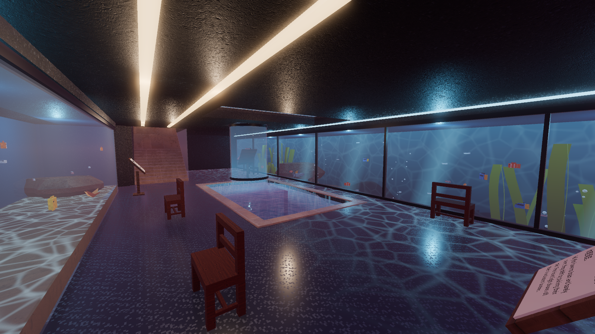
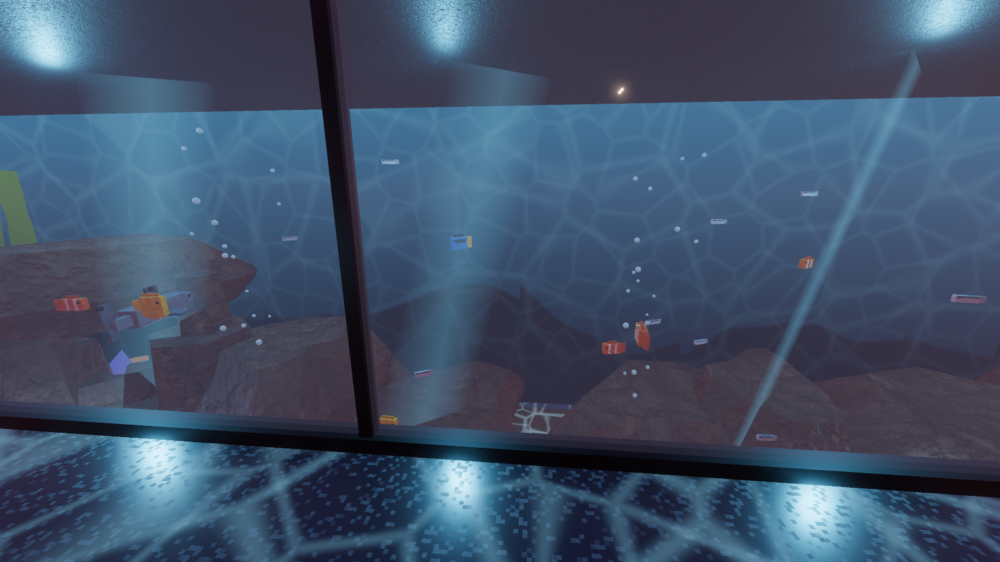
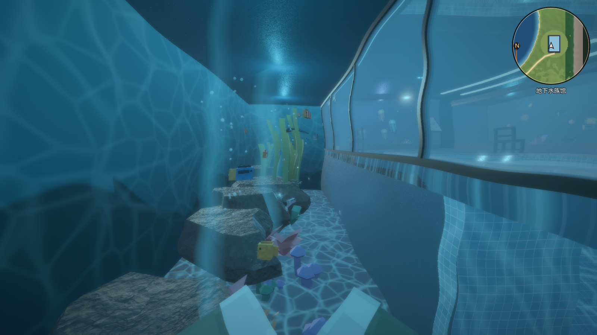
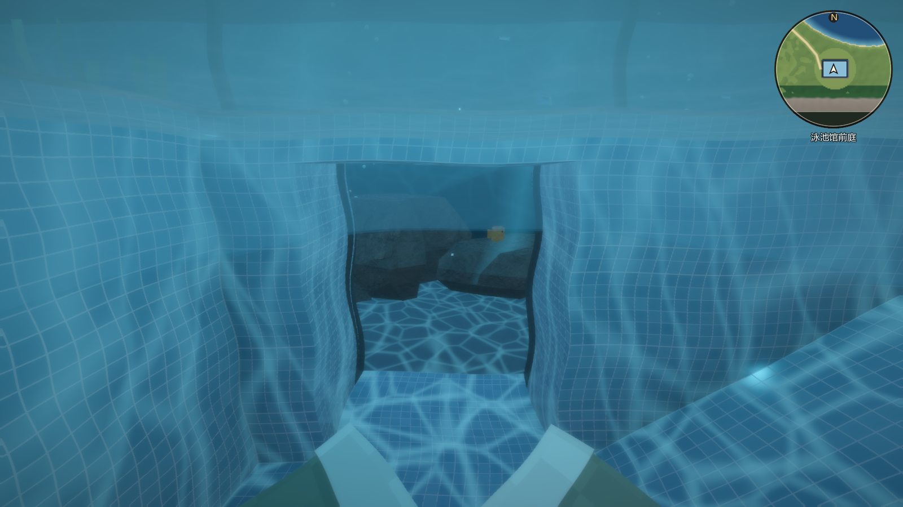
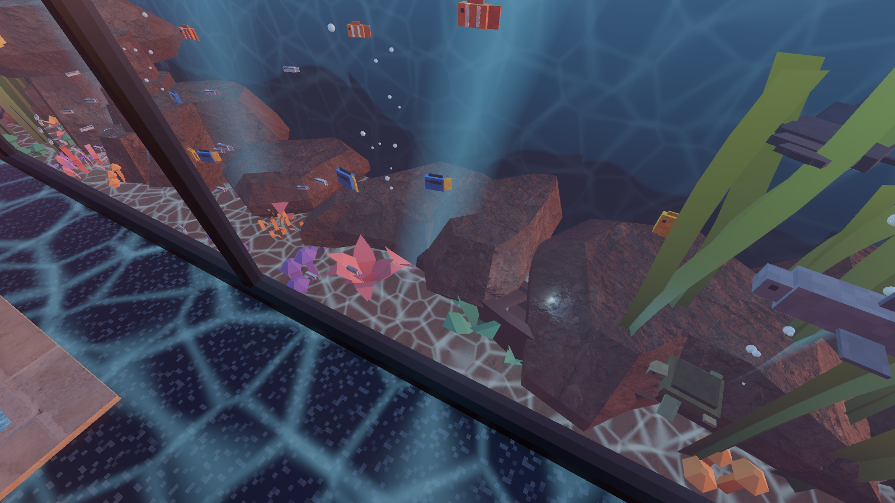

# 水族馆升级：能潜进去的海洋大缸 验收记录（2026-10-21）

## 改了什么

原来北侧是一个 2.3 m 深、只能隔着玻璃看的小鱼缸，地下大厅是黑灰色的混凝土，比较简陋。现在：

| 部分 | 内容 |
|---|---|
| **海洋大缸** | 24 × 4.9 m，缸底沙面在 y = −9.8 m（比大厅地面低 2.8 m），水一直满到顶板。大厅一侧是整面落地玻璃，每 4 m 一根细竖框；站在玻璃前往下看能看到更深的缸底 |
| **能潜进去** | 下潜池北壁底部开了一条 2 m 宽、2.5 m 高的水下通道（对着池底平坦的西半边，避开东侧的上岸坡道），直通大缸。整条路线：泳池深端洞口 → 玻璃水管 → 下潜池 → 水下通道 → 海洋大缸，原路游回再走坡道上岸 |
| **缸里的布景** | 后壁和两端是“深海背景板”（上浅下深的海色、远处礁石剪影、流动焦散）；一排大礁石和一座礁石拱门；东西两头两片会随水摇的海带林（30 株）；46 丛珊瑚和水草；东侧沙里半埋着一条沉没的独木舟；3 处出气口冒气泡；5 道从缸顶斜射下来的光束 |
| **新生物** | 蝠鲼（在中上层慢慢扇翼滑翔）、两条礁鲨（在中层巡游），加上小丑鱼、蓝倒吊、黄高鳍刺尾鱼、两群银鱼和海龟。大缸里共 40 多只，全馆 74 只 |
| **鱼会躲人** | 潜水时离鱼 2.2 m 以内，鱼会加速散开，过一会儿再游回来 |
| **大厅** | 墙和顶板换成深蓝灰；地面换成深色抛光水磨石，靠近大缸玻璃的地方映出流动的水纹光；顶上加了两条暖白灯带和一条沿玻璃的青色灯带 |
| **说明** | 大缸前的讲解牌改为“海洋大缸”；下潜池旁新增“潜入海洋大缸”讲台牌（中英双语）；开发者面板新增“海洋大缸（潜水）”传送点 |

- 原来的南侧珊瑚缸和东侧水母缸保留；水母缸往南让了 0.6 m，给大缸腾位置。
- 地形基坑加深到 −10.6 m（在大缸底板以下），整栋楼的落叶挡板和遮挡体都覆盖到新的深度。
- 在大缸里没有水面（水满到顶），不会浮起来；画面是水下滤镜。
- 不会游泳也能看：走楼梯下到大厅，隔着玻璃看。

## 自动检查：49/49 通过

- 游泳测试的路线延长为：泳池漂浮 → 洞口 → 水管 → 下潜池 → 通道口 → 水下通道 → 游进海洋大缸 → 在缸里游到另一头 → 游回通道 → 回到下潜池 → 坡道上岸。途经泳池、水管、下潜池、通道、大缸五块水体，单帧最大位移 0.054 m，上岸后在水族馆区域。
- 水族箱测试：3 个缸共 74 只（含蝠鲼、礁鲨），全部在缸内。
- 原有的楼梯步行、深水区爬上岸等检查照常通过。

## 性能

地下水族馆机位（1080p、高画质、不限帧率）：GPU 6.7 ms、124 FPS、绘制调用 757、三角形 39 万。默认 60 FPS 上限下 GPU 约忙四成。

## 截图

| | |
|---|---|
|  地下大厅：落地玻璃后是海洋大缸 |  隔着玻璃看大缸 |
|  潜进大缸，和鱼一起游 |  下潜池底部通往大缸的通道 |
|  大缸比大厅地面深 2.8 m | |
