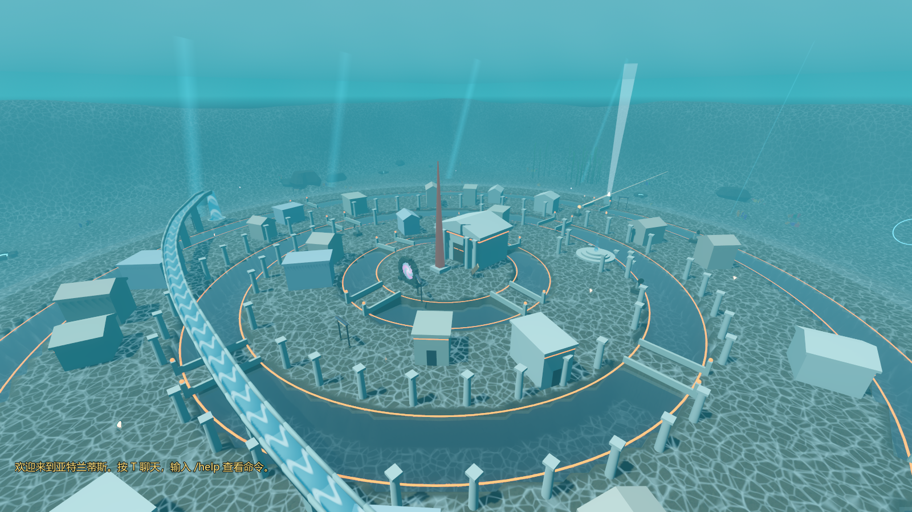
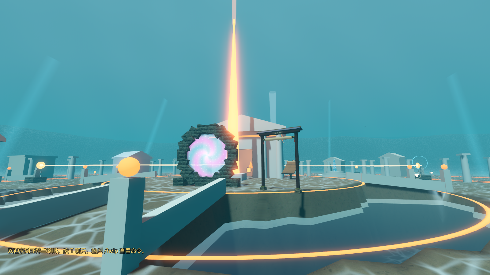
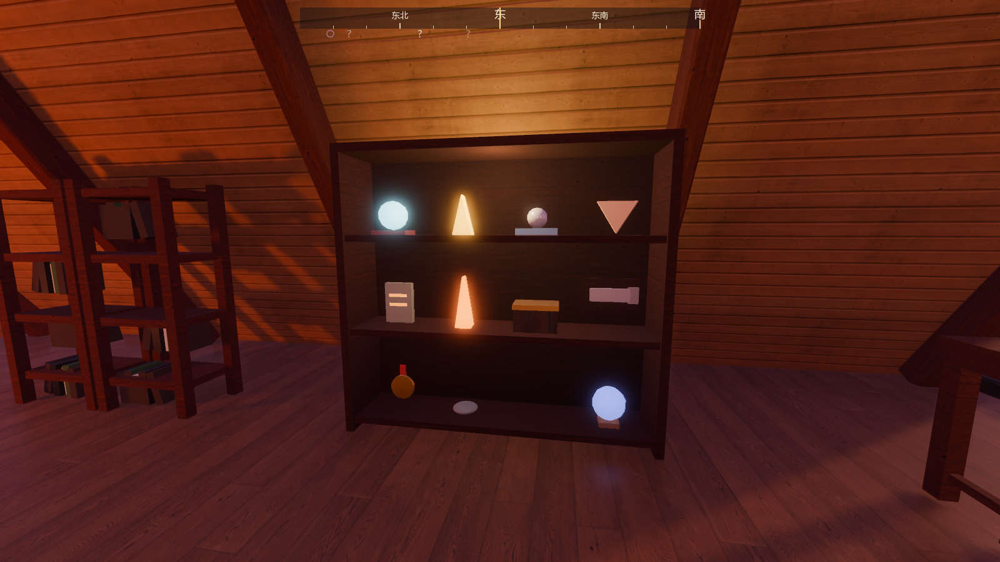

# 亚特兰蒂斯 + 更多玩法（2026-10-26）

分支 `feature/atlantis-more-play`（从 v0.5 的 `feature/v0.5-worlds-scrolls-newgame` 2149daa 分出，PR 叠在 #25 上），worktree `D:\个人世界\DuskLake-atlantis`。计划见 `docs/PLAN_ATLANTIS.md`。

## 一、世界四：亚特兰蒂斯 Atlantis

- **入口**：湖畔泳池馆地下水族馆那口 24 m 海洋大缸，缸底西半边立着一圈长青苔、刻着发光山铜纹的古老石环（`world_layout.json → atlantis_ring`）。潜下去从环里游过去就到；看着它按 E 也行。回来从神殿前的石环（或 Tab 世界地图里点“暮色湖畔”），落在大缸里石环旁边。联机时和别的世界一样不能去。
- **布局**（`data/worlds/atlantis.json`，场景 `scenes/worlds/World04.tscn`，脚本 `scripts/worlds/World04.gd`）：照柏拉图写的同心环——中央岛（半径 11 m）、水环一、陆环一、水环二、陆环二、水环三、外沿；四个方向的石堤把各环连起来（石堤是地形的一部分，走起来没有台阶），过水的那段两边有矮石栏和山铜灯柱。
- **气泡穹顶**：半径 62 m 的半球，边缘泛白、带一点彩虹色。穹顶里是空气，能走路；穹顶外整片都是海（`ShapedWater`：整片海的水体减去穹顶这个球），海里不浮不沉，游速是池子里的 1.7 倍。
- **城里**：山铜神殿（白石墙、山花屋顶、门前柱子、一圈发光山铜饰带，两扇青铜大门）、神殿前 16 m 高的山铜尖塔、台阶广场（三层圆台和喷泉）、两圈柱廊、二十多座白石房子（门口一道山铜饰带）、每一圈环边上一道发红光的山铜纹路、横穿全城的洋流水渠（石拱墩上的水槽）。
- **穹顶外**：焦散光纹的海床、珊瑚丛、三片海带林、礁石、斜着的沉船、12 道光束、5 口冒气泡的气泡泉；水族馆的鱼群、海龟、蝠鲼、礁鲨、两群发光水母，还有一头方块鲸鱼绕着城游大圈。海底四周是缓缓升起的海底山。
- **光照随时刻**：这里也有时钟（湖畔的时刻接着走）。白天蓝绿透亮、焦散光明显；入夜后环境光降下来，山铜纹路和水母亮起来（`atl_09_night`）。穹顶里雾淡，出了穹顶雾浓。

### 能做的事

| 玩法 | 怎么玩 |
|---|---|
| 氧气 | 出了穹顶屏幕下方出现氧气条：普通 75 秒用完，开了“游泳体力”45 秒，喝了鱼汤多撑一倍；靠近气泡泉补满；用完黑幕一闪，被托回最近的气泡泉。规则「亚特兰蒂斯氧气」可关，悠闲漫步和摄影模式默认关 |
| 光束谜题 | 光井（北边外沿）把光往南射出；五尊捧镜雕像，看着按 E 转 45°（八个朝向）。光照到雕像就按镜子的朝向往下传，一尊尊对准后照到尖塔：尖塔点亮、往上射出一道光，神殿两扇大门缓缓打开（雕像朝向按 uid 存档，门和尖塔回来还在） |
| 收集 | 8 颗珍珠（海底的贝床上）、8 枚贝壳（城里）、6 块古代石板（第六块在神殿里）；石板上是亚特兰蒂斯的传说（海神的岛、两眼泉、十个王、山铜、贪心、气泡，中英），记进旅行日志的「传说」页 |
| 洋流水渠 | 西岸的漩涡泉：走进去，水柱把人托上水渠，一路冲到城东头（128 m，约 16 秒） |
| 骑蝠鲼 | 西边蝠鲼礁上歇着一头大蝠鲼：看着它按 E 抓住，驮着你在城外绕一大圈再送回礁石（约 54 秒，途中按 E 松手）；骑着的时候不耗氧气 |
| 探索与任务 | 6 个探索点（山铜神殿、台阶广场、洋流水渠、沉船、海带林、蝠鲼礁）、7 幅卷轴（中英）；老图腾的两个新任务「沉没之城」「山铜之光」进任务追踪 |
| 摄影清单 | 新增 4 样：山铜尖塔、从海里看气泡穹顶、大蝠鲼、海底鲸鱼 |

## 二、更多玩法（6 个）

每个玩法都是新建游戏页「玩法活动」分组里的一个开关（规则 `fishing`、`skipping`、`treasure`、`cooking`、`challenges`、`achievements`，加上 `oxygen`），已经接进五种玩法模式：悠闲漫步关计时挑战和氧气，摄影关计时挑战和氧气，挑战模式全开。新增预设「深海遗城」（出生在亚特兰蒂斯）。

| 玩法 | 怎么玩 | 数据 |
|---|---|---|
| 钓鱼 | R 甩竿（准星越高甩得越远，4–11 m），鱼漂沉下去后 1.5 秒内再按 R 收竿；咬钩不收鱼会跑，走开会收竿。湖（码头、湖岸）、琥珀沙丘的绿洲、云海浮岛的池塘、亚特兰蒂斯的水环各有自己的鱼，共 13 种，按稀有度随机、长度随机，进旅行日志「活动」页的鱼图鉴（记最大尺寸）和鱼篓 | `data/play/fish.json` |
| 打水漂 | 湖边或码头上按住 Q 蓄力、松开扔：石头按真实抛物线飞，落水时入水角度小于 30° 而且够快就弹起来，每弹一次溅一圈水花。平着、用力、跑起来扔弹得多（满蓄力平扔 9 下），往下扔一下就沉；记最多弹几下 | — |
| 寻宝 | 按本局的世界种子在四个世界各埋一只宝箱（每个世界 4–5 个候选点，同一个种子总在同一个地方）；线索写在旅行日志「活动」页；B 在脚下挖，挖错地方会说“还远 / 不远了 / 就在附近”；挖到宝箱从土里升起、打开，里面一枚刻着世界名字的金币 | `data/play/treasure.json` |
| 炉火烹饪 | 木屋铸铁炉顶上的铁锅（炉火灭着做不了）、琥珀沙丘驼队营地篝火上的铁锅：看着按 E 打开面板，用鱼篓里的鱼做烤鱼（1 条：体力恢复快一倍）、鱼汤（2 条：海底氧气多撑一倍）、海鲜拼盘（3 种鱼：游得快三成、体力恢复快一倍、氧气更耐用），做好就吃，效果 5 分钟 | `fish.json → recipes / buffs` |
| 计时挑战 | 五条路线：湖畔「林道奔跑」、云海浮岛「绳桥穿越」「云海跳台」（原来的跳台计时并进来）、琥珀沙丘「沙丘冲刺」、亚特兰蒂斯「潜水环」。走（游）进金色起点环开始计时，按顺序经过检查点（只算下一个），到终点停表，记最好成绩和金 / 银 / 铜牌 | `data/play/challenges.json` |
| 成就 + 收藏柜 | 24 个成就（去过四个世界、点亮尖塔、采珠人、读完石板、骑蝠鲼、钓到 8 种鱼、水漂弹 9 下、四个宝箱、金牌、海鲜大餐……），解锁时提示，旅行日志「成就」页；木屋北墙书架旁一只三层收藏柜，柜里一盏小灯，按存档摆出云珠、古代碎片、珍珠、贝壳、石板、山铜晶、宝箱、鱼标本、金牌、水漂石、小图腾、星盘 | `data/play/achievements.json` |

- **联机**：这些玩法只改本机玩家自己的记录。房主照常玩、照常存档；访客按 R / Q / B、开铁锅时提示“联机做客时不能……（这是房主的世界，记录不会保存）”。协议不变（3）。
- **存档 v5**：加 `achievements`、`records`（打水漂、挑战成绩、做过几道菜）、`catches`（每种鱼的条数和最大尺寸）、`pantry`（鱼篓和菜）、`treasures`（各世界挖到宝箱的游戏日）。v1–v4 的旧档都能迁移读入（新字段为空，原有内容和规则不丢）。

## 三、顺手修的漏洞

| 漏洞 | 根因 | 改法 | 回归检查 |
|---|---|---|---|
| 云海浮岛、琥珀沙丘左下角写“欢迎来到暮色湖畔” | “当前世界”只由 WorldTravel 在旅行时设置，直接实例化的世界（截图工具、以后别的加载路径）不知道自己是谁 | 世界根节点（`Main`、`MiniWorld`）进树时自己声明 `WorldTravel.current_world`；截图工具的聊天机位按当前世界写 | 「欢迎语按当前世界」：三个世界左下角都是自己的名字 |
| 截图工具把湖畔摘下树后，旅行日志刷新时报错 | 日志连着 Autoload 的信号，世界不在树里也会被调用 | `JournalPanel._refresh` 不在树里时不刷新 | 截图全程无报错 |
| 自动检查日志里偶尔出现一串 “Attempting to initialize the wrong RID” | 湖畔进树时在后台线程提前读几十个 Kenney 模型；无窗口运行用的假渲染器，分配网格和材质 RID 的表不是线程安全的，后台线程和主线程同时建东西（木屋收藏柜、石环……）时偶尔撞上（本分支 3 次里 2 次出现，v0.5 原样 3 次 0 次） | 无窗口运行时不开后台预读（有窗口的游戏照旧并行读） | 改后连跑 5 次 0 条；全套自动检查日志 0 条 ERROR |

## 操作

| 操作 | 按键 |
|---|---|
| 去亚特兰蒂斯 | 泳池馆地下 → 海洋大缸 → 潜到缸底，从石环里游过去（或看着石环按 E） |
| 转雕像 / 骑蝠鲼 / 做饭 | 看着按 E |
| 洋流水渠 | 走进西岸的漩涡泉 |
| 钓鱼 / 打水漂 / 挖宝 | R / 按住 Q 松开 / B |
| 活动、传说、成就 | J → 活动 / 传说 / 成就 |

## 验证

### 自动检查

- `tests/TestRunner.tscn`：**113 项全部通过**（v0.5 的 101 项 + 12 项新的：钓鱼、打水漂、寻宝、炉火烹饪、收藏柜、计时挑战、成就、玩法开关、存档 v5、亚特兰蒂斯、欢迎语按当前世界、亚特兰蒂斯进度回来还在；“跨世界”一项扩成湖畔 ↔ 云海浮岛 ↔ 湖畔 ↔ 琥珀沙丘 ↔ 湖畔 ↔ 亚特兰蒂斯 ↔ 湖畔，其中去亚特兰蒂斯是真的在大缸里从石环游过去）。全程日志没有一条 `ERROR`。
- `tests/BootTest.tscn`：**6 项**通过。`tests/NetTest.tscn`：**12 项**通过（新增“访客钓鱼、挖宝被禁用并提示，房主照常能玩”）。

亚特兰蒂斯里自动检查实际走过的路线和数字：

| 项目 | 结果 |
|---|---|
| 内容 | 雕像 5、气泡泉 5、珍珠 8、贝壳 8、石板 6、卷轴 7、物种 8、水母 12、房子 23、宝藏候选点都在地上 |
| 穹顶 | (0, 2, 30)、(40, 3, 40) 是空气；(80, 5, 0)、(0, 30, 60) 是海；(13.5, −1.2, 8) 是水环一 |
| 走石堤 | 从外沿 (0, 58) 沿南边石堤走到中央岛，48 m，没下水，单帧最大位移 0.09 m |
| 光束谜题 | 门先关着、走到门口进不去；五尊雕像按 E 共 18 次转到位，光路 6 段，雕像全亮，尖塔点亮、大门打开；走进神殿捡到第六块石板 |
| 氧气 | 出穹顶 2 秒开始耗（75 秒一条）；耗尽黑幕回到最近的气泡泉；泉边 1 秒补满；规则关掉不耗 |
| 洋流水渠 | 走进漩涡泉被带走，15.7 秒冲完 128 m，单帧最大位移 0.18 m，落在城东头 |
| 骑蝠鲼 | 看着按 E 抓住，绕城一圈 54 秒回到礁石，途中氧气不掉 |
| 潜水环 | 从起点环游过 7 个环，53.6 秒（银牌） |
| 跨世界内存 | 湖畔 308 MB → 亚特兰蒂斯 241 MB（节点 9264 → 2474，云海浮岛 2360、琥珀沙丘 1502）→ 回湖畔 303 MB；单程约 1.0 秒 |

湖畔的新玩法：码头上甩竿钓到湖里的鱼、咬钩不收会跑、对着岸上甩不出去；满蓄力平扔弹 9 下、往下扔 0 下；同一个种子宝藏在同一处、12 个种子分到 4 处，在线索处挖出宝箱；炉火灭着做不了菜，生火后做海鲜拼盘扣 3 条鱼、游速 ×1.3；收藏柜摆出鱼标本、宝箱、水漂石；林道奔跑 24.7 秒（金牌），跳到后面的检查点不算；存档 v5 写盘读回一致，v4 旧档迁移不丢内容。

### 帧率（1920×1080，高画质，关垂直同步和动态分辨率，`devtools/Benchmark.tscn`）

| 机位 | FPS | GPU ms | 绘制调用 | 三角形 |
|---|---|---|---|---|
| 湖畔·码头望雪山（开阔机位） | 99.9 | 8.3 | 1805 | 112 万 |
| 湖畔 18 个机位平均（含沙之门） | 80.7 | — | — | — |
| 云海浮岛·主岛 / 全景 / 跳台 | 170 / 181 / 246 | 5.5 / 3.6 / 3.5 | 363–1496 | 5–15 万 |
| 琥珀沙丘·光门 / 绿洲 / 全景 | 160 / 156 / 150 | 5.7–5.9 | 679–823 | 34–35 万 |
| **亚特兰蒂斯·穹顶全景** | **134.9** | 6.8 | 1553 | 72 万 |
| **亚特兰蒂斯·神殿前** | **154.2** | 5.8 | 1112 | 56 万 |
| **亚特兰蒂斯·穹顶外海底** | **147.8** | 6.1 | 1435 | 67 万 |

亚特兰蒂斯三个机位都在 135 FPS 以上，高于湖畔开阔机位（99.9）。湖畔 17 个老机位平均 80.6（v0.5 记的是 78.9，在本机两轮之间 3–5 % 的波动内）；显存湖畔 678 MB、亚特兰蒂斯 629 MB。

### 截图（`docs/screenshots/`）

- 亚特兰蒂斯：`atl_00_ring`（大缸里的石环入口）、`atl_01_overview`（穹顶里的同心环城）、`atl_02_street`（陆环上的街道和石堤）、`atl_03_temple_before` / `atl_05_temple_after`（尖塔点亮、大门打开前后）、`atl_12_beam`（光束一路传过雕像）、`atl_04_outside`（穹顶外看气泡穹顶）、`atl_13_seabed`（海带林）、`atl_06_current`（洋流水渠）、`atl_07_manta`（骑蝠鲼）、`atl_10_oxygen_hud`（氧气条）、`atl_11_tablet`（古代石板）、`atl_14_dive_rings`（潜水环）、`atl_08_world_map`（世界地图）、`atl_09_night`（夜里的山铜纹路）
- 更多玩法：`play_01_fishing`、`play_02_skipping`、`play_03_treasure`、`play_04_cabinet`、`play_05_achievements`、`play_06_challenge`、`play_07_cooking`、`play_08_journal_activities`、`play_09_journal_lore`、`play_11_oasis_fishing`
