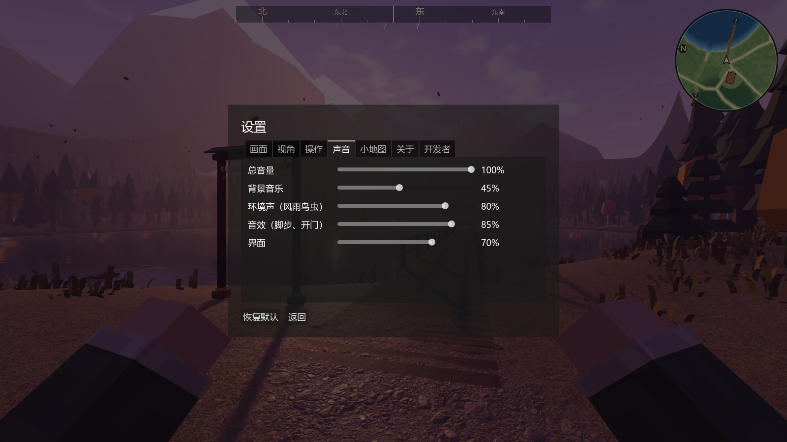

# M3 声音（2026-10-27）

分支 `feature/m3-audio`，叠在 PR #31（第一章收尾）上，worktree `D:\个人世界\DuskLake-audio`。
规格第 07 章与 AGENT_HANDOFF Task C：AudioDirector 和音区，六条总线，风、湖水、雨、壁炉独立循环与空间声源，进屋室外雨声 1–2.5 秒平滑衰减，开门、开灯、炉火、坐下的交互声，QA-05。
游戏之前完全没有声音，这一版把整个世界的声音一次补上。

## 声音从哪来

**全部用代码合成**：`devtools/audio/synth.mjs`（Node，无依赖，固定随机种子）生成 `assets/audio/` 下 102 个 WAV（32 kHz、16 bit、单声道），原创，登记为 CC0（`assets/licenses.csv → AUD-01`）。没有下载任何第三方音频，不存在授权问题；改音色就改脚本、重新生成：

```
node devtools/audio/synth.mjs            全部重新生成
node devtools/audio/synth.mjs fire rain  只生成名字里含这些词的
```

做法：风、雨、水、火是各种噪声（白 / 粉 / 棕）过随时间变化的滤波器，再撒上雨点、水泡、火星这样的小事件；鸟叫、虫鸣是按频率轨迹积分的正弦；乐器是 Karplus-Strong 拨弦（竖琴）、FM 钟声、失谐锯齿波铺底。循环音在尾部和开头之间等功率交叉淡化，首尾无缝。Godot 导入时压成 QOA，导出的游戏只多约 5–6 MB。

| 类别 | 声音 |
|---|---|
| 环境循环（18） | 松风、寒风、白天的树叶、夏秋夜的虫鸣、湖水拍岸、小溪、瀑布、小雨、大雨、屋里听到的屋顶雨、炉火 / 篝火、水下、山洞、泳池馆、云海的风与风铃、沙丘的干风、亚特兰蒂斯穹顶的嗡鸣与鲸歌、仙境的铃声 |
| 动物与天气 | 6 种鸟叫、猫头鹰、2 种青蛙、3 种雷（近的带炸裂声） |
| 脚步（7 种地面 × 4） | 草地、砂石步道、木板、石头、雪、沙、浅水；落地、入水、划水、出水 |
| 交互 | 开门（门闩 + 门轴吱一声）、关门、门锁着、开锁、开关、生火、熄火、坐下 / 躺下、风灯点亮、雕像转动、碎片嵌回祭坛、穿过光门、快门、甩竿、落水、咬钩、挖、棋子、煎东西、划桨 |
| 界面 | 按钮、打开 / 合上、对话、信纸、翻日志、捡到东西、发现地点、任务完成、成就 |
| 音乐乐器 | 竖琴（C4）、钟（C5）、低音（C2）、长音铺底（C3，循环） |

## 混音（`AudioDirector`，Autoload 名 `Sound`）

| 内容 | 做法 |
|---|---|
| 总线 | MUSIC（带一点混响）、AMB_OUTDOOR、AMB_WEATHER（这两条带低通，进屋、水下用）、AMB_INDOOR、FOLEY、UI；启动时建好 |
| 环境层 | 不定位的循环，按世界状态每层 1.5 秒淡入淡出：风随风力，下雪 / 冬天换寒风；白天的树叶（冬天没有）；虫鸣只在夏秋（春天少一点）的晴夜；小雨 / 大雨按雨量；屋顶雨只在有屋顶的室内（木屋、石头小屋、泳池馆）；山洞、泳池馆、水下各一层；云海、沙丘、亚特兰蒂斯各一层 |
| 进屋（QA-05） | 户外与天气两条总线在约 1.7 秒内降 14 dB、低通从 20 kHz 压到 750 Hz（平滑，不是一下子断）；屋里的炉火、屋顶雨照响；6 m 内有开着的门时只降一部分（外面的声音透进来）；出门反向恢复 |
| 水下 | 户外、天气、音效三条总线压低通，叠一层水下的闷声 |
| 定位声源 | 湖水从离你最近的湖岸传来、小溪从最近的一段溪水传来（跟着你移动的 3D 声源）；炉火、山洞篝火、驼队营地的篝火、瀑布、仙境的铃声挂在原地（`SoundEmitter`，炉火熄灭时先减弱再停）；白天随机方向 12–34 m 外树上的鸟叫，夜里偶尔一声猫头鹰，春夏的夜里湖边有青蛙 |
| 雷 | 闪电以后按距离（声速 343 m/s）延迟，越远越小声，近的带炸裂声 |
| 脚步 | 走 0.75 m / 跑 1.05 m 一步；地面：码头、桥、木屋标了木板，室内按区域（木屋、石头小屋木地板；泳池馆、水族馆、山洞石头），地形按世界和位置（湖畔：浅水、雪线以上和冬天积雪是雪、湖边沙滩、步道砂石、其余草地；云海草地；沙丘沙子；亚特兰蒂斯城里石头、城外沙底），其他东西算石头；从 3 m 以上落地有一声闷响 |
| 交互 | 按 `interactable_state_changed` 放在物件所在的位置（32 m 内才放；世界刚建好的 2 秒内不放，免得读档恢复门灯状态时一齐响）；所有按钮按下轻轻一响；发现地点、捡到东西、任务完成、成就、拍照、钓鱼、打水漂、挖宝、烹饪、下棋、划船、睡觉、穿过光门各有声音 |

## 音乐（`MusicDirector`，`Sound.music`）

乐曲不是录好的，而是按 `data/audio/music.json` 现场生成：湖畔的白天、黄昏、夜里、雨天、冬天，和云海、沙丘、亚特兰蒂斯各有自己的调、五声音阶、速度和乐器。一首 16–28 小节：每两小节换和弦（长音铺根音和五度、低音），旋律在音阶上一步一两格地走，小节头落在和弦音上，每四小节留一口气；放完安静 100–220 秒再来（像《我的世界》，音乐只是偶尔出现）。换了世界或天变了，正在放的那首淡出。默认音量 45 %（规格：极轻背景音乐）。

过场有写好的配乐（`themes`）：开场（`intro`）、三个世界点亮（`light`）、新星座（`stars`）、暮烬之夜（`embers`）、终章（`finale`，从暮烬的小调走到标题时的大调和弦与钟声）。`cutscenes.json` 每段过场写着 `music`，过场开始时放、结束时淡出。

## 设置

设置 → 声音：总音量、背景音乐、环境声、音效、界面五个滑块（0 = 静音），自动保存。



## 检查

| 自动检查（新增） | 结果 |
|---|---|
| 六条总线（户外、天气带低通），声音表 68 个声音的文件都在、循环音设了循环；102 个合成文件没有削波和直流偏移 | 通过 |
| 环境层：夏夜有虫鸣没有白天的树叶，夏日正午相反，大雨有雨声，冬天换成寒风；湖水声从最近的岸边、小溪声从最近的一段溪水传来 | 通过 |
| **QA-05** 大雨里走进木屋：2.5 秒内室外雨声降 13.8 dB、低通到 972 Hz，0.3 秒时只降了 5.4 dB（平滑）；屋顶雨声和炉火照响；出门恢复 | 通过 |
| 炉火熄灭时声音先减弱、再停掉 | 通过 |
| 脚步按地面换声音（草地、码头木板、山洞石头、雪山顶的雪、木屋地板）；从高处落地有一声闷响 | 通过 |
| 开门 / 关门、开关灯各有声音；闪电 686 m 外，雷声 2 秒后才到 | 通过 |
| 背景音乐：湖畔白天 lake_day、夜里 lake_night，开一首会出音；过场配乐能放能停；六段剧情过场都配了乐，其他世界各有曲风 | 通过 |
| 音量设置：背景音乐拉到 0 就静音，环境声按设置走 | 通过 |
| 声音每帧在主线程上的开销 82 µs（< 400 µs） | 通过 |
| QA-10 素材许可登记覆盖 `assets/audio/` | 通过 |

全套：自动检查 **135 / 135**（上一版 126 项，新增 9 项），启动流程 6 / 6（开场过场带配乐），联机 12 / 12。无窗口运行时音频驱动是 dummy，自动检查查的是混音状态（总线音量、低通、各层增益、放了哪个声音），不是耳朵听到的声音。

声音的频谱和电平用脚本核过（各类声音的低 / 中 / 高频能量占比合理，峰值不超过 -0.1 dBFS，循环首尾相接）。我自己没法听，音色、音量平衡需要你在游戏里听过以后说哪里要改，改脚本重新生成就行。

## 帧率

声音在主线程上每帧约 **82 µs**（混音、脚步、湖水和小溪声源跟随、音乐调度加起来；自动检查里测的，不受机器状态影响）。混音本身在 Godot 的音频线程上。

帧率测试（1920×1080，高画质，关垂直同步）这一轮受本机其他程序和发热影响很大，所以按“上一版 → 这一版 → 上一版”背靠背跑了三次：

| 运行顺序 | 湖畔 19 机位平均 FPS | 其他世界 9 机位平均 FPS | 湖畔平均 GPU ms | 湖畔平均 CPU ms |
|---|---|---|---|---|
| 1. 上一版（第一章收尾，没有声音） | 87.4 | 184.1 | 4.02 | 6.31 |
| 2. 这一版（有声音） | 73.0 | 136.0 | 4.03 | 7.29 |
| 3. 上一版再跑一次 | 72.4 | 93.1 | 4.03 | 7.39 |

同一份上一版代码第三次跑比第一次低了 15 / 91 FPS，这一版夹在两次之间、和上一版两次的平均（79.9 / 138.6）相当；GPU 时间三次一样。帧率上看不出声音的开销。
