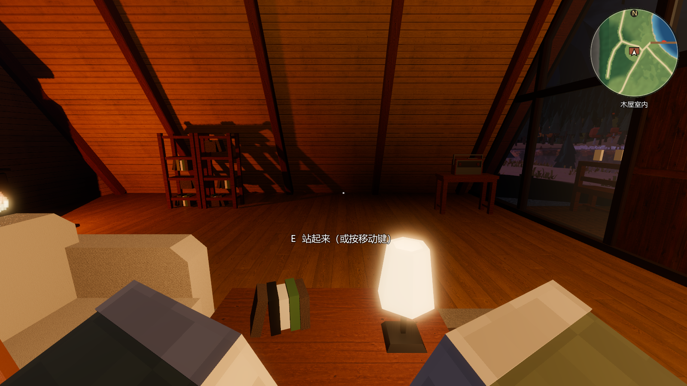
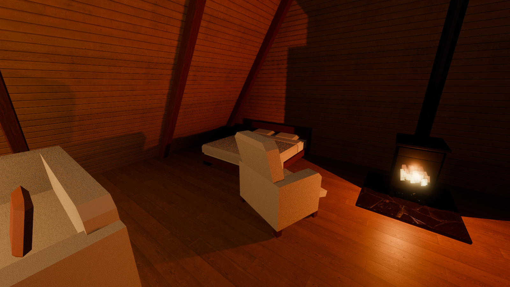
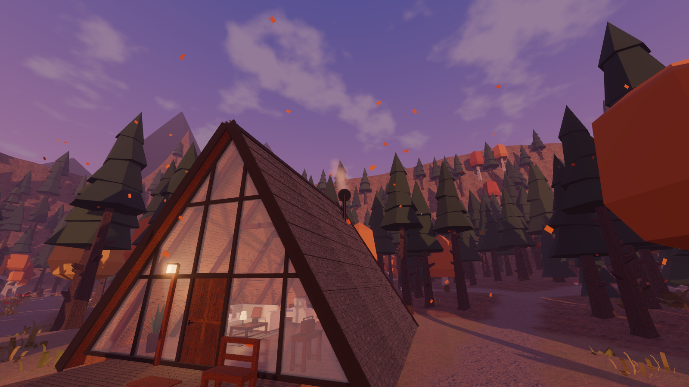
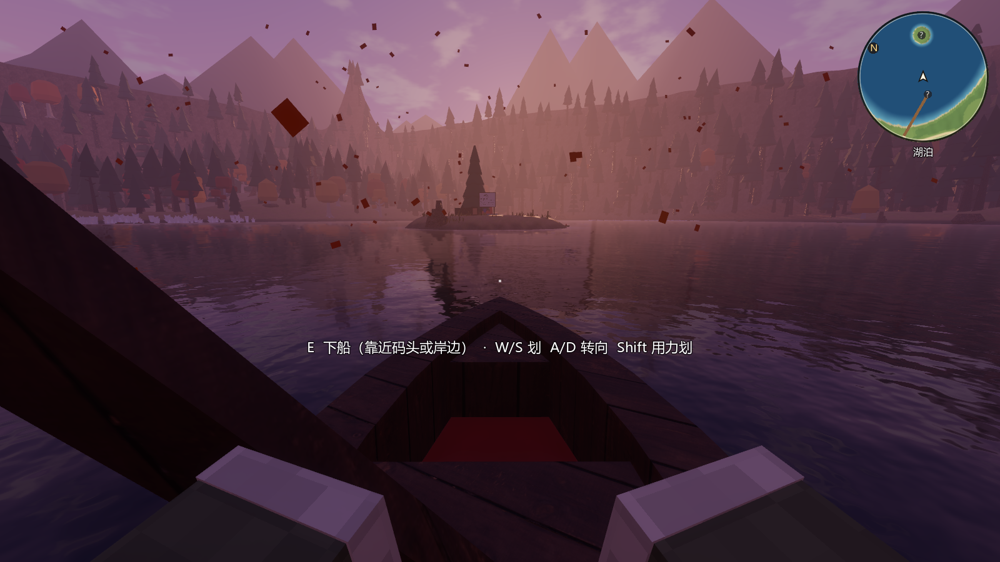
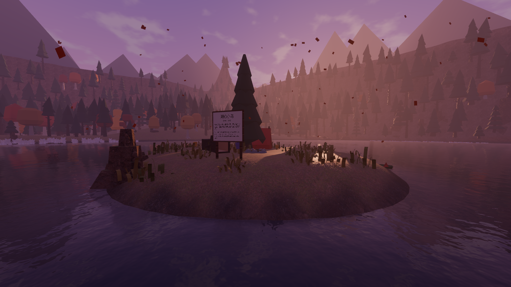
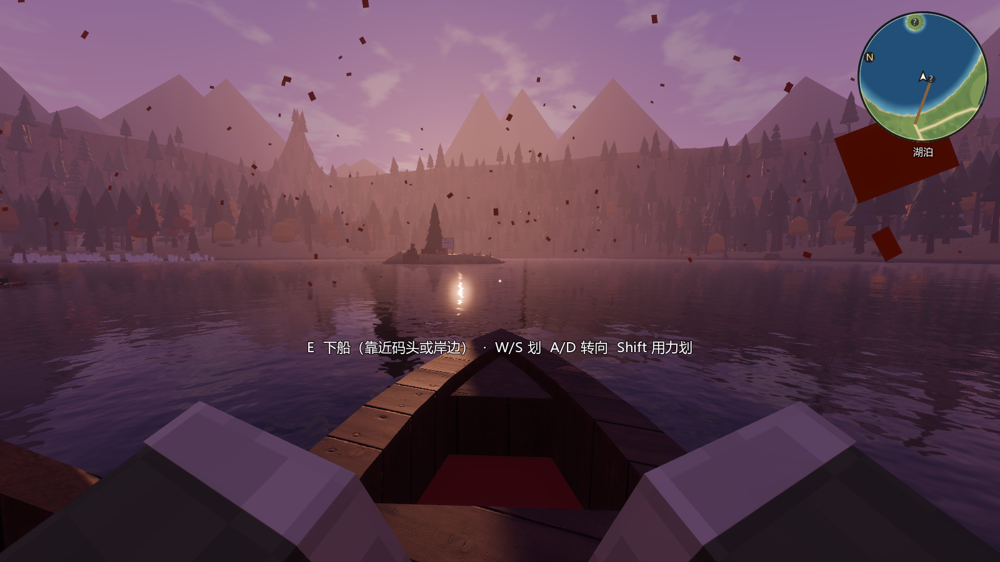

# M2 扩展：木屋生活、独木舟与湖上探索 验收记录（2026-10-21）

## 木屋生活

| 东西 | 怎么用 | 效果 |
|---|---|---|
| 铸铁炉 | 看着炉子按 E | 生火 / 熄火。生火时炉膛里有火苗，火光一闪一闪照亮屋子，烟囱冒出一缕炊烟（屋外看得见）；熄火后炉膛变暗、火光和炊烟消失 |
| 落地灯、台灯 | 看着灯按 E | 开 / 关 |
| 吊灯、门廊灯 | 门边墙上的开关（屋里一个、门廊一个）按 E | 开 / 关；门廊灯的灯罩也跟着亮灭 |
| 沙发（3 个位子）、扶手椅、门廊长椅 | 看着坐垫按 E | 坐下：腿向前伸，头可以自由环顾；再按 E 或按任意移动键站起来，落在座位前方 |
| 双人床（新摆在炉子北侧） | 看着床按 E | 晚上（18:00 以后或 6:00 以前）画面暗下去，一觉睡到第二天早上 7:00；白天小睡 1 小时。醒来站在床边，屏幕上提示睡了多久 |

- 泳池馆里也能坐：3 张躺椅、大厅长椅、水族馆 4 张长椅（面朝鱼缸）。
- 开关和座位都有稳定的 uid，状态记在 `WorldState`，以后存档可以直接恢复（比如“炉火开着”）。
- 炉子和灯都可以开关，这是规格书 M1 的“壁炉点火开关、壁灯 / 台灯开关、一个可以坐下的沙发位置”；声音（炉火声、开关声）属于 M3。

## 独木舟

- 独木舟停在码头南侧的水面上，码头岸边有一块中英双语的说明立牌。
- 上船：站在码头边看着船按 E。码头栏杆会挡住准星，所以离船 3.2 m 以内、视线大致朝着船也算对准了它。
- 操作：

| 按键 | 作用 |
|---|---|
| W | 向前划 |
| S | 倒划 |
| A / D | 转向 |
| Shift | 划得更快 |
| E | 下船。靠近码头时落到码头板上，靠近岸边时落到最近的干燥平地上；离岸太远会提示“划到岸边或码头再下船” |

- 手感：
  - 推力随桨的节奏一下一下地给，水的阻力让速度收敛到约 2–3 m/s；
  - 转向有惯性，原地也能用桨拨转；
  - 桨在船的一侧从前往后划，直行时每划两下换一边，转向时换到外侧；第一人称看得到双手和桨在动。
- 浮动：参考开源 Godot 浮力插件（[WaterBox](https://godotengine.org/asset-library/asset/edit/23596)、[FloatableBody](https://godotengine.org/asset-library/asset/2345)）在船体几个点取水面高度的做法。在船头、船尾、左右舷四点取水面高度，得到起伏、俯仰和横摇。风越大、雨越大，浪越高。
- 碰撞：
  - 船身四点下面的水比吃水（0.22 m）浅就算搁浅，码头桩区也挡船；
  - 搁浅后只要这一步让水变深（倒划、掉头）就能离开，不会卡死在岸边。
- 位置：无人时船系在原地，不随风漂。位置和朝向每秒记进 `WorldState.vehicles`。
- 小地图上会显示船的位置（红色船形）。

## 湖上探索

- 新增**湖心小岛**（42, −6）：半径约 13 m，高出水面 1.1 m。岛上有营火、帐篷、倒木和中英双语立牌，岛上也长树和草；四周有涉水挡墙，上岛后走不进深水。
- 四个探索点写在 `world_layout.json → lake_pois`：

| 探索点 | 位置 | 内容 |
|---|---|---|
| 码头尽头 Dock End | (−2, 26) | — |
| 湖心小岛 Lake Islet | (42, −6) | 营火、帐篷、倒木、立牌 |
| 北岸芦苇湾 North Reed Bay | (35, −65) | 70 丛芦苇长在浅水和岸边 |
| 东岸睡莲湾 East Lily Cove | (108, −2) | 55 片睡莲浮在水面 |

- 走路或划船进入探索点的半径就算发现，屏幕中上方弹出提示，例如“发现：湖心小岛 Lake Islet（2 / 4）”。
- 小地图上，没发现的点是灰色问号，发现后变成金色圆点。
- 发现记录在 `WorldState.discoveries`。存档版本升到 v2（新增发现和载具两个字段），并写了 v1 → v2 的迁移。
- 开发者面板新增两个传送点：独木舟旁（码头）、湖心小岛。

## 自动检查：48/48 通过

新增 4 项：

| 检查 | 结果 |
|---|---|
| 木屋生活：看着炉子按 E 熄火（火光、火苗、炊烟都停）、再生火；落地灯开关；门边墙上开关控制吊灯；沙发坐下（定在坐垫上、碰撞关闭）、按 E 站起并落回地板、按移动键也能站起 | 通过 |
| 床：22:00 睡 9 小时到第二天 7:00；13:00 小睡 1 小时；醒来站在床边 | 通过 |
| 独木舟：无人时不漂；码头上船；向东划 10 s 走了 15.1 m，速度 1.9 m/s，有起伏，人跟着船；湖中间下船被拒；划到湖心小岛直到搁浅，船身仍在水里；上岸后站在岛上，自动发现小岛；在岛上往深水走被挡在 0.18 m 水深处；码头边下船落到码头板上；船的位置记进存档 | 通过 |
| 探索：走到码头尽头记为新发现（再走一次不重复），弹出提示；存档快照含发现列表和船位置，版本为 2；v1 存档迁移到 v2 | 通过 |

## 截图

| | |
|---|---|
|  夜里坐在沙发上 |  炉火和新摆的床 |
|  烟囱冒烟 |  划独木舟（第一人称，看得到双手和桨） |
|  湖心小岛营地 |  小地图上的探索点和船 |
