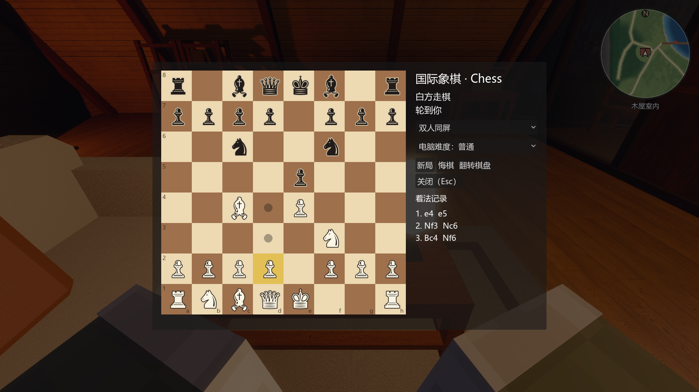
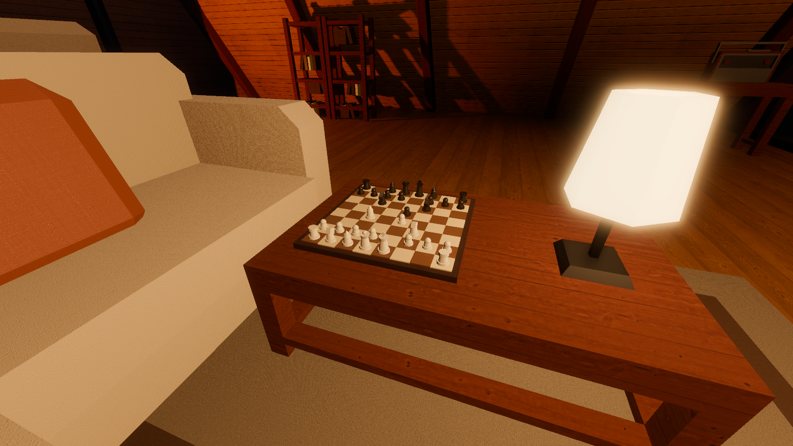

# 木屋里的国际象棋 验收记录（2026-10-21）

## 怎么玩

- 木屋茶几上摆着一副国际象棋（白方靠沙发一侧）。站着或坐在沙发上，看着棋盘按 **E**，打开 2D 棋盘。
- 点自己的棋子，能走的格子会出现圆点（能吃的子外面画一圈）；再点目标格落子。
  - 兵走到底线时，右侧弹出“升变为：后 / 车 / 象 / 马”。
  - 不合法的走法点了没反应。
- 模式：
  - 双人同屏（两个人轮流用鼠标走）；
  - 人机 · 我执白；
  - 人机 · 我执黑（棋盘自动翻过来）。
- 电脑难度：简单 / 普通 / 困难。电脑在后台线程思考，画面不卡；困难难度从开局想一步约 0.15 s。
- 按钮：
  - 新局；
  - 悔棋（人机模式下一次退回到你走之前）；
  - 翻转棋盘；
  - 关闭（Esc 也行）。
- 右侧显示轮到谁、将军提示和结局，下面是标准代数记谱的着法记录（如 `1. e4 e5 2. Nf3 Nc6`）。
- 茶几上的 3D 棋盘跟着对局实时摆子。棋局存进 `WorldState.flags["chess"]`：关掉再打开，接着下。
- 打开棋盘时人物不会走动，鼠标给棋盘用；关闭后恢复。坐在沙发上下完棋，按 E 对着别处就站起来。

## 规则实现（`scripts/games/ChessGame.gd`）

- 完整规则：
  - 所有棋子的走法；
  - 王车易位（王不能在被将军时、经过或停在被攻击的格子上易位）；
  - 吃过路兵；
  - 升变为四种子。
- 结局判定：将死、逼和、50 步规则、三次重复局面、子力不足判和。
- 其他：悔棋、FEN 读写、带消歧义和将军标记的标准代数记谱。
- 用国际象棋程序的标准 **perft** 计数验证走法生成：在给定局面下，把 N 步内所有合法走法的数目和公认值比对，任何一条规则写错都对不上。

| 局面 | 1 层 | 2 层 | 3 层 |
|---|---|---|---|
| 开局 | 20 ✓ | 400 ✓ | 8902 ✓ |
| Kiwipete（易位、过路兵、升变都密集的测试局面） | 48 ✓ | 2039 ✓ | — |
| 第 3 号标准测试局面（残局，过路兵将军等边界情况） | 14 ✓ | 191 ✓ | 2812 ✓ |

## 电脑对手（`scripts/games/ChessAI.gd`）

- 搜索：负极大值搜索 + Alpha-Beta 剪枝，吃子优先排序；叶子节点做两层吃子延伸，避免“吃了马上被吃回”的漏着。
- 估值：子力加位置表（兵往前推、马和象居中、王躲在后排）。
- 难度：
  - 简单：搜 1 层，带随机；
  - 普通：搜 2 层；
  - 困难：搜 3 层。

## 自动检查：51/51 通过

新增 2 项：

| 检查 | 结果 |
|---|---|
| 规则：三组 perft 标准计数全部吻合；愚人杀判为黑胜并记为 `Qh4#`；逼和；吃过路兵（记为 `exd6`，被吃的兵消失）；易位（f1 被攻击时不能短易位，长易位成功并记为 `O-O-O`）；升变成马（`a8=N`）；三次重复判和；悔棋回到开局 FEN；普通难度电脑找到一步杀 | 通过 |
| 木屋：坐在沙发上看着茶几上的棋盘按 E 打开 2D 棋盘（人物仍坐着、移动被锁）；人机模式走 e4，电脑应着；3D 棋盘 32 个子同步，e4 上有子；非法走法被拒；棋局存档；关闭后解锁移动 | 通过 |

## 截图

| | |
|---|---|
|  坐在沙发上打开 2D 棋盘（选中 d2 兵，圆点是能走的格子） |  茶几上的 3D 棋盘与对局同步 |
