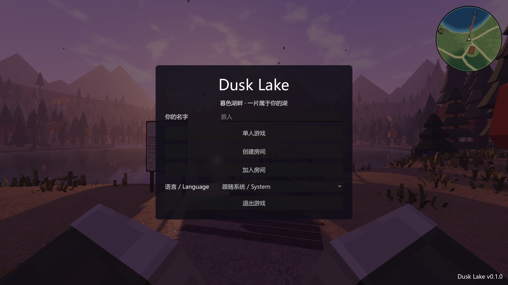
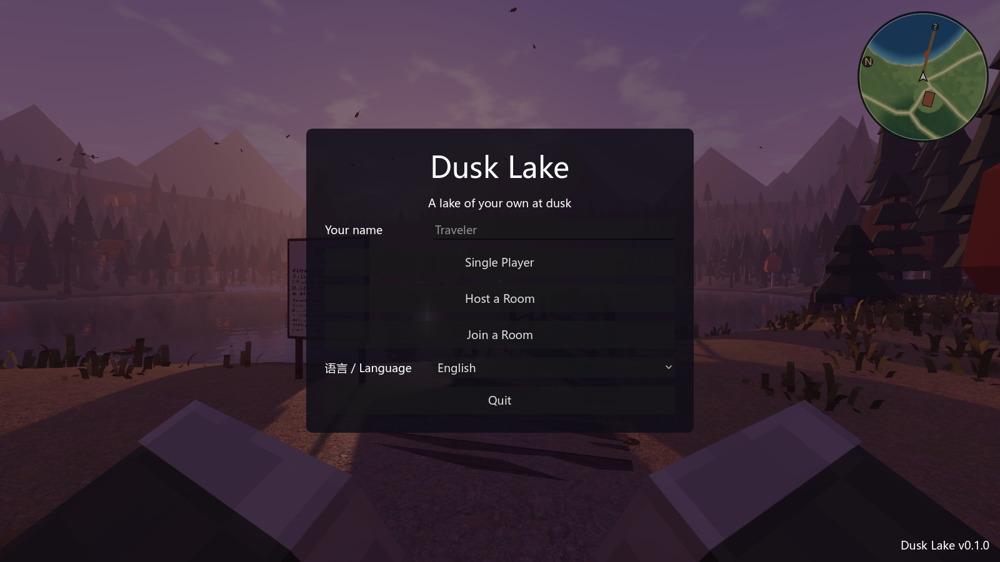
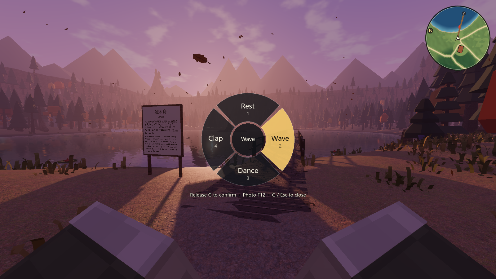
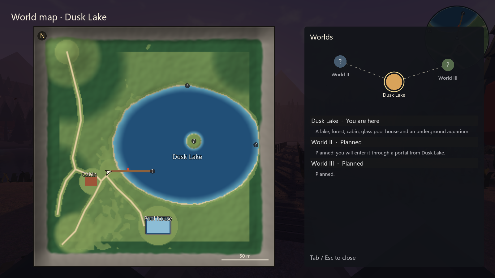

# M2 扩展：联机、界面语言 验收记录（2026-10-21）

联机最早做在 `release/v0.1` 分支（提交 49c0111，另有一批未提交的同步改动），没有进任何 PR。这次把它合进 main，补上之后几个分支（聊天框、国际象棋、海洋大缸、动作轮盘、世界地图）的同步与翻译。

## 怎么一起玩

| 步骤 | 做法 |
|---|---|
| 启动 | 游戏启动先弹大厅：写名字，选“单人游戏 / 创建房间 / 加入房间”，下面可以选语言 |
| 建房 | 点“创建房间”：房主自己的电脑就是服务器（Godot ENet，UDP 24567），得到一个房间号，例如 `R2M-025S`，可以一键复制 |
| 加入 | 朋友点“加入房间”，输入房间号（也可以直接输 IP 或 `IP:端口`） |
| 游戏中 | Esc → “多人房间”看房间号、名单、端口状态，或离开房间 |

- 最多 4 人。版本不一致、人满会直接提示原因（例如“房主是 0.2.0，你是 0.1.0”）。
- 不经过任何外部服务器。跨网络要么房主路由器支持 UPnP（游戏会自动尝试开端口），要么手动转发 UDP 端口，要么大家在同一个虚拟局域网（例如 Tailscale）里。房间页会分别给出公网、局域网、虚拟局域网的房间号。

## 同步什么

| 内容 | 规则 |
|---|---|
| 人物 | 每人自己算自己的人物，每秒 20 次把位置、朝向、速度和**身体状态**发给房主，房主转给其他人。别人看到你的方块人（你自己的发型衣服），头顶有名字 |
| 身体状态（本次新增） | 坐在椅子上、划船、席地坐、躺下、挥手、跳舞、鼓掌都会同步：别人看到你坐在沙发上、躺在草地上、在码头边跳舞 |
| 独木舟 | 你划船时，别人那边的同一条船跟着你走，并标成“有人在用”，别人上不去；下船后船停在最后的位置 |
| 时间、季节、天气 | 以房主为准；访客不能用 /weather、/time 改世界；只有房主能睡觉跳过夜晚 |
| 门等可交互物 | 访客开门先在本地生效，再由房主核对距离；隔得太远的操作会被房主改回 |
| 聊天、/me | 经房主转发；进出房间、房主离开会写成系统消息 |

房主退出或断线时，访客收到通知，回到自己的单人湖畔。

## 界面语言

- 界面文字的原文是中文，英文翻译在 `locale/en.tsv`（每行“中文<Tab>英文”），运行 `devtools/make_po.sh` 生成 `locale/en.po`。
- **默认跟随系统**：中文 Windows 显示中文，其他系统显示英文；大厅和 设置 → 操作 里可以改成 English 或中文。第一版默认是英文，合进来时改成跟随系统，这样本机打开仍是中文，外国朋友那边自动是英文。
- 这次补了 80 条英文：国际象棋界面、动作轮盘、世界地图、画质设置、开发者面板、世界注册表与季节飘落物的名字。
- 画在屏幕上的文字（轮盘、世界地图）和带变量的提示都改成先 `tr()` 再填变量，切换语言后立即生效。
- 自动检查会扫描全部脚本里的中文，没有英文翻译就失败；数据文件里会显示出来的名字（世界、飘落物方案）也一起查。

| 大厅（中文系统） | 大厅（English） |
|---|---|
|  |  |

| 动作轮盘（English） | 世界地图（English） |
|---|---|
|  |  |

英文下轮盘中央的字会按圆的大小自动缩小；“松开 G 确认”挪到了轮盘下面那行提示里。

## 自动检查

- `godot --headless --path . --fixed-fps 60 res://tests/TestRunner.tscn`：**68 / 68 通过**（含语言默认跟随系统、全部界面文字有英文、房间号编解码、联机规则）。
- `godot --headless --path . res://tests/NetTest.tscn`（两个进程本机回环）：**10 / 10 通过**。新增一项“访客跳舞，房主看到的方块人也在跳”，划船那一项也会检查对方的人物是不是划船姿势。

联机协议版本从 1 升到 2（姿态里多了身体状态），游戏版本号 0.1.0 → 0.2.0；和旧版本互相连不上，会提示两边的版本号。

## v0.5：本局规则跟着房主走（协议 3）

- 房主在“新建游戏”页选的规则（一天长度、天气变化、小动物数量和亲人、仙境频率、任务与图鉴、小地图罗盘问号、体力、夜晚亮度……）放在欢迎包里发给访客；房主中途改了规则再广播一次。
- 访客只照着用，不写自己的存档；离开房间回到自己的湖畔时，换回进房间前自己的规则。
- 开局类的设定（起始季节、时刻、天气、出生点）访客用不上：世界的时间天气本来就跟房主同步。
- 联机房间都在暮色湖畔：从“创建房间”进新建游戏页时出生世界固定为湖畔；联机时不能去云海浮岛、琥珀沙丘。
- 联机协议 2 → 3（欢迎包多了规则），和 0.4 互相连不上，会提示两边的版本号。联机检查新增一项“访客收到房主的规则”。
