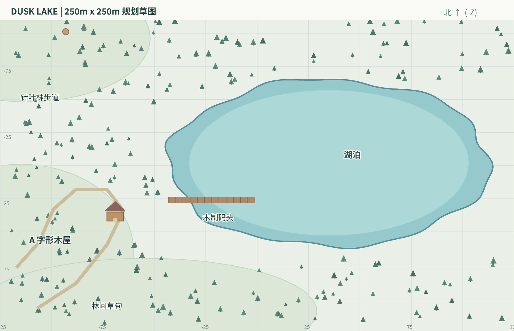

# Dusk Lake

**3D 私人湖畔世界｜游戏设计与技术开发规格书（GDD + TDD）**  
**版本：** V1.0 · 2026-10-20 ｜ **平台：** Windows 单机优先 ｜ **状态：** 可交付 AI 编程代理实施

> **一句话愿景：** 玩家置身于有四季和天气变化的私人湖畔；能从树林走到码头看日落，推开木屋的门，在雨声、炉火与暖光里休息。整个世界是可自由行走、可保存的连续 3D 空间，后期再加入 NPC 和少量好友联机。

> 图 1（用户提供的室外视觉参考）保存在私有文档包，不进入公开仓库。

**视觉参考 01｜暮色湖畔。** 关键要素：湖面柔和倒影、粉紫渐变天空、较克制的低多边形树林、木屋与码头的暖光对比；不是要求逐像素复制。

## 01｜产品目标与范围

### 1.1 必须实现的体验

- **探索：** 完整 250 × 250 米连续地图，以第一人称视角自由行走；森林、湖畔、码头与木屋可到达。
- **氛围：** 四季（春 / 夏 / 秋 / 冬）、昼夜、天气变化、天空与环境光联动；木屋室内外具有不同听觉和照明感受。
- **连接：** 木屋真实占据世界坐标，门可开关；玩家进入室内不传送、不黑屏、不切场景。
- **声音：** 湖浪、松风、鸟鸣 / 虫鸣、雨、雪天寒风、木地板脚步、壁炉音效等；有位置与室内外混音。
- **保存：** 记录世界日期、时间、季节、天气、玩家位置和主要互动状态；重新打开仍能继续。
- **架构：** 角色、环境、互动、音频数据驱动且松耦合，为未来 NPC 与多人预留接口。

### 1.2 第一版不做什么

第一版（MVP）**不实现**自动生成的无限地图、复杂建造系统、真实生态模拟、NPC AI 对话、联网服务器、VR、物理准确的水体模拟。NPC 仅做架构预留，不把任何尚未完成的功能标为已实现。

### 1.3 用户体验原则

1. **慢节奏、无压力：** 没有战斗、体力消耗和强迫性任务。
2. **美术风格统一：** Stylized Realism（风格化写实），室外轮廓简洁，室内材质与灯光更细腻。
3. **天气是体验系统：** 不只换贴图；天空、地表、粒子、声音、室内窗景一起变化。
4. **同一个世界：** 所有主要地点拥有稳定坐标，便于保存、寻路与多人同步。
5. **默认可访问：** 支持调节镜头灵敏度、FOV、画质、天气强度与音量；默认关闭强烈镜头晃动。

## 02｜美术方向与两张关键参考图

### 2.1 室外：暮色、森林、湖泊

沿用图 1 的构图逻辑，而非直接使用其画面当场景贴图。选择三种视觉锚点：**低角度暖阳 + 高饱和度但柔和的蓝紫天际 + 松树林的暗色剪影**。湖泊优先表现天空颜色、轻波纹、岸边反射和近景高光；远山用低精度地形与高度雾营造边界以外的深度。

### 2.2 室内：A-Frame 雨夜木屋

> 图 2（用户提供的室内视觉参考）保存在私有文档包，不进入公开仓库。

**视觉参考 02｜雨夜木屋。** 关键要素：A 字形坡屋顶、面向湖 / 森林的大型三角落地窗、木梁与木地板、炉火和蜡烛的暖色光源、窗外的冷蓝雨夜。窗景必须来自真实室外 3D 场景，而不是独立视频背景。

**统一风格约束：** 建筑、家具、植被的造型统一为中度简化的真实比例；PBR 木材与织物采用适度纹理细节；环境轮廓不做纯写实高密度扫描。以材质粗糙度、雾、色调映射与照明统一美术语言，避免“卡通森林 + 照片级木屋”的割裂。

| 视觉组件 | 美术标准 | 首版实现方式 |
|:--|:--|:--|
| 森林 | 松树成片、不同高度与密度、有疏密节奏 | GLB 树木 + MultiMesh / 分层 LOD |
| 湖面 | 夕照反射、微风波纹、岸边浅水变化 | 可控水面 Shader；不追求实时物理模拟 |
| 天空 | 晨昏蓝紫渐变、季节色温差异、薄云 | Physical / Procedural Sky + 环境参数 |
| 木屋 | 三角屋顶、真实门窗和室内空间 | Blender 建模 + GLB 导入 |
| 灯光 | 室外冷暖渐变、室内炉火暖光 | DirectionalLight3D + 局部灯光 |
| 天气 | 可感知的雾、雨、雪及湿润表面 | 粒子 + 材质参数 + 音效联动 |

**参考图来源与权限：** 两张图为项目发起人在当前对话中提供的视觉参考，原始创作者与再分发许可尚未核验；项目资料可用于私人方案讨论，但**未经权利确认，不应放入公开 GitHub 仓库、市场宣传或作为正式游戏贴图**。交付包中保留原始文件以便私有开发对照。

## 03｜世界尺寸与空间规划

### 3.1 坐标与边界

- **世界尺寸：** 250 × 250 m = **62,500 m²**；地面平面使用 X/Z 坐标，**X、Z 均在 -125 至 +125 m**；Y 为高度（单位米）。
- **地图原点：** (0,0,0) 置于湖区附近；**北方 = -Z**，保持统一。
- **玩家活动：** 以柔性自然地形、密林、岩石与水域阻挡边界；保留可视远山 / 天空；避免凭空出现看不见的墙。
- **高差：** 主游览带坡度适中，主要路径建议坡度不超过约 12°；观景点可更高。具体以关卡实测调整。
- **场景组织：** 首版保持一个 World 主场景常驻；不需要地形流式加载。树木与小物件按距离裁剪、LOD / MultiMesh 优化。

{width=6.70in}

### 3.2 区域与重要坐标（概念值）

| 区域 | 参考坐标（X,Z） | 功能与资产 |
|:--|:--|:--|
| 湖泊中心 | (+35,-2) | 水面约 156×126 m；水波、倒影、岸线、湖声 |
| A 字形木屋 | (-69,+37) | 室内外一体，正门、落地窗、壁炉、家具与室内声音区 |
| 木质码头 | (-43,+26) 至 (-1,+26) | 可行走的木板、轻微水浪、日落观景点 |
| 北部针叶林 | (-85,-70) | 松树、石头、曲折步道、鸟鸣与风声 |
| 西北观景点 | (-93,-101) | 能俯瞰林地与湖泊的低山丘 |
| 南部林间草甸 | (-84,+93) | 花草、季节变化展示、未来 NPC 活动位 |

**空间依赖：** 湖边木屋离最近湖岸约数十米，码头从岸上延伸入水；室外场景的天空、雨雪与松树应当透过木屋玻璃真实可见。每处位置以后都必须有稳定 `zone_id`。

### 3.3 场景规模与碰撞

- 地形使用 1–2 m 网格采样作为首期雕刻基线；不必为了小地图过早引入大型流式地形插件。
- 玩家可站立的主要区域有稳定碰撞；水边与码头防止穿模；湖水是否允许涉水须明确（MVP 默认不可深度游泳）。
- 近景重点植被需要有限碰撞；远景树木使用简化碰撞或不提供碰撞。
- 预留玩家走向木屋的无障碍路线和 NPC 将来可使用的导航区域。

## 04｜第一人称玩家与交互

| 控制项 | 默认操作 | 实现和验收要求 |
|:--|:--|:--|
| 前 / 后 / 左 / 右 | W / S / A / D | `CharacterBody3D`，地面与斜坡移动顺畅 |
| 环视 | 鼠标 | 水平 yaw、垂直 pitch 限幅；灵敏度可设置 |
| 奔跑 | Shift | 步行约 3.2 m/s；跑步约 5.2 m/s，均可调 |
| 互动 | E | 摄像机中心射线 2.5 m；统一 `Interactable` 接口 |
| 暂停 / 释放鼠标 | Esc | 打开简洁设置面板，鼠标正常恢复 |
| 跳跃 | Space | 可在第一期后段实现，不影响核心散步体验 |

- **摄像机：** 第一人称眼睛高度建议 1.65 m，默认 FOV 75°（范围如 65°–95°），不加剧烈晃动；步行加速与减速平滑。
- **交互提示：** 目标物体进入视线时显示轻量文字（如“E 打开木门”），不常驻大型 HUD。
- **玩家实体：** `Player.tscn` 独立，主体与相机分层，未来 NPC 或其他玩家无需引用主场景中固定的摄像机路径。
- **MVP 可交互物：** 木屋门、壁炉点火开关、壁灯 / 台灯开关、一个可以坐下的沙发位置；复杂家具摆放后置。

## 05｜时间、四季与天气系统

### 5.1 系统拆分原则

`WorldClock` 只负责世界时间；`SeasonController` 只负责季节与对应世界表现；`WeatherController` 独立计算当前天气和过渡；`EnvironmentDirector` 根据前三者的状态合成**天空、光照、雾、地表湿度与粒子参数**。`AudioDirector` 订阅同一组信号，但独立管理音频混合。

**四季与天气不可写成一个枚举。** 比如“秋季雨天”和“夏季雨天”共享 Rain 天气类型，但采用不同树叶、色温、虫鸣和雨声组合。这个边界也方便未来 NPC 根据环境做行为决策。

### 5.2 时间尺度（可配置的默认方案）

| 参数 | 设计初始值 | 说明 |
|:--|:--|:--|
| 游戏内 1 天 | 现实 48 分钟 | 可加速、暂停；无强制真实时间绑定 |
| 游戏内 1 季 | 12 个游戏日 | 四季循环；完整一年 = 48 个游戏日 |
| 初次进入 | 秋季第 1 天 17:20 | 优先还原第一张日落图的情绪 |
| 单次天气驻留 | 3–8 游戏小时 | 允许自动变化；同场景测试可固定状态 |
| 天气视觉过渡 | 30–90 现实秒 | 渐变天空、雾、音量与地表湿度 |
| 开发调试 | 时间 / 季节 / 天气可强制切换 | Debug 面板与正式控制入口分离 |

**这些数值是开发预设，不是气候学数据。** `season_days`、`day_length_minutes`、`transition_seconds` 等都放在配置 Resource / JSON 中，方便后续微调。

### 5.3 四季变化清单

| 季节 | 树木与地面 | 光线和天空 | 环境声 | 特殊粒子 / 说明 |
|:--|:--|:--|:--|:--|
| 春 Spring | 新叶、浅绿草、少量花 | 偏清透、日出略暖 | 鸟鸣、微风、春雨 | 花瓣、湿润泥地 |
| 夏 Summer | 浓绿植被、较密草 | 明亮高对比、漫长暖色黄昏 | 虫鸣、微风、水声 | 局部热空气感可后置 |
| 秋 Autumn | 金橙 / 赭红叶、地面落叶 | 紫粉暮色与柔和侧光 | 林风、落叶沙响、秋雨 | 轻量落叶粒子 |
| 冬 Winter | 枝叶变疏、草地积雪材质 | 冷蓝天光、日照偏短 | 冬风、低强度鸟声、踩雪声 | 雪粒子与积雪覆盖；湖面冻结推迟 |

**季节素材制作方案：** 优先使用同一棵树的材质变体、叶片密度变体，而不是为每个季节完全复制整张地图；通过场景节点分组或实例参数批量切换。积雪与湿地覆盖用 shader 参数协调，避免对每块地形独立更换大型贴图。

### 5.4 天气类型与季节适用性

| `weather_id` | 春 | 夏 | 秋 | 冬 | 主要视听表现 |
|:--|:--:|:--:|:--:|:--:|:--|
| `CLEAR` 晴 | ✓ | ✓ | ✓ | ✓ | 清晰天空、直射日光、明亮环境音 |
| `OVERCAST` 阴 | ✓ | ✓ | ✓ | ✓ | 云量高、漫射光、风声增强 |
| `LIGHT_RAIN` 小雨 | ✓ | ✓ | ✓ | — | 薄雨粒子、轻微地面湿润、屋檐滴水 |
| `HEAVY_RAIN` 大雨 | ✓ | ✓ | ✓ | — | 密雨、能见度降低、室内明显雨声 |
| `FOG` 雾 | ✓ | ✓ | ✓ | ✓ | 高度 / 距离雾、声音相对柔和 |
| `SNOW` 下雪 | — | — | — | ✓ | 飘雪、积雪权重上升、户外寒风 |

默认不在冬季生成降雨、不在非冬季生成降雪；日后可以扩展雨夹雪等复合天气。自动天气权重属于关卡配置，而非引擎固定规则。

### 5.5 天气更新流程与边界条件

1. 时钟推进，到达可变更天气的窗口，`WeatherController` 根据季节权重和随机种子选定目标天气。
2. 先触发 `weather_transition_started(from, to, duration)`；环境系统渐变天空 / 云 / 雾 / 湿度；粒子密度、环境音与表面效果分别平滑插值。
3. 在雨 / 雪生效时，降水围绕玩家局部生成以节约性能；**必须对屋顶内部空间实施遮挡 / 室内掩码**，不能在室内直接降雨降雪。
4. `WeatherController` 发出 `weather_changed(weather_id)`；若玩家处于木屋，室外雨声通过低通和衰减保留，窗面雨痕与屋檐水滴继续可见。
5. 重新载入存档时恢复天气目标、进度或归一化稳定状态；不能因载入后重新随机导致“读档天气变了”。

**优先做天气预设测试：** `Autumn_Dusk_Clear`、`Autumn_Night_HeavyRain`、`Winter_Morning_Snow`、`Spring_Fog`。这些预设用同一地图验证场景变化。

## 06｜木屋与室内外无缝场景

### 6.1 强制采用的连续空间实现

`Main` 含常驻 `World`、`Cabin`、`Player`，木屋是地图里的真实子场景；不是进入房间时调用 `change_scene_to_file()`，不是瞬移到独立室内空间，也不是播放假窗外风景。允许模块化 `.tscn` 场景分别编辑，但运行时放在同一世界坐标系。

- **木屋结构：** 静态碰撞墙壁、屋顶、地板；独立门铰链与开关动画；可用射线开门。
- **物理连接：** 角色从户外连续走上门廊、进门、坐到沙发；移动 / 视角无中断。
- **音区：** 在小屋内部放 `Area3D`，维护 `is_indoors`；进出门时音量跨区平滑过渡 1.0–2.5 秒。
- **雨雪遮挡：** 室内粒子禁入，同时窗面独立渲染雨痕；屋檐落水可在门外保留。
- **室内光：** 壁炉和灯采用暖色独立光源；大窗在黄昏时能观察室外变化，避免过曝与完全黑屏。
- **未来导航：** 保留门槛两侧的可通行平面，NPC 导航网格跨门连接可在后期生成 / 扩展。

### 6.2 初版表现与性能折中

- 优先选择 Godot 4.7.2 的 **Forward+** 渲染器开发 Windows 版；明确提供低画质选项供性能不足机器测试。
- 不一开始全面开启昂贵的实时全局光照、体积效果和高精反射；先把**定向太阳光 + 环境光 + 局部灯光 + 屏幕空间效果**组合稳定。
- 门窗穿透视野需要避免穿帮，场景不应只加载室外或室内其中一个。
- 不使用单独的室内“贴图天幕”冒充连续场景；湖水反射、水雾与窗玻璃的高级效果可逐步提升。

## 07｜环境音与空间混音

### 7.1 Bus 拆分和基础音层

| Audio Bus | 声音内容 | 使用方式 |
|:--|:--|:--|
| `AMB_OUTDOOR` | 松风、湖水、鸟、蝉、远处林音 | 环境循环 / 与季节绑定 |
| `AMB_WEATHER` | 雨 / 雪时风声、屋顶雨点 | 天气驱动，平滑淡入淡出 |
| `AMB_INDOOR` | 室内底噪、炉火、木屋轻响 | 进入室内增强 |
| `FOLEY` | 木地板、草地、雪地脚步、开门 | 角色行为与表面类型控制 |
| `MUSIC` | 可选的极轻背景音乐 | 默认关闭或音量偏低 |
| `UI` | 菜单、交互反馈 | 独立音量滑块 |

### 7.2 位置与触发

- 湖浪、门、壁炉、虫鸣点位采用 `AudioStreamPlayer3D`，有距离衰减、左右声像和最大可听距离。
- 室外风 / 全局雨幕采用非定位环境声层；进入室内降低其响度并施加合适低通，不能瞬时切断。
- 壁炉熄灭时先减弱焰音，再停掉；开门时提高户外声透入感；关门降低高频。
- 地面有 `surface_type`（木板 / 草地 / 砂石 / 雪），驱动不同脚步声；天气湿润状态可微调音色。
- 循环音确保无明显接缝；设置 `AudioDirector` 统一混音，避免多个 Area3D 争夺音量造成泵音。
- 所有层允许静音；天气强度和背景音乐音量应可分别控制。

## 08｜场景组织、代码模块与数据流

### 8.1 推荐目录结构

```text
DuskLake/
├── project.godot
├── scenes/
│   ├── main/Main.tscn
│   ├── world/World.tscn
│   ├── world/Forest.tscn
│   ├── world/Lake.tscn
│   ├── buildings/Cabin.tscn
│   ├── player/Player.tscn
│   ├── props/InteractableDoor.tscn
│   └── ui/PauseMenu.tscn
├── scripts/
│   ├── core/EventBus.gd
│   ├── core/WorldState.gd
│   ├── systems/WorldClock.gd
│   ├── systems/SeasonController.gd
│   ├── systems/WeatherController.gd
│   ├── systems/EnvironmentDirector.gd
│   ├── systems/AudioDirector.gd
│   ├── systems/SaveManager.gd
│   ├── player/FirstPersonController.gd
│   └── interactions/Interactable.gd
├── data/
│   ├── seasons/        # SeasonProfile Resource
│   ├── weather/        # WeatherProfile Resource
│   └── world/          # 世界参数、区域 ID
├── assets/
│   ├── imported/       # 已核验许可的 GLB、纹理、音频
│   └── licenses.csv    # 记录许可与来源
├── docs/
└── tests/
```

说明：这棵树是后续**游戏仓库**的推荐结构，不等于当前交付文档包中已经生成了可运行游戏。两张视觉参考图在私有文档包里保存，不要默认提交进公开游戏仓库。

### 8.2 模块职责与依赖规则

| 模块 | 唯一职责 | 不应直接依赖 |
|:--|:--|:--|
| `WorldState` | 保存当前状态与 schema 版本 | 场景节点路径 |
| `WorldClock` | 时间 / 日期 / 速度 / 暂停 | 天气 UI、音频节点 |
| `SeasonController` | 季节计算 / 视觉参数请求 | 具体树木节点名 |
| `WeatherController` | 天气规则 / 过渡 / 随机种子 | 具体雨粒子实例 |
| `EnvironmentDirector` | 将状态映射到天空、雾、灯光、地表 | 保存文件 API |
| `AudioDirector` | Bus、音区、声层与淡入淡出 | NPC 行为细节 |
| `InteractionSystem` | 发现、显示、调用可交互对象 | 某个特定木屋或 NPC |
| `SaveManager` | 版本化 JSON 存取 / 迁移 | 天气随机计算 |

**事件契约（名称建议）：** `time_changed(hour_fraction)`、`season_changed(from_id,to_id)`、`weather_transition_started(from_id,to_id,duration)`、`weather_changed(id)`、`zone_entered(zone_id,actor_id)`、`interactable_state_changed(uid,state)`、`save_loaded(schema_version)`。

**事件顺序：** `WorldClock` 更新 → `SeasonController/WeatherController` 得到目标状态 → `EnvironmentDirector` / `AudioDirector` 响应 → `SaveManager` 序列化稳定快照。事件不承担持久化真相，状态以 `WorldState` 为准。

### 8.3 世界状态与存档格式（示例）

```json
{
  "schema_version": 1,
  "world_seed": 18427,
  "world_day": 1,
  "time_minutes": 1040,
  "season_override": null,
  "weather_id": "CLEAR",
  "weather_seed": 75014,
  "player": {"position": [-69.0, 2.1, 39.0], "yaw": 0.8, "pitch": -0.03},
  "interactables": {"cabin_front_door": "closed", "fireplace_main": "off"},
  "flags": {}
}
```

- 存档目录为 `user://saves/`；采用临时文件后原子替换 / 安全重命名，防止写入中断损坏主存档。
- 季节从 `world_day` 与 `season_days` 派生；`season_override` 仅用于开发测试或用户手动覆盖，避免季节与日期逻辑冲突。
- 不保存每片叶子 / 每个雨滴的位置。由当前天气和随机种子重建程序化效果。
- 所有交互对象必须拥有稳定 `uid`，未来 NPC / 多人网络也沿用稳定对象 ID。

## 09｜为未来 NPC 预留的结构

### 9.1 NPC 的潜在玩法，不属于 MVP

将来可在木屋周围加入温和、低打扰的角色：湖边钓鱼的人、森林散步者、白天来访的邻居或可陪伴玩家的动物。角色行为与天气、时刻、季节可以关联；例如雨天进入屋檐下避雨、夜间回家，冬天改变活动路线。但第一版不投入完整对话模型、任务树与大型行为树系统。

### 9.2 第一版就要保留的技术基础

1. **导航：** 重要步道、码头、木屋门口和屋内通路维持可导航几何体；后期通过 `NavigationRegion3D` / NavigationMesh 和 `NavigationAgent3D` 寻路。门的开闭应能改变可通行状态。
2. **实体 ID：** 玩家、未来 NPC、交互物品都要用稳定 `entity_id`；不要用临时节点路径存档。
3. **统一交互：** 玩家面对 NPC 与面对木门都走同一个 `interact(actor, target)` 契约；具体动作由目标提供。
4. **状态订阅：** NPC 只观察 `WorldClock`、`SeasonController`、`WeatherController` 输出；不允许 NPC 自己再计算“另一个天气”。
5. **数据留槽：** 存档 `flags` 可以扩展成 `npc_states`、`dialogue_flags`、`relationship_values`，新增字段通过 `schema_version` 迁移。
6. **性能预算：** 预留 3–8 个近景活动 NPC 的初步目标，实际数量以设备基准测试为准；远处 NPC 可以降频更新。

### 9.3 后续可实现的 NPC 数据模型

```text
NPCDefinition:
  npc_id, display_name, avatar_scene, default_spawn,
  dialogue_profile_id, schedule_profile_id,
  interaction_tags, weather_preferences

NPCRuntimeState:
  npc_id, position, current_activity,
  schedule_segment, dialogue_flags, relationship_value
```

建议 NPC 生命周期为 `Spawn → Idle/Patrol → ReactToWeather → Interact → ResumeSchedule`，优先数据驱动，复杂对话和 Agent 记忆模块以后再接入。为避免天气和 NPC 互相阻塞，天气事件应只发通知，不等待 NPC 全部更新完成。

## 10｜后期 2–4 人联机的架构预留

多人属于第二阶段以后。首版要做到：世界状态不依赖 `Player` 单例，玩家实例可以独立创建；相机和输入只属于本地受控角色；场景物体都有权威 `entity_id`，对时间、天气、门、壁炉的修改通过统一状态命令执行。

未来架构可以增加 `NetworkAdapter` / `WorldAuthority`，由主机或服务器管理**共享时间、季节、天气、门窗状态、可交互物**；每位玩家保持独立位置、视角与本地 UI。同步对象 ID 和状态增量，而不是复制整张场景树。

**现在无需实现** ENet 房间、公网穿透、服务器部署或联网身份体系；先通过单人存档与模块边界降低以后改造成本。

## 11｜关键素材来源与使用规则

**下载原则：** 首选 Kenney / Poly Haven / ambientCG 等明确 CC0 来源；可使用 Quaternius 但须按实际下载页面的适用许可证审查；音频在逐条确认授权后入库。首次提交 GitHub 时，**不要把未核验的完整第三方素材包直接上传到公开仓库**。

| 资源 / 站点 | 对应内容 | 许可与核验重点 | 地址 |
|:--|:--|:--|:--|
| Godot 4.7.2 Standard | 游戏引擎 | 开源软件；Windows 标准版 | https://godotengine.org/download/windows/ |
| Blender | A 字形木屋、场景资产制作 | 开源软件；手工或 Python 建模 | https://www.blender.org/download/ |
| Kenney Nature Kit | 松树、草、石头和基础植被 | **CC0**；330 个素材 | https://kenney.nl/assets/nature-kit |
| Kenney Furniture Kit | 沙发、桌子、架子等室内占位 | **CC0**；140 个素材 | https://kenney.nl/assets/furniture-kit |
| Poly Haven | HDRI、PBR 材质、3D 资产 | **CC0**；优先 1K/2K 纹理 | https://polyhaven.com/ |
| Poly Haven / Wood Floor | 木屋地板 | **CC0**；地板 PBR | https://polyhaven.com/a/wood_floor |
| Poly Haven / Wooden Planks | 木屋木梁、墙板、码头 | **CC0**；木板 PBR | https://polyhaven.com/a/wooden_planks |
| ambientCG | 木材、土壤、织物等材质 | **CC0**；下载时留存来源 | https://ambientcg.com/ |
| Quaternius Stylized Nature MegaKit | 细节更多的风格化自然模型 | 官网 **QAL**；部分单包页标 CC0，**需逐包核验** | https://quaternius.itch.io/stylized-nature-megakit |
| Freesound | 湖水、雨声、虫鸣、炉火、开门声 | **逐条核验** CC0 / CC BY；避免默认用 NC 音频 | https://freesound.org/ |
| Pixabay Sound Effects | 音效替代来源 | **Pixabay Content License**，不是 CC0；禁止单独再分发 | https://pixabay.com/sound-effects/ |
| Godot Shader 社区 | 水面、雾、玻璃雨滴效果的参考代码 | **逐项核验** Shader 页面许可与 4.7.x 兼容性 | https://godotshaders.com/ |

**许可特别提醒：** Quaternius 官网于 2026-08-28 更新了 QAL，规定可以把资产用于游戏，但不允许把资产自身当独立素材包再分发；部分历史包页仍标注 CC0。具体使用权以**下载当时适用的资产 / 页面许可**为准，并保存截图或许可副本。Freesound 存在 CC0、CC BY 与 CC BY-NC，选择错误会影响后续商业发布。

### 11.1 精确素材采购清单

| 任务 | 搜索关键词 / 目标 | 优先级 |
|:--|:--|:--|
| 针叶林 | `pine tree`, `spruce`, `conifer`, `stylized forest` | P0 |
| A 字形木屋 | `A-frame cabin`, `log cabin`, `wood beam`, `large triangular window` | P0；结构建议自制 |
| 湖边码头 | `wooden dock`, `weathered planks`, `lake rocks` | P0 |
| 室内家具 | `sofa`, `bookshelf`, `wooden coffee table`, `rug`, `floor lamp` | P0 |
| 天空和天气 | `sunset HDRI`, `overcast sky`, `rain window droplets`, `falling snow` | P0 |
| 环境音 | `forest ambience`, `lake shore waves`, `rain on roof`, `fireplace crackle`, `wood footsteps` | P0 |
| 季节美术 | `autumn foliage`, `spring flowers`, `snow ground`, `fallen leaves` | P1 |
| NPC 动画 | `idle`, `walk`, `sit`, `talk`, `umbrella` | P2 |

所有纳入项目的素材都登记在 `assets/licenses.csv`，至少记录：`asset_id, filename, creator, source_url, license, download_date, modifications, redistribution_notes`。当前文档包内的 `ASSET_SOURCES.csv` 是**采购候选表**，不表示已取得这些模型或音效文件。

## 12｜开发阶段、交付物与验收标准

| 阶段 | AI 开发任务 | 可观察的交付 / 验收 |
|:--|:--|:--|
| **M0 基础工程** | Godot 项目、Git、目录、CI 可选、基本玩家 | F6/F5 可运行；移动顺畅；场景无脚本解析错误 |
| **M1 地图闭环** | 250×250 地形、湖泊、森林、码头、木屋结构 | 玩家能连续从林道走到码头再进木屋；无传送 |
| **M2 环境系统** | 世界时钟、四季、6 类天气、日夜光照 | Debug 可强制切换状态；天空、树叶、地表与粒子联动 |
| **M3 声音和交互** | 音频 Bus、3D 音源、室内外音区、开门与灯炉 | 进屋雨声衰减、炉火渐显；可开关门 / 灯 / 炉 |
| **M4 存档优化** | 状态保存、重载、画面档位、许可证审计 | 读档恢复日期 / 天气 / 玩家 / 互动状态；可导出 Windows |
| **M5 可选扩展** | NPC 原型、基础对话和日程；联机可行性研究 | 不纳入 V1 验收；需另行定义规格 |

### 12.1 强制 QA 用例（交给 AI 自动化 + 人工体验）

- `QA-01` 从森林沿路走向木屋，不掉出地形、不被空气墙卡住；地图外侧自然封闭。
- `QA-02` 玩家从屋外穿过房门、关门、再返回室外，位置连续、相机无闪烁、场景不重载。
- `QA-03` 在秋季 17:20 设置 `CLEAR`，天空 / 湖面 / 森林形成接近参考 01 的暮色氛围。
- `QA-04` 在秋季夜间设置 `HEAVY_RAIN`，木屋外降雨，屋内不出现雨粒子；窗面可看到降雨。
- `QA-05` 进入屋内后 2.5 秒内，室外雨声逐步减弱，室内壁炉声仍有清晰定位；退出反向恢复。
- `QA-06` 切换春夏秋冬，树木 / 草地 / 光照 / 代表性声音可区分；只有冬季出现雪。
- `QA-07` 存档时开启壁炉、关门、处于冬季雪天；重新启动后玩家位置和状态正确恢复。
- `QA-08` 鼠标视角、键位、暂停、音量、FOV 等能调整；持续漫游不出现严重眩晕性镜头晃动。
- `QA-09` 显示 FPS、绘制调用、显存 / 内存与平均帧时数据；硬件配置确定后制定具体性能门槛。
- `QA-10` `assets/licenses.csv` 覆盖所有导入外部文件，未核验授权文件不进入公开发布包。

### 12.2 质量与性能的暂定目标

Windows 1080p / 中画质预期体验为平均 **60 FPS**；这是**设计目标，不是现在已验证的性能承诺**。未确定显卡前不得声称达标。场景首先保证正确的室内外连续性、可读照明、可关闭的重型视觉效果，以及独立设置中的降雨粒子密度、阴影质量、植被距离等档位。

## 13｜交给 Claude Code / Codex 的协作协议

### 13.1 AI 每次任务应如何交付

1. 先解释将修改的文件、依赖和风险，**只做一个里程碑**，不得同时堆积未测试的功能。
2. 对非资源性的功能优先脚本化建场景；外部素材均写入清单，不得把搜索结果当成已下载文件。
3. 运行 Godot 的导入和测试 / 解析检查，指出真实验证过的内容和仍需在 Windows GUI 中人工检查的内容。
4. 不修改 `WorldState` 核心 schema 而不升级 `schema_version` 与迁移逻辑。
5. 每阶段提交明确验收步骤、前后截图与已知问题；失败时修复再推进。

### 13.2 第一个可复制任务

> 请基于 `DEVELOPMENT_SPEC.md` 创建 Godot 4.7.2 Standard + GDScript 项目 `DuskLake`。**仅实现 M0 与 M1 的可运行灰盒**：稳定的第一人称 `CharacterBody3D`、250×250 米地形、湖泊占位、林道、码头、可开门进入的 A 字形木屋、可见的室内空间。按第 08 章拆分模块与目录，统一 X/Z 世界坐标；室内外不允许调用切换场景或传送。美术资产暂时使用程序化占位模型，但保留可替换的资产插槽。为四季、天气、存档、NPC 导航留接口，不在这一阶段实现它们。完成后运行 Godot 的脚本检查，给出启动命令、测试方法及尚未实现清单。

## 14｜决定记录与待确认事项

**已确定：** Stylized Realism；250×250 米；Windows 单机优先；Godot 4.7.2 + GDScript；第一人称；无缝木屋；四季与天气；环境音；NPC / 多人预留。  
**可调整的设计默认值：** 世界一天耗时、每季天数、玩家速度、湖泊位置、具体天气权重、相机 FOV。  
**待实机确认：** 显卡、目标画质 / 分辨率、是否允许自由切换时间与天气、NPC 视觉风格与语音 / 对话路线、是否公开开源游戏仓库、外部参考图版权。

### 技术与许可依据（原始链接）

- Godot 官方下载（当前 4.7.2）：https://godotengine.org/download/windows/
- Godot 3D 模型导入（推荐 glTF / GLB）：https://docs.godotengine.org/en/stable/tutorials/assets_pipeline/importing_3d_scenes/available_formats.html
- Godot 环境与后期：https://docs.godotengine.org/en/stable/tutorials/3d/environment_and_post_processing.html
- Godot 3D 导航：https://docs.godotengine.org/en/4.4/tutorials/navigation/navigation_introduction_3d.html
- Godot 3D 音效播放器：https://docs.godotengine.org/en/4.5/classes/class_audiostreamplayer3d.html
- Kenney Nature Kit：https://kenney.nl/assets/nature-kit
- Kenney Furniture Kit：https://kenney.nl/assets/furniture-kit
- Poly Haven 官方许可：https://polyhaven.com/license
- Quaternius 当前官网许可：https://quaternius.com/license.html
- Freesound 许可 FAQ：https://freesound.org/help/faq/
- Pixabay 官方内容许可：https://pixabay.com/service/license-summary/

---

**文档版本 V1.0。** 此文件为开发与采购规格，并非已完成的游戏工程。两张用户参考图仅供内部视觉对照，外部素材需各自确认来源和许可。
