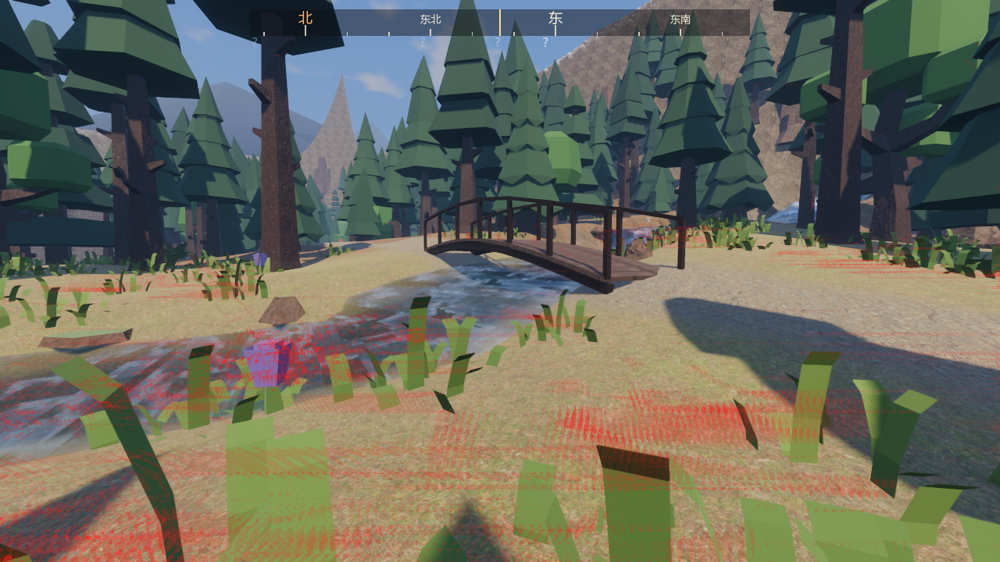
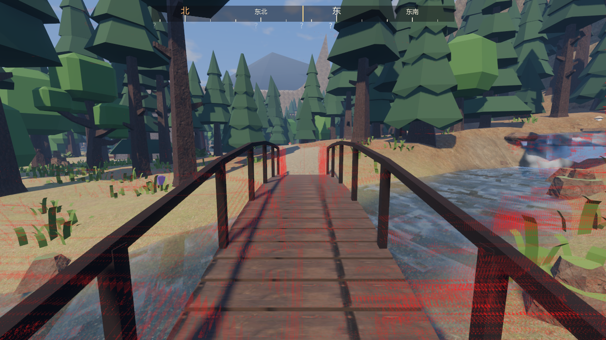

# 溪上木板桥“走动时闪烁”复查（2026-10-26）

v0.5 的闪动记录里，溪桥机位（`fb1_creek_bridge`）走动时还有 4–5 % 的闪烁像素，问题总结里把它列成了“木板桥走动时仍在闪”。这次逐项拆开查：**桥本身不闪**。这个数是近处的草、栏杆和流动的溪水在镜头横移时扫过画面，被探针算成了“闪了一下”。

## 结论（1280×720，高画质 TAA，探针 `FlickerProbe`，60 帧里闪 2 次以上的像素占比）

| 测法 | 桥边机位 fb1（离桥 8 m 看桥） | 桥头机位 fb3（站在桥上顺着桥面看，新加） |
|---|---|---|
| 站着不动 | 0.24 % | 0.07 % |
| 每帧横移 1 cm（慢走） | 0.40 % | 0.20 % |
| 每帧横移 3 cm（原来的测法） | 5.08 % | 4.90 % |
| 3 cm，藏掉桥 | 5.06 %（桥没有贡献） | — |
| 3 cm，藏掉地上的草和花 | 1.58 % | 1.45 % |
| 3 cm，藏掉草和溪水 | 0.48 % | — |
| 3 cm，关掉太阳阴影 | — | 4.89 %（阴影没有贡献） |
| 3 cm，75 % 渲染比例 + 动态分辨率 | 4.23 % | 4.28 % |
| 3 cm，低画质（FXAA） | 8.74 % | 7.24 % |

北岭裂谷的原木桥站在桥头看（`fb4_on_gorge_bridge`）：0.52 %（高画质）。

- **藏掉桥，数字不变**；站在桥上看桥面，木板和板缝在相邻帧里是稳的（热力图里桥面几乎没有红点）。
- 剩下的红点几乎都在**画面下半部分离镜头 1–3 m 的草叶上**。镜头每帧横移 3 cm 时，1 m 外的草叶每帧要在画面上跑十几个像素，细草叶“这一帧在、下一帧走了”，探针的判定（亮度突变又变回去）就把它当成闪。慢走（1 cm）时这部分几乎消失，站着不动时为 0。
- 溪水约占 1 个百分点：水面白沫顺流跑得快（0.9–3.6 m/s），镜头一动 TAA 的历史帧失效，泡沫边缘每帧跳几个像素。站着不动时只有 0.1–0.2 %。
- 真正属于桥的只有一处很小的走样：桥另一头两根几乎对齐的栏杆立柱之间，偶尔露出一像素宽的亮缝，几个像素大小。

| 桥边机位：红点在近处草叶和溪水上 | 站在桥上：桥面几乎没有红点 |
|---|---|
|  |  |

## 探针加的选项（以后查闪动先拆开再改）

- `hide=cover,water,bridges,forest,fauna,shadows`：先藏掉一类东西再测，数字掉多少就是它占多少。
- `step=0.01`：每帧横移多少米（默认 0.03）。一个数随步长大幅变化，说明它主要是近处物体的快速运动，不是走样或 Z 冲突。
- 新机位 `fb3_on_creek_bridge`、`fb4_on_gorge_bridge`：站在桥头顺着桥面看，测走上桥时眼前的木板。

```bash
godot --path . --resolution 1280x720 --position 100000,100000 --fixed-fps 30 res://devtools/FlickerProbe.tscn -- out=<目录> move spots=fb3_on_creek_bridge hide=cover step=0.01
```

```bash
python devtools/flicker_report.py <目录>
```
