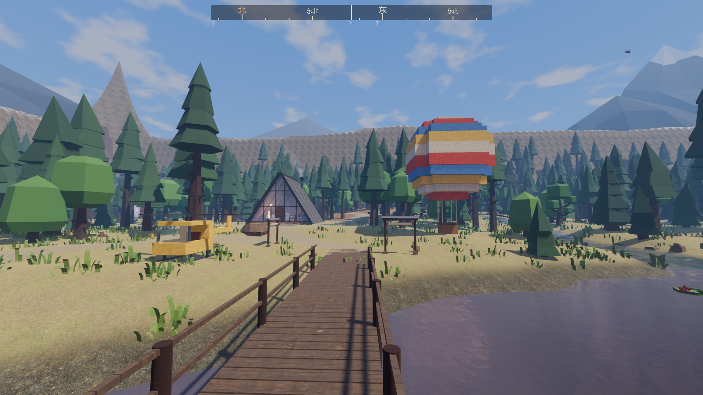
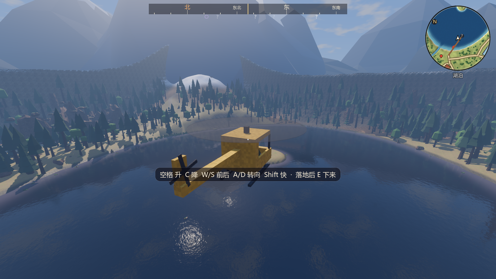
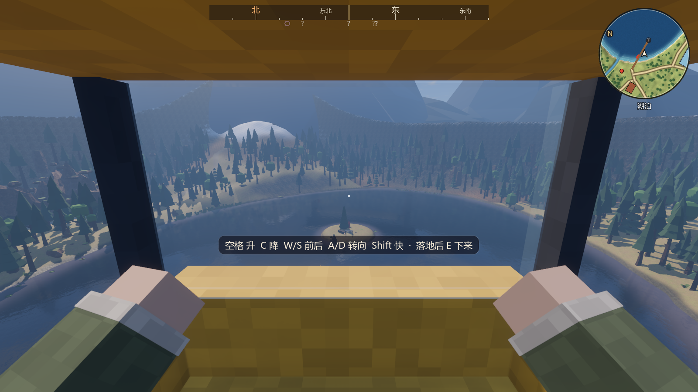
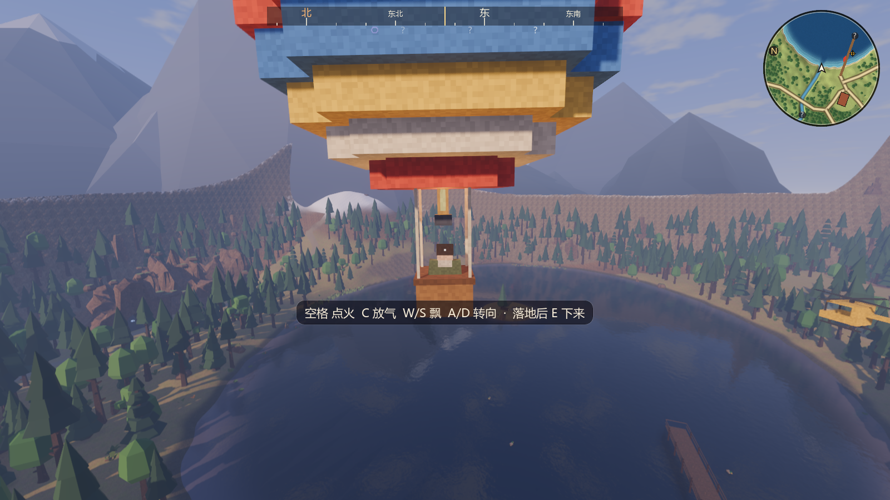
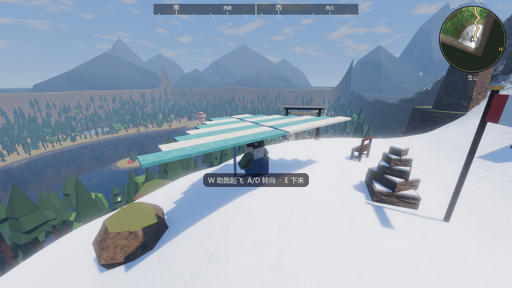
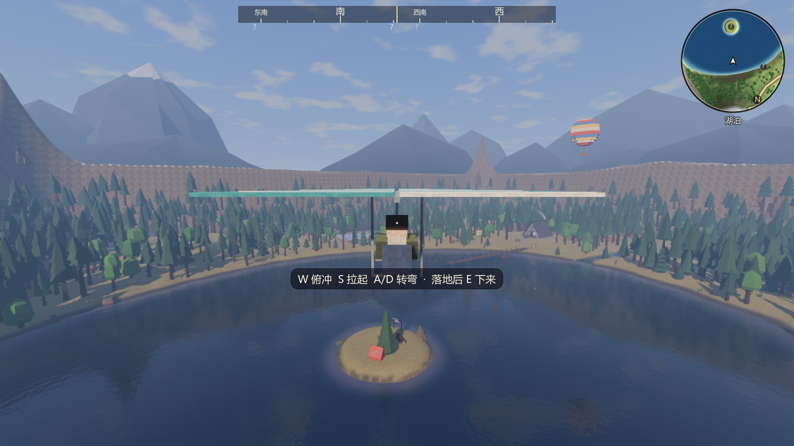
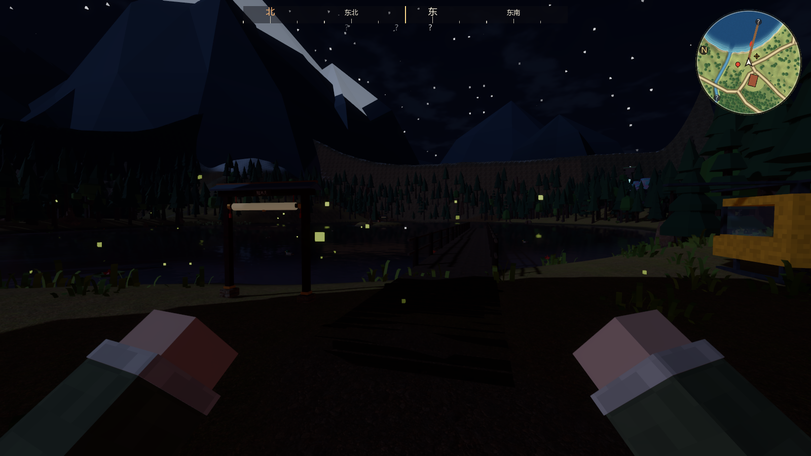
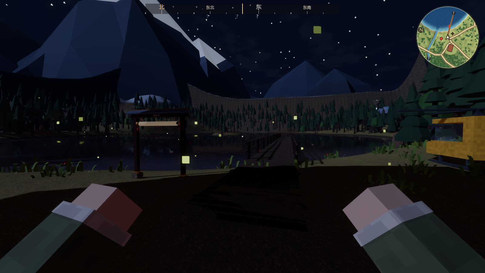
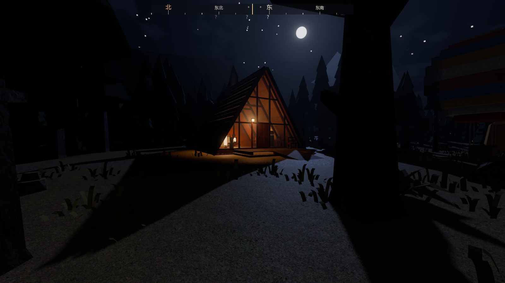
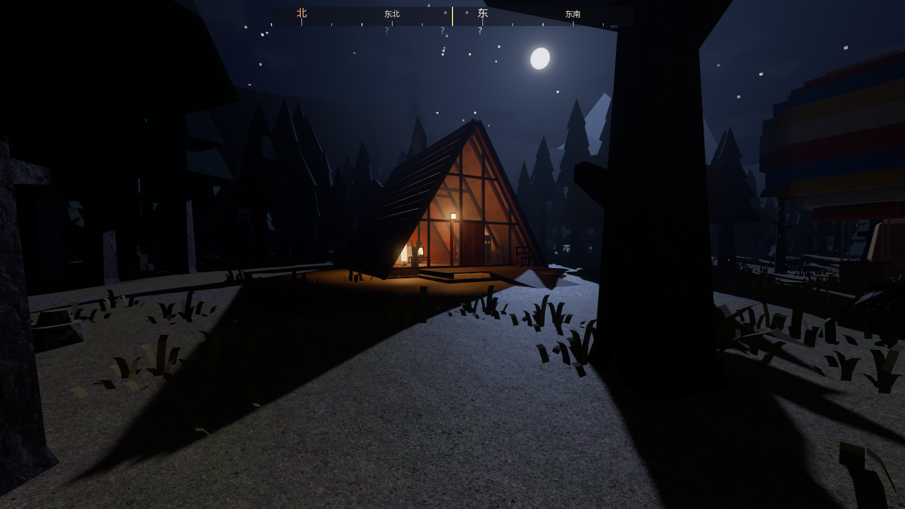

# 飞行器与夜晚调亮（2026-11-03）

起因：用户说“先再放几个交通工具，在游戏里面，可以飞行的，然后夜晚状态下调亮一点”。
分支 `feature/flying-vehicles`，叠在 `feature/mp-smooth`（PR #36）上，worktree `D:\个人世界\DuskLake-fly`。

## 1. 三种飞行器

| 飞行器 | 停在哪 | 怎么飞 |
|---|---|---|
| 小直升机 | 出生点东南的草地（-40, 34），机头朝湖 | 空格升、C / Ctrl 降、W / S 前进后退、A / D 转向、Shift 更快（9 → 15 m/s）。坐上去旋翼要先转起来（约 1.3 秒）才能升空；松开就悬停；机身随加速前倾、随转弯侧倾。转快了桨叶换成一片淡淡的圆盘 |
| 热气球 | 出生点北边的湖岸草地（-55, 16） | 空格点火上升（2.8 m/s，吊篮上方有火焰和暖光）、C 放气下降、都不按保持高度；W / S 慢慢往前后飘（2.5 m/s）、A / D 转向，风一直推着它走。人站在吊篮里 |
| 滑翔翼 | 雪山顶南坡（104, -103），朝着湖 | 在地上按 W 助跑，跑到 7 m/s 离地；空中按滑翔比一路往下沉：平飞 10 m/s、约 8.7 : 1，W 俯冲 15.5 m/s，S 拉起 6.5 m/s；A / D 转弯带侧倾。从山顶能一路滑过整个湖 |

共同的规则：

- 走近对着它按 E 坐上去；**落地以后**按 E 下来，落脚点在旁边一圈没被东西占着、不太陡的地面上。空中、深水上、高屋顶上下不来，会提示原因。
- 滑翔翼掉进深水，或挂在陡坡的树上旁边没处下，按 E 直接回到山顶出发点。
- 运动自己算（和独木舟一样不走物理引擎，结果可复现）：地面高度用 `WorldTerrain.height_at`，湖面也算地面；建筑、树干、石头用一次形状扫掠（`cast_motion`，不算地形）挡住，碰上就停在碰上之前。往下落时碰到的是屋顶、码头，就停在上面。
- 离水面最高 80–100 m，离地图边界至少 8 m。没人开时会慢慢降落，落地后每帧什么都不算（停着的三架不占 CPU）。
- 位置每秒写进 `WorldState.vehicles`（和独木舟同一张表，存档格式不变）；读档按存下的位置停好，存在深水上的回到停放点。新游戏都回停放点。
- 第三人称时镜头自动拉远（直升机 8.5 m、热气球 9.5 m、滑翔翼 6.5 m），看得见整架。第一人称在直升机里从挡风玻璃往外看。
- 声音都是 `devtools/audio/synth.mjs` 新合成的：直升机旋翼（每秒 11 下的拍打 + 发动机嗡嗡，音高随转速）、热气球燃烧器的呼呼声、滑翔翼迎面的风声（音高随速度）。
- 小地图、世界地图上有图标：红色圆球是热气球、黄点带十字是直升机、青色三角是滑翔翼（有人在开时不画）。
- 联机：姿态包里原来放独木舟的字段改成通用的“载具”（uid、位置、朝向），别人那边的同一架跟着开的人走，自己上不去；开的人中途离开（传送、掉线），飞行器在两边都自己慢慢落地。协议不变（仍是 4）。

| 出生点旁停着的直升机和热气球 | 直升机飞过湖面 |
|---|---|
|  |  |

| 直升机里往外看 | 清晨的热气球 |
|---|---|
|  |  |

| 雪山顶的滑翔翼 | 滑过湖面 |
|---|---|
|  |  |

## 2. 夜晚调亮

设置 → 画面 → 新增“夜晚亮度”（0–200 %，默认 100 %；0 = 原来那么暗）。夜里按它一起提：

| 项 | 原来（0 %） | 默认（100 %） | 200 % |
|---|---|---|---|
| 环境光 | 0.16 | 0.52 | 0.88 |
| 月光 | 0.22 | 0.46 | 0.70 |
| 曝光 | 1.35 | 1.63 | 1.91 |
| 夜空颜色 | ×1 | ×1.5 | ×2 |

白天不受影响；本局规则“夜晚更亮”照样在这上面再加。两组同机位截图的平均亮度：出生点 14.6 → 22.6，木屋外 12.7 → 22.3（0–255）。

| 原来 | 现在（默认） |
|---|---|
|  |  |
|  |  |

## 3. 性能

`Benchmark`（1920×1080，高画质），和 PR #36 同一时段背靠背各跑一次：三架飞行器每个机位多 0–30 个绘制调用，显存不变；帧率差别在两次运行的起伏之内。停着的飞行器物理和画面更新都直接跳过。

| 机位 | 绘制调用 PR #36 → 本分支 | FPS |
|---|---|---|
| 湖岸出生点 | 1544 → 1560 | 165.3 → 163.7 |
| 码头望木屋 | 2225 → 2248 | 157.7 → 149.2 |
| 北部林道 | 1865 → 1871 | 163.4 → 153.0 |
| 雪山顶·望湖 | 1693 → 1705 | 154.2 → 143.1 |
| 地下水族馆 | 539 → 533 | 155.7 → 154.8 |

## 4. 自动检查

- 新增 7 项：
  - 三架按布局停在地上；
  - 小直升机：旋翼转起来才升空，飞到湖上，空中、湖面上下不来，低空撞木屋被墙挡住，飞回来落地下来站稳，存档里有位置；
  - 热气球：站在吊篮里，点火上升、有火焰，松手保持高度，放气落地后下来；
  - 滑翔翼：雪山顶助跑起飞，8 秒滑 74 m、降 9.2 m（8.1 : 1），落地后下来（掉进湖里回到山顶）；
  - 联机（本机）：别人开时本机那架跟着摆、自己上不去，对方离开后慢慢落地；
  - 读档：按存下的位置停好，存在深水上的回到停放点；
  - 夜晚亮度：默认比原来亮，可调 0–200 %，白天不变。
- 联机检查新增 1 项（两个进程）：访客开小直升机升到 12 m，房主看到它飞起来、自己上不去；访客在空中传送走后，直升机在房主那边自己落地。
- 自动检查 147/147、启动流程 6/6、联机 21/21。
- 新增 25 条英文翻译（共 815 条）。
