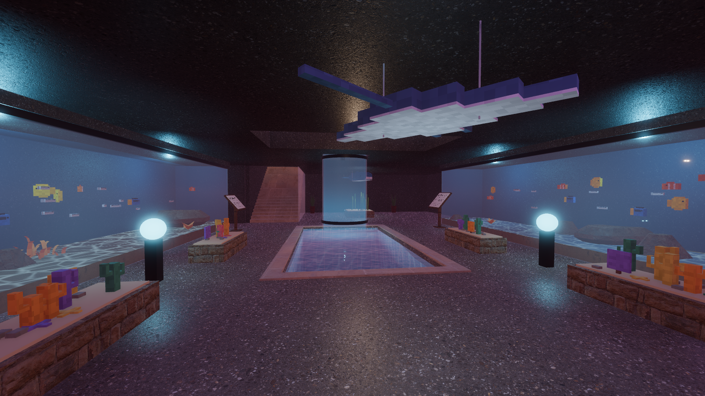
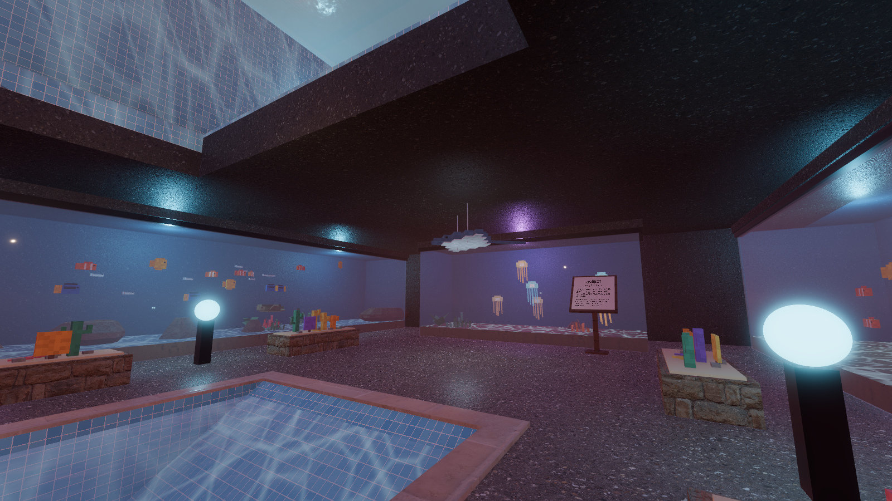
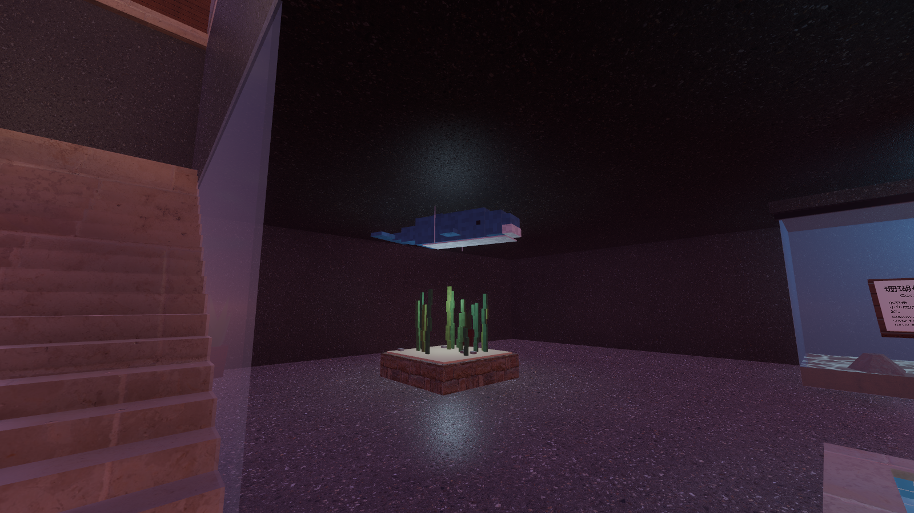
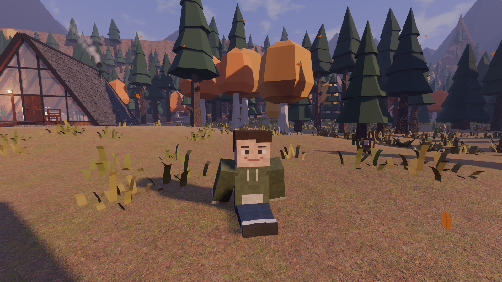
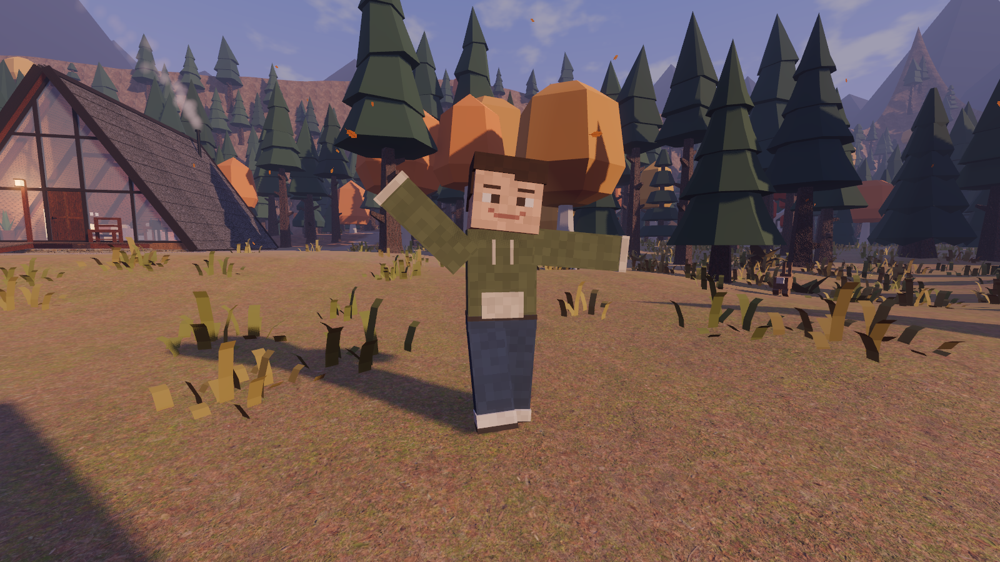
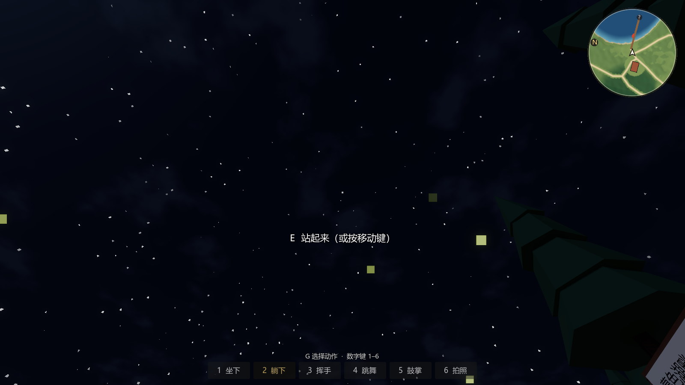
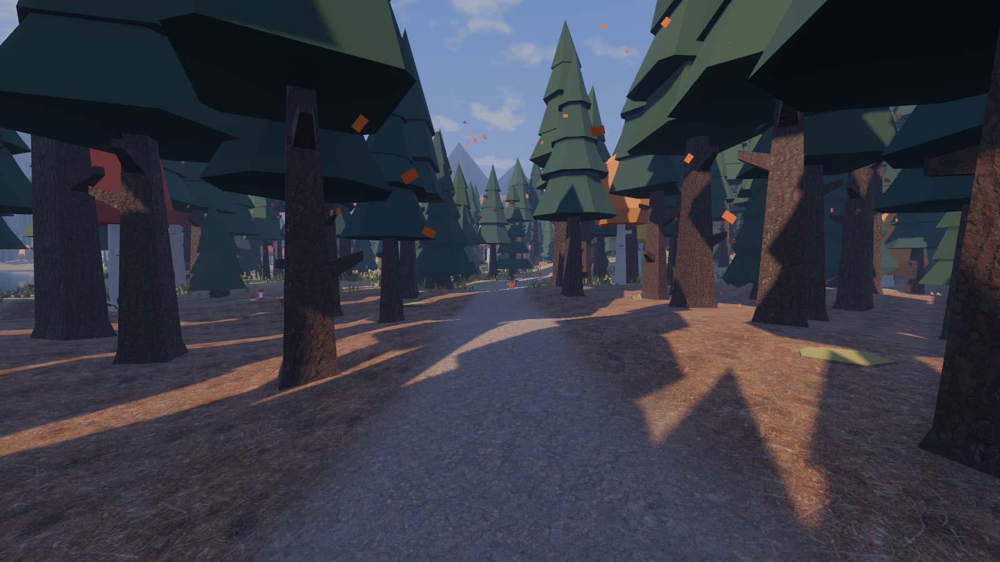
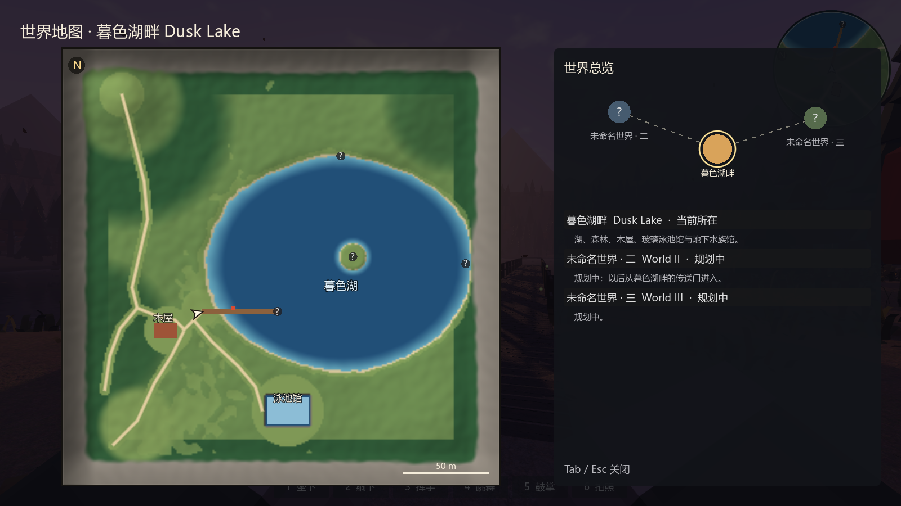

# M2 扩展：动作栏、水族馆装饰、世界地图与全屏 验收记录（2026-10-21）

## 水族馆装饰（不再放长椅）

地下水族馆是私人空间，原来鱼缸前的 4 张长椅和对应座位都拿掉了，换成：

| 装饰 | 位置 | 说明 |
|---|---|---|
| 珊瑚花坛 × 4 | 原长椅位置（鱼缸玻璃前） | 石砌矮花坛、沙面，种着方块分枝珊瑚、扇珊瑚、海星、卵石，每个花坛的颜色组合不同 |
| 玻璃球落地灯 × 2 | 两组花坛之间 | 黑色灯柱顶上一颗发蓝光的玻璃球，自带柔光 |
| 方块蝠鲼吊饰 | 东侧大厅上空 | 翼展约 2.2 m，钢丝挂在顶板下，慢慢转圈、轻轻上下浮动 |
| 方块鲸鱼吊饰 + 海带花坛 | 西侧楼梯口旁 | 原来空着的暗角：头顶一条蓝鲸，下面一个海带花坛，配一盏柔光 |
| 绿植 × 2 | 西墙角 | Kenney 盆栽 |

- 吊饰最低点离地面都在 1.95 m 以上，不会挡人；花坛有碰撞，不挡楼梯下来和下潜池上岸的路线。
- 泳池躺椅和大厅长椅照旧可以坐。

| 水族馆 | 蝠鲼 | 鲸鱼与海带 |
|---|---|---|
|  |  |  |

## 动作栏

屏幕底部一排按钮，数字键随时可用；按 **G** 放出鼠标后可以直接点按钮（点完自动收回鼠标）。

| 键 | 动作 | 说明 |
|---|---|---|
| 1 | 坐下 | 席地而坐，双手撑在身后，视线降低约 0.7 m |
| 2 | 躺下 | 平躺、抬眼看天（夜里能看星星和萤火虫）；第一人称时手收起来 |
| 3 | 挥手 | 约 2.6 秒后自动结束 |
| 4 | 跳舞 | 一直跳，直到走动或再按一次 |
| 5 | 鼓掌 | 约 2.8 秒后自动结束 |
| 6 | 拍照 | 隐藏界面拍一张当前画面，白光一闪，存到“图片\Dusk Lake”文件夹 |

- 坐、躺、跳舞再按同一个键就起身；按移动键、空格或 E 也会起身（起身那一下不会跳起来）。
- 挥手、跳舞、鼓掌时自动切到第三人称看自己，做完切回第一人称（设置 → 操作 里可以关掉）。
- 游泳、划船、坐在椅子上、飞行或在空中时不能做动作，会提示“现在不能……”。
- 设置 → 操作：可以隐藏底部动作栏（数字键仍有效）。

| 坐下 | 挥手 | 跳舞 |
|---|---|---|
|  |  |  |

| 动作栏 | 躺下看星星 |
|---|---|
|  |  |

## 季节飘落物：晴天不再满屏红点

- 原来秋天不论晴雨都有约 330 个红橙色小方块在飘（700 个上限 × 静风 35%），暮色下看起来是满屏红点。
- 现在数量和外观写在 `data/weather/seasonal_fx.json`：
  - 落叶：320 个上限 × 静风 12%，晴天无风时同屏约 80 片，风越大越多；
  - 形状改成带叶柄的像素叶片，颜色以黄褐、橙褐为主，少一些红；
  - 春天花瓣同理（圆瓣）；雨雪天和夜里几乎不飘（与原来一样）。
- **原版红点完整保留**，方案名 `legacy_red_motes`（“原版红点”）：700 个、静风 35%、方块形、原配色，参数与第一版完全相同。
  - 开发者模式（F2）面板 → “季节飘落物”可以随时切到“原版红点”，也可以“按季节”或“关闭”；
  - 以后写进世界观时，把 `active` 里某个季节指向 `legacy_red_motes` 即可。

| 现在（秋天晴天） | 保留的原版红点 |
|---|---|
|  |  |

## 全屏

- **F11** 或 **Alt + Enter** 随时切换全屏 / 窗口，暂停菜单里也能按；切换结果自动保存，下次启动保持。
- 暂停菜单首页多了“全屏 / 窗口（F11）”按钮；设置 → 画面 里的“全屏”勾选同步。

## 世界地图与多世界预留

- **Tab** 打开 / 关闭世界地图（Esc 也能关）：
  - 左边是整张暮色湖畔，北朝上：地形底图、步道、码头、木屋、泳池馆、湖心小岛，探索点（未发现是问号，发现后显示名字），独木舟，玩家箭头，指北和 50 m 比例尺；
  - 右边是“世界总览”：各个世界之间的连线图和列表，当前世界带金圈。
- 世界列表来自 `data/worlds/worlds.json`（`WorldRegistry` 读取）：
  - 目前开放的只有暮色湖畔；
  - 预留了两个“规划中”的世界槽位（未命名世界 · 二、三），点它们会提示“还在建设中，以后从传送门进入”；
  - 以后加新世界：在 JSON 里加一条（名字、场景、简介、总览图位置、颜色），状态改成 `open`，再接上传送门。真正的跨世界切换（场景加载、存档衔接）在第二个世界做出来时实现，本次只做到注册表和地图。

## 自动检查

`godot --headless --path . --fixed-fps 60 res://tests/TestRunner.tscn`：**52 / 52 通过**。新增 4 项：

| 检查 | 结果 |
|---|---|
| 水族馆不放长椅，换成珊瑚花坛与头顶吊饰 | 水族馆座位 0，珊瑚花坛 4，蝠鲼和鲸鱼离地 ≥ 1.95 m |
| 动作栏 | 坐下眼睛降低 0.72 m；走动起身；躺下放平、视线低、手收起、再按起身；挥手举手后自动结束并切回第一人称；跳舞持续；鼓掌自动结束；游泳时拒绝 |
| 晴天落叶零星，原版红点保留 | 秋天晴天 84 个（风 0.16）；切到原版红点 321 个；切回正常 |
| 全屏与世界地图 | F11 绑定、全屏切换、Tab 打开地图、当前世界暮色湖畔、规划中 2 个且不能进入 |

## 性能（1920×1080，关垂直同步，RTX 5060 Laptop）

| 机位 | FPS | 帧时 | 绘制调用 | 显存 |
|---|---|---|---|---|
| 湖岸出生点 | 154 | 6.5 ms | 959 | 876 MB |
| 码头望木屋 | 109 | 9.2 ms | 2828 | 908 MB |
| 木屋室内 | 111 | 9.0 ms | 2421 | 914 MB |
| 北部林道 | 115 | 8.7 ms | 2552 | 914 MB |
| 秋夜大雨·木屋外 | 153 | 6.5 ms | 1143 | 916 MB |
| 冬日下雪·湖岸 | 148 | 6.8 ms | 1678 | 919 MB |
| 泳池馆大厅 | 129 | 7.8 ms | 1194 | 919 MB |
| 地下水族馆 | 100 | 10.0 ms | 3619 | 919 MB |
| 夏夜雷雨·湖岸 | 160 | 6.2 ms | 1135 | 919 MB |

水族馆多了 4 盏小灯和装饰，比上次记录（106 FPS）略低，在两次运行之间 ±10–20% 的波动范围内。
