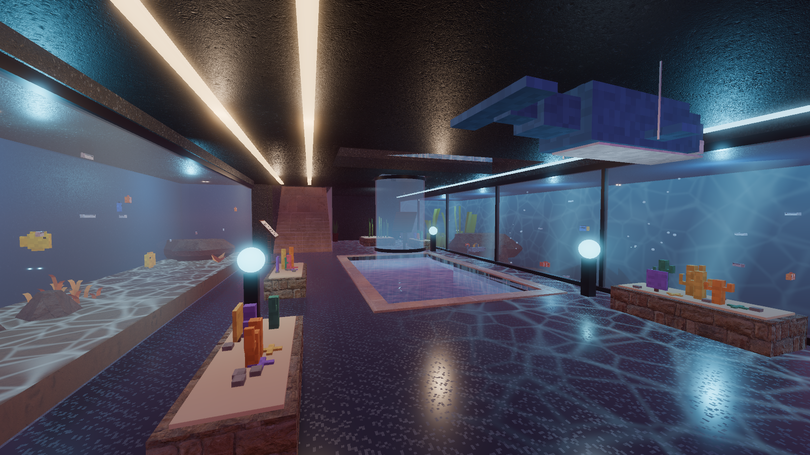
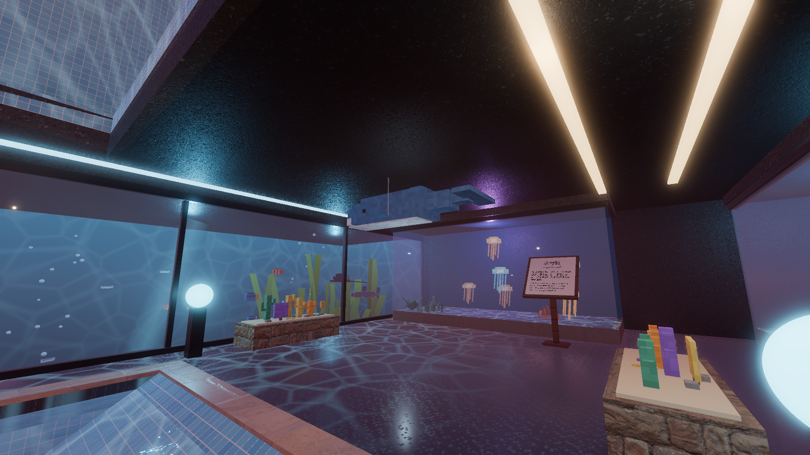
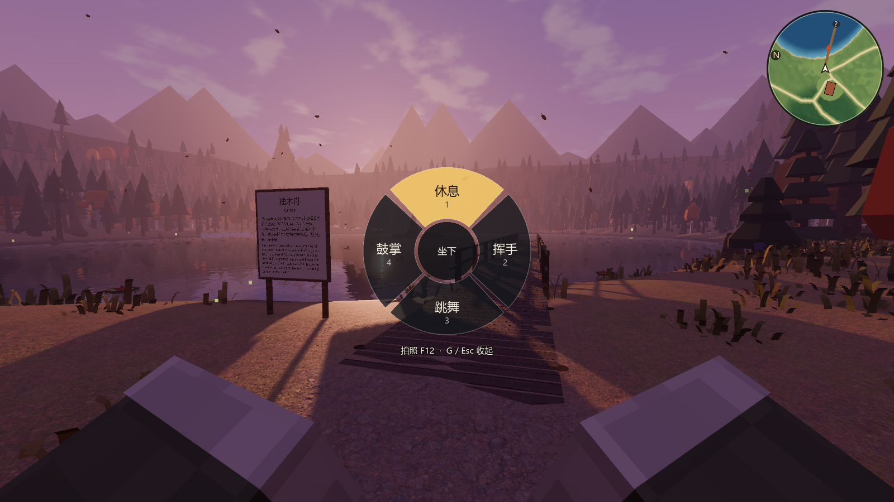
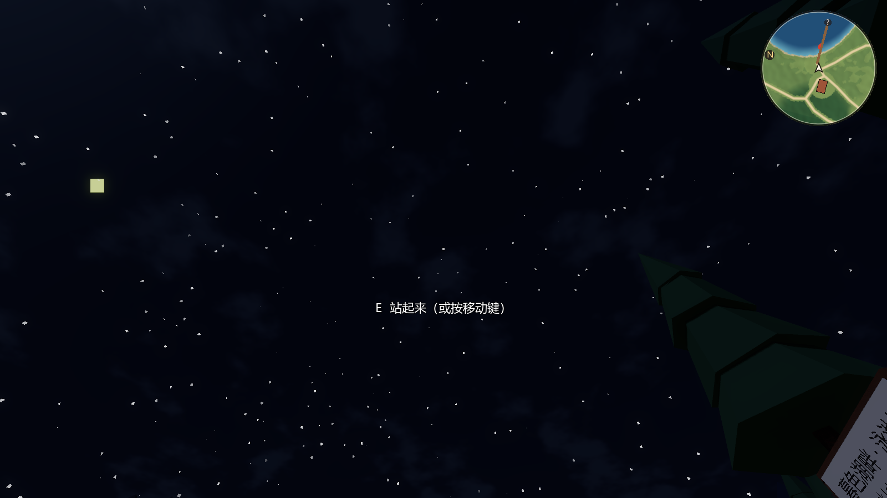
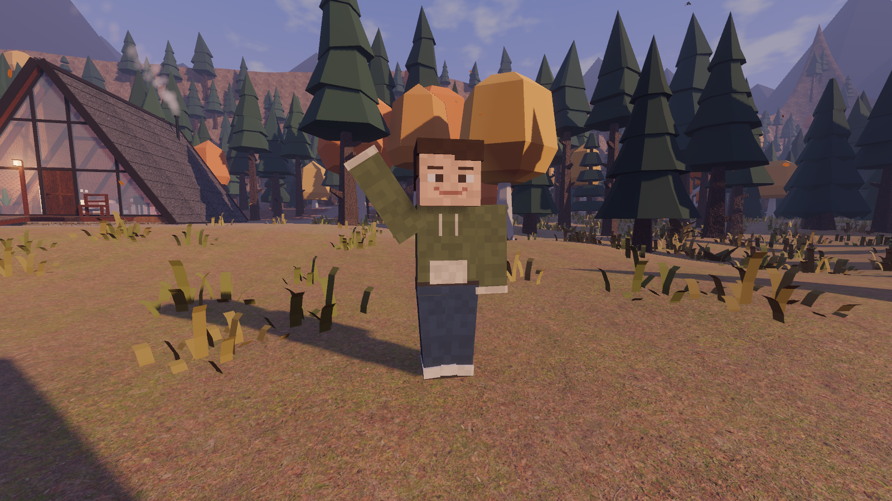
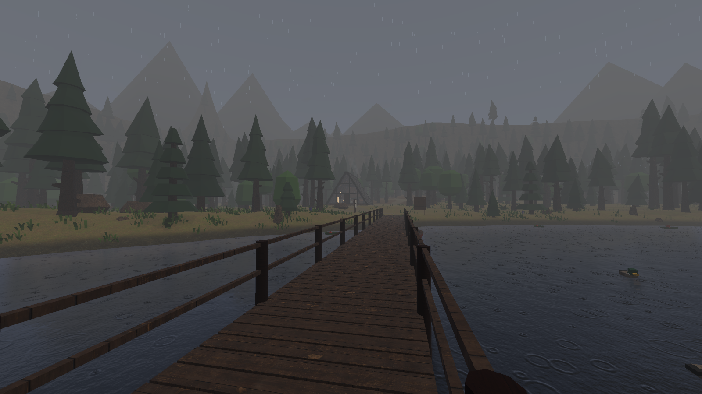
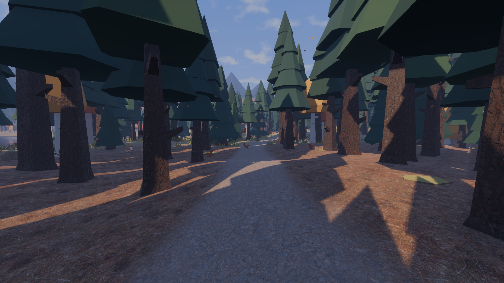
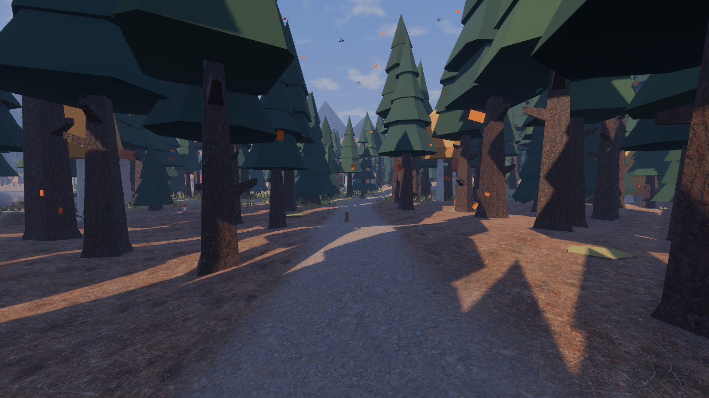
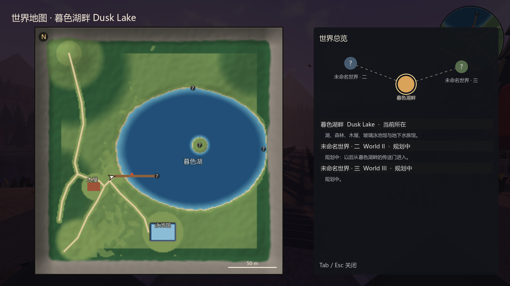

# M2 扩展：动作轮盘、水族馆装饰、世界地图与全屏 验收记录（2026-10-21）

## 水族馆装饰（不再放长椅）

地下水族馆是私人空间，长椅和对应座位都拿掉了。北侧已经换成能潜进去的海洋大缸（见 `AQUARIUM_DIVE.md`），装饰按新布局摆放：

| 装饰 | 位置 | 说明 |
|---|---|---|
| 珊瑚花坛 × 4 | 海洋大缸玻璃前两个、南缸前两个（原长椅位置） | 石砌矮花坛、沙面，种着方块分枝珊瑚、扇珊瑚、海星、卵石，每个花坛的颜色组合不同 |
| 玻璃球落地灯 × 3 | 花坛之间 | 黑色灯柱顶上一颗发蓝光的玻璃球，自带柔光 |
| 方块鲸鱼吊饰 | 大厅中部上空 | 钢丝挂在顶板下，慢慢转圈、轻轻上下浮动；海洋大缸里已经有活的蝠鲼，所以大厅不再挂蝠鲼 |
| 海带花坛 | 西侧楼梯口旁 | 原来空着的暗角，配一盏柔光 |
| 绿植 × 2 | 西墙 | Kenney 盆栽 |

- 鲸鱼最低点离地面 1.95 m 以上，不会挡人；花坛有碰撞，不挡楼梯下来、下潜池上岸和潜进大缸的路线。
- 泳池躺椅和大厅长椅照旧可以坐。

| 水族馆 | 鲸鱼吊饰 |
|---|---|
|  |  |

## 动作轮盘

平时屏幕上不显示任何动作按钮。按 **G** 才在屏幕中央弹出一个四格轮盘（参考 GTA、堡垒之夜的表情轮盘）：

- **按住 G**，鼠标往某个方向一推，松开 G 就执行那一格；
- **轻点 G**，轮盘留在屏幕上，用鼠标点一格；再按 G 或 Esc 收起。

| 格子 | 快捷键 | 动作 |
|---|---|---|
| 上：休息 | 1 | 合并了坐下和躺下：第一次是席地而坐（双手撑在身后，视线降低约 0.7 m），再选一次躺下（平躺抬眼看天，夜里能看星星和萤火虫），第三次起身。轮盘中央会提示下一步是“坐下 / 躺下 / 起身” |
| 右：挥手 | 2 | 约 2.6 秒后自动结束 |
| 下：跳舞 | 3 | 一直跳，直到走动或再选一次 |
| 左：鼓掌 | 4 | 约 2.8 秒后自动结束 |

- 拍照不放在轮盘里，单独用 **F12**：隐藏界面拍一张当前画面，白光一闪，存到“图片\Dusk Lake”文件夹。
- 按移动键、空格或 E 都会起身（起身那一下不会跳起来）。
- 挥手、跳舞、鼓掌时自动切到第三人称看自己，做完切回第一人称（设置 → 操作 里可以关掉）。
- 游泳、划船、坐在椅子上、飞行或在空中时不能做动作，会提示“现在不能……”。

| 动作轮盘（按住 G 往上推） | 躺下看星星 |
|---|---|
|  |  |

| 坐下 | 挥手 | 跳舞 |
|---|---|---|
|  |  |  |

## 雨：下得慢一点、雨丝细一点

- 雨滴改成接近真实终端速度匀速下落（约 8–10 m/s），原来是约 25 m/s 往下砸。
- 雨丝从 1.8 cm × 60 cm 缩到 1.1 cm × 30 cm，颜色更淡；同屏雨滴上限 9000 → 7000。落得慢以后每秒落地的雨滴（溅起的水花）约为原来的四成。
- 雨仍然不进室内，屋檐下、泳池馆里照旧没有雨。

## 季节飘落物：晴天不再满屏红点

- 原来秋天不论晴雨都有约 330 个红橙色小方块在飘（700 个上限 × 静风 35%），暮色下看起来是满屏红点。
- 现在数量和外观写在 `data/weather/seasonal_fx.json`：
  - 落叶：320 个上限 × 静风 12%，晴天无风时同屏约 80 片，风越大越多；
  - 形状改成带叶柄的像素叶片，颜色以黄褐、橙褐为主，少一些红；
  - 春天花瓣同理（圆瓣）；雨雪天和夜里几乎不飘（与原来一样）。
- **原版红点完整保留**，方案名 `legacy_red_motes`（“原版红点”）：700 个、静风 35%、方块形、原配色，参数与第一版完全相同。
  - 开发者模式（F2）面板 → “季节飘落物”可以随时切到“原版红点”，也可以“按季节”或“关闭”；
  - 以后写进世界观时，把 `active` 里某个季节指向 `legacy_red_motes` 即可。

| 现在（秋天晴天） | 保留的原版红点 |
|---|---|
|  |  |

## 全屏

- **F11** 或 **Alt + Enter** 随时切换全屏 / 窗口，暂停菜单里也能按；切换结果自动保存，下次启动保持。
- 暂停菜单首页多了“全屏 / 窗口（F11）”按钮；设置 → 画面 里的“全屏”勾选同步。

## 世界地图与多世界预留

- **Tab** 打开 / 关闭世界地图（Esc 也能关）：
  - 左边是整张暮色湖畔，北朝上：地形底图、步道、码头、木屋、泳池馆、湖心小岛，探索点（未发现是问号，发现后显示名字），独木舟，玩家箭头，指北和 50 m 比例尺；
  - 右边是“世界总览”：各个世界之间的连线图和列表，当前世界带金圈。
- 世界列表来自 `data/worlds/worlds.json`（`WorldRegistry` 读取）：
  - 目前开放的只有暮色湖畔；
  - 预留了两个“规划中”的世界槽位（未命名世界 · 二、三），点它们会提示“还在建设中，以后从传送门进入”；
  - 以后加新世界：在 JSON 里加一条（名字、场景、简介、总览图位置、颜色），状态改成 `open`，再接上传送门。真正的跨世界切换（场景加载、存档衔接）在第二个世界做出来时实现，本次只做到注册表和地图。

## 自动检查

`godot --headless --path . --fixed-fps 60 res://tests/TestRunner.tscn`：**合并进 main 后 63 / 63 通过**（含聊天框、海洋大缸、国际象棋等其他分支的检查）。本次新增 4 项：

| 检查 | 结果 |
|---|---|
| 水族馆不放长椅，换成珊瑚花坛、海带花坛与方块鲸鱼 | 水族馆座位 0，珊瑚花坛 4，鲸鱼离地 ≥ 1.95 m |
| 动作轮盘 | 平时不显示、G 弹出，四个方向选格正确；休息：坐下（眼睛降低 0.72 m）→ 躺下 → 起身；走动起身；躺下放平、视线低、手收起；挥手举手后自动结束并切回第一人称；跳舞持续；鼓掌自动结束；游泳时拒绝 |
| 晴天落叶零星，原版红点保留 | 秋天晴天 89 个（风 0.18）；切到原版红点 329 个；切回正常 |
| 全屏与世界地图 | F11 绑定、全屏切换、Alt+Enter 切全屏且不误开聊天框、Tab 打开地图、当前世界暮色湖畔、规划中 2 个且不能进入 |

## 性能（1920×1080，关垂直同步，RTX 5060 Laptop，叠在性能优化 PR 之上）

| 机位 | 帧率 | GPU | CPU 渲染 | 绘制调用 | 显存 | 性能 PR 记录 |
|---|---|---|---|---|---|---|
| 湖岸出生点 | 143 FPS | 4.1 ms | 3.7 ms | 2073 | 812 MB | 127 FPS |
| 码头望木屋 | 110 FPS | 4.1 ms | 6.1 ms | 3627 | 813 MB | 95 FPS |
| 木屋室内 | 96 FPS | 5.6 ms | 5.6 ms | 3560 | 851 MB | 91 FPS |
| 北部林道 | 120 FPS | 4.7 ms | 4.7 ms | 2613 | 851 MB | 116 FPS |
| 秋夜大雨·木屋外 | 134 FPS | 4.8 ms | 3.6 ms | 1485 | 853 MB | 140 FPS |
| 冬日下雪·湖岸 | 123 FPS | 4.2 ms | 4.4 ms | 2768 | 854 MB | 119 FPS |
| 泳池馆大厅 | 129 FPS | 6.0 ms | 3.5 ms | 1737 | 854 MB | 127 FPS |
| 地下水族馆 | 145 FPS | 5.9 ms | 2.8 ms | 616 | 854 MB | 150 FPS |
| 夏夜雷雨·湖岸 | 133 FPS | 4.3 ms | 4.2 ms | 2346 | 854 MB | 136 FPS |

水族馆多了 4 盏小灯和装饰（绘制调用 591 → 616），帧率变化在两次运行之间 ±10–20% 的波动范围内。
