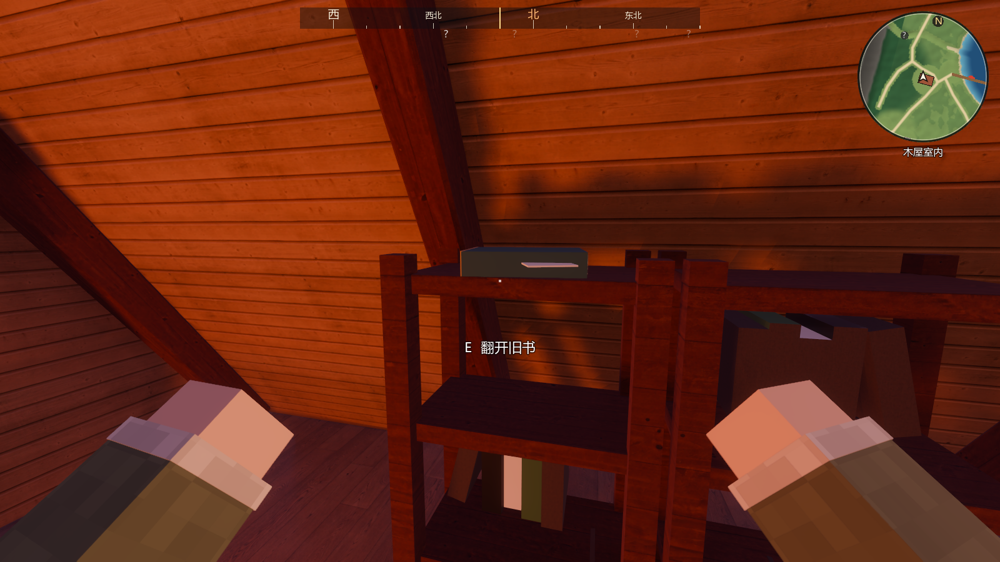
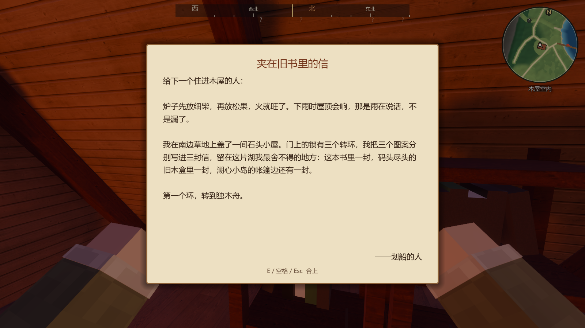
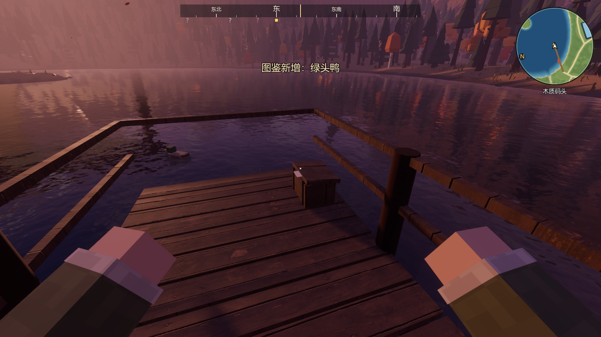
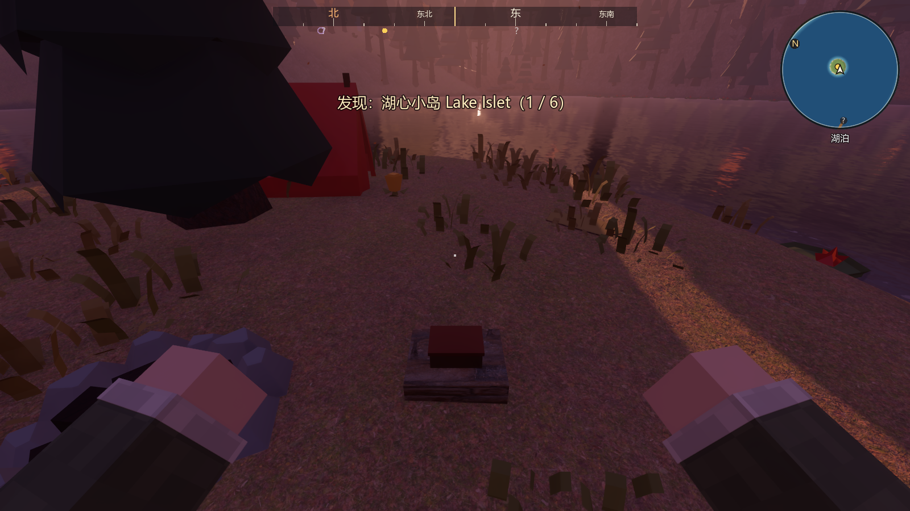
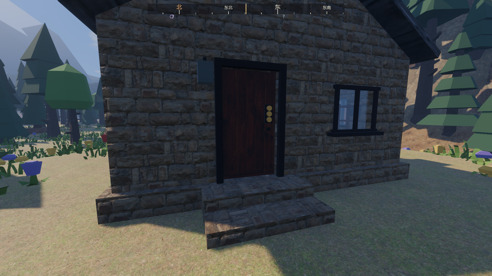
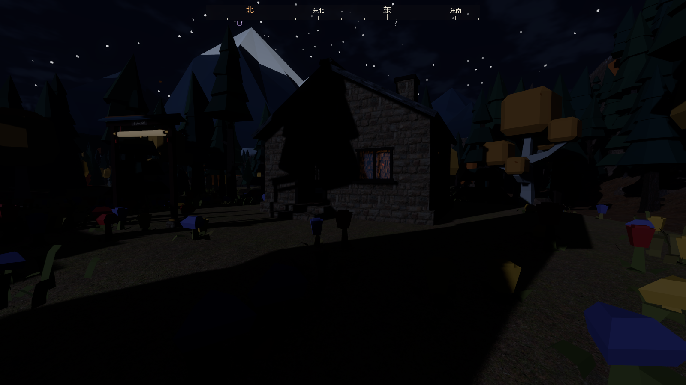
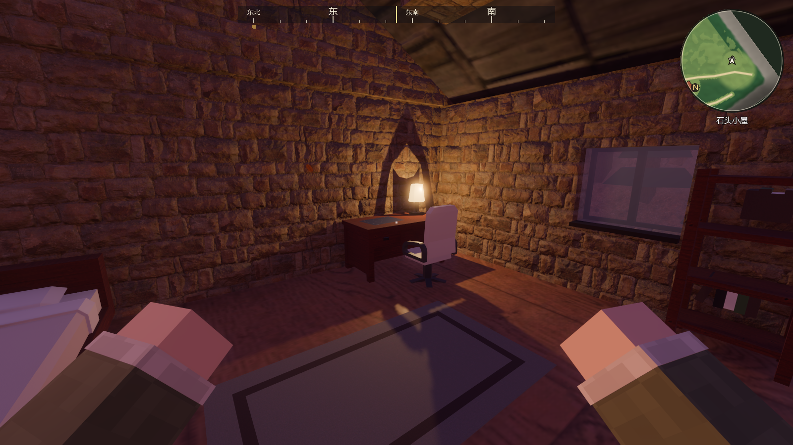
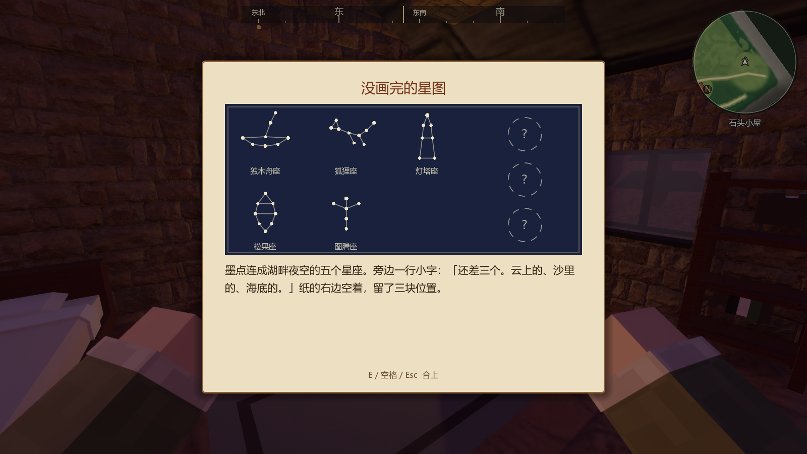

# 划船人的信与石头小屋（世界观落地①，2026-10-26）

分支 `feature/stone-cottage-letters`，基于 v0.5.0 的 main（c6ddfa5），worktree `D:\个人世界\DuskLake-letters`。
世界观（2026-10-26 定稿）：暮色湖畔是停在黄昏里的渡口，前一位旅人“划船的人”替走不开的老图腾去过门后的世界。南部草地那间一直锁着的石头小屋就是这位旅人的家。

## 做了什么

| 内容 | 说明 |
|---|---|
| 三封信 | 木屋左边书架顶上一本墨绿皮的旧书（信纸露出一角）、码头尽头的旧木盒、湖心小岛营火边石头上的铁盒。看着它按 E 打开读信界面（信纸、标题、正文、落款“——划船的人”），E / 空格 / Esc 合上；读过还能再读。顺序随意，每封信说出小屋门锁上的一个图案，第一封还说了另外两封在哪 |
| 石头小屋的门 | 门上一把三环转锁（铁板上三个铜环）。一封没读：提示“不知道该转到哪里”；读了几封：提示“你知道 2 个：狐狸、灯塔”；三封都读过：按 E 把三个环转到独木舟、狐狸、灯塔，锁开、门推开。之后是普通木门，按 E 开关 |
| 屋里 | 墙按门洞和三扇窗切块（玻璃窗能看见屋里屋外），门前两级石阶（碰撞是一道 22° 缓坡），木地板；靠后墙的书桌和椅子（能坐）、桌上没画完的星图（能看）和台灯（能开关，开了从窗外看得见）、靠左墙的床（能睡）、右墙书架、左墙斜挂一把船桨、中间一块地毯。屋里是室内区域 `cottage_interior`（不下雨） |
| 没画完的星图 | 深蓝纸上用墨点画着湖畔夜空的五个星座（读 `data/sky/constellations.json`），右边三个虚线空位写着“？”，旁边一行小字“还差三个。云上的、沙里的、海底的。”——留给下一步“点亮世界后新增星座”。桌上的纸和读信界面里的是同一个画法（桌上那张用 SubViewport 画成贴图） |
| 老图腾的新任务 | 「划船人的信」排在第三个（巡湖之后）：读完三封信（新目标类型 `letters`）、打开石头小屋的门（`flag: cottage_unlocked`）。完成时图腾说：“门开了？那个划船的还是老样子，什么都写下来，就是不写自己去了哪儿。” |
| 旅行日志 | J →「传说」页最上面是“划船人的信 n / 3”，读过的信显示全文，没读的显示“？？？” |
| 成就 | 「划船人的信」：读完三封信，打开石头小屋（成就共 25 个） |
| 解说卷轴 | 石头小屋的卷轴改成“门上挂着一把三环转锁……也许湖边哪里留着开锁的线索” |

文字都有中英两份；信的英文版见截图 `ltr_10_letter_en`。

## 数据与存档

- 信的内容、锁、星图文字：`data/story/letters.json`（`PaddlerStory` 读取）。湖边两处的位置：`world_layout.json → letters`；木屋那本书是室内物件，位置在 `CabinLife.OLD_BOOK`（木屋局部坐标，书架最上面一层隔板）。
- 读过的信：`WorldState.flags.letters`（按读到的顺序）；开过锁：`flags.cottage_unlocked`。门的状态 `locked / closed / open` 按 uid `cottage_door` 存档并联机同步；台灯 `cottage_lamp`、椅子 `cottage_chair`、床 `cottage_bed` 同木屋里的一样。都在已有字段里，存档版本不变（v5）；旧存档里门仍是 `locked`。
- 联机：读信只是本机玩家自己的记录；访客按门锁提示“联机做客时，这扇门要房主来开”，房主开锁后访客那边门也开了。
- 新增素材：Kenney Furniture Kit 的 `desk`、`chairDesk`、`bedSingle`（CC0，登记在 `assets/licenses.csv` 的家具行，现为 21 个 GLB）。原来只会说“门锁着”的 `LockedDoor` 已删除，由 `CottageDoor` 取代。

## 检查

| 自动检查 | 结果 |
|---|---|
| 石头小屋：一封信都没读时按 E 只提示，朝门直走被挡在外面，屋旁没有树 | 通过 |
| 码头木盒 → 湖心岛铁盒 → 木屋旧书（故意不按信里的顺序）各读一封，读过能再读；读了两封时门前提示知道 2 个图案 | 通过 |
| 三封读完按 E 开锁、门推开；从门前走缓坡进屋，一路连续（最大单步 0.05 m），屋里是室内、站在地板上 | 通过 |
| 屋里：星图能看、台灯能开；再从门走出去 | 通过 |
| 图腾任务两项目标完成、成就条件满足、旅行日志显示全文；读信与开门写进存档，旧存档里门仍锁着 | 通过 |
| 界面文字全部有英文翻译（扫描范围加上 `scripts/story`） | 通过 |

全套：自动检查 **118 / 118**（main 上是 114 项：去掉原来只查“门锁着”的 1 项，新增 5 项；翻译检查的扫描范围加上了 scripts/story）、启动流程 6 / 6、联机 12 / 12。

截图（`docs/screenshots/ltr_*`）：

| 木屋书架顶上的旧书 | 读信 |
|---|---|
|  |  |
| 码头尽头的旧木盒 | 湖心小岛营火边的铁盒 |
|  |  |
| 三环转锁 | 开锁后的夜里，台灯亮着 |
|  |  |
| 屋里 | 没画完的星图 |
|  |  |

## 帧率（1920×1080，高画质，关垂直同步，窗口停在屏幕外）

| 机位 | FPS | GPU ms | 绘制调用 | 三角形 |
|---|---|---|---|---|
| 石头小屋（屋外） | 81.4 | 4.18 | 3940 | 143 万 |
| 石头小屋室内（新机位，台灯关） | 85.9 | 4.02 | 3100 | 127 万 |
| 码头望雪山（开阔机位） | 116.4 | 3.36 | 1814 | 112 万 |
| 木屋室内 | 65.3 | 5.21 | 5368 | 250 万 |

湖畔 18 个老机位平均 90.6 FPS（亚特兰蒂斯那轮记的是 17 个机位 80.6；本机两轮之间的波动比这次改动大，不据此说变快了），显存湖畔 684 MB、云海 625 MB、沙丘 628 MB、亚特兰蒂斯 634 MB。石头小屋屋外机位的三角形数和绘制调用与周边机位同一量级，屋里比屋外还少。

## 顺手修

- 石头小屋原来是一整块碰撞盒，烟囱从屋顶往下穿进墙体里；改成空心以后烟囱只从屋面长出来，不伸进屋里。
- 台灯的点光开了阴影：不开阴影时光会穿墙，夜里屋外地上一块亮斑。
