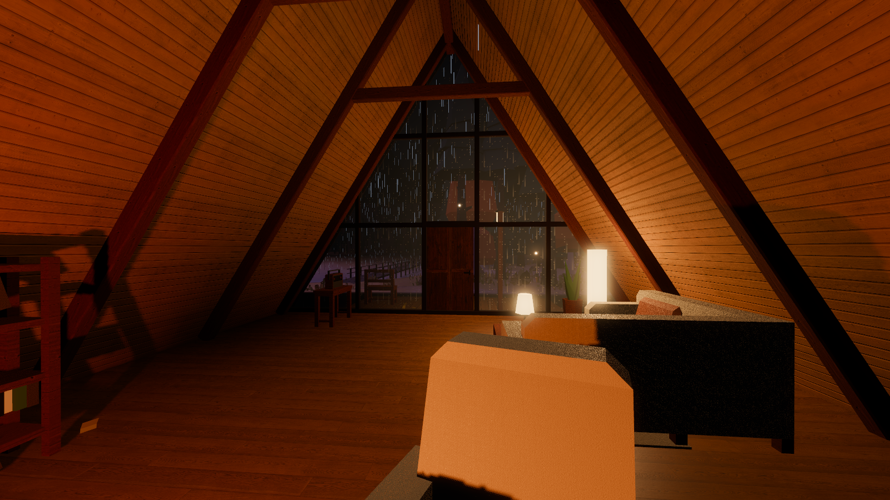
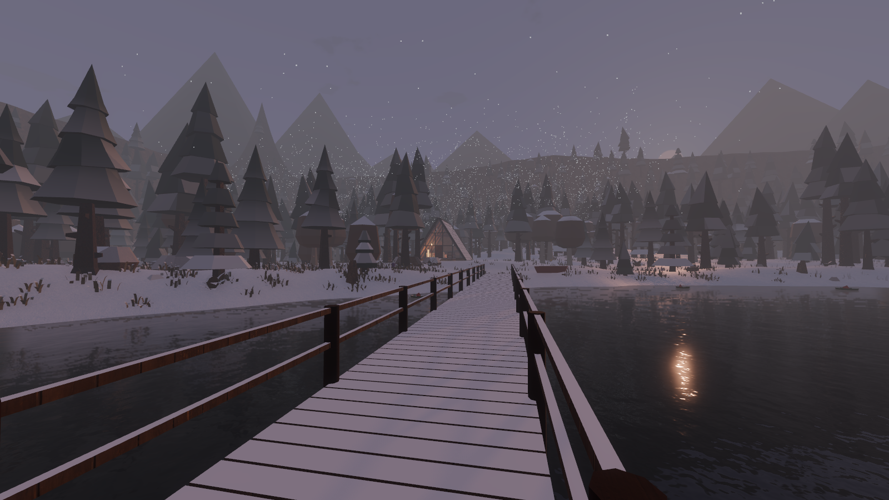
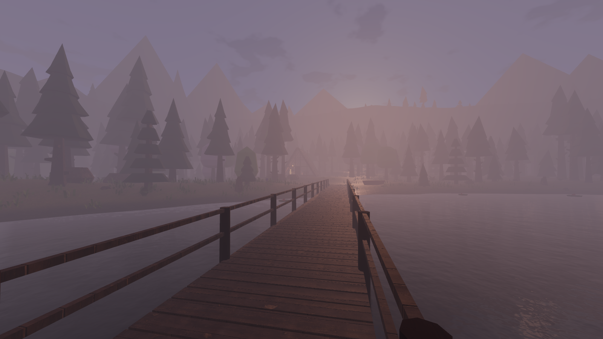
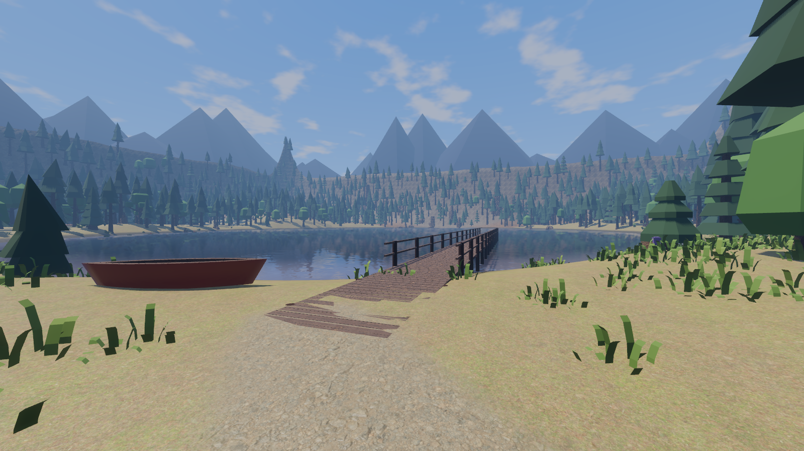
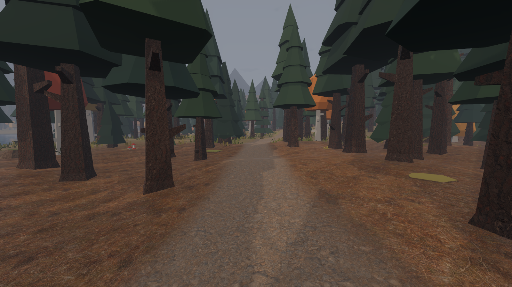
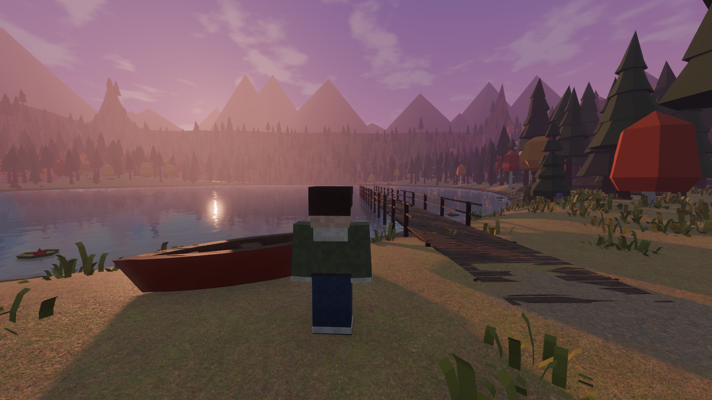

# M2 天气系统 + 方块人物 验收记录（2026-10-21）

## 天气系统（规格第 05 章）

| 模块 | 位置 | 职责 |
|---|---|---|
| WorldClock | `Main/Systems/WorldClock` | 推进世界时间。游戏内一天 = 现实 48 分钟，开局秋季第 1 天 17:20 |
| SeasonController | `Main/Systems/SeasonController` | 每季 12 个游戏日，由日期推出季节，可覆盖 |
| WeatherController | `Main/Systems/WeatherController` | 6 类天气按季节权重抽取。天气持续 3–8 游戏小时，过渡 30–90 现实秒。随机数由 `weather_seed` 和变天次数决定 |
| EnvironmentDirector | `World/Environment` | 根据时间、季节、天气设置太阳与月亮、天空（星空、云、阴天灰化）、雾、环境光、地面湿润与积雪、降水强度、植被季节色和湖面倒影 |
| Precipitation | `World/Precipitation` | 雨雪粒子只在相机周围生成。跟随相机的高度场碰撞让粒子碰到屋顶或树冠就消失，所以室内和屋檐下不下雨雪 |
| ClimateSystem | `Main/Systems` | 提供预设、跳季、改时刻、改天气的统一入口。调试面板和测试都通过它操作 |

- 数据在 `data/seasons/seasons.json`（四季日出日落、正午太阳高度、各季色板、天气权重）和 `data/weather/weather.json`（六类天气参数和四个测试预设）。代码里不写死数值。
- 季节和天气是两个独立状态。冬季不会下雨，其他季节不会下雪。换季时，如果当前天气在新季节不允许，会自动过渡到该季的后备天气。
- 天气相关的全局着色器参数是 `rain_amount`、`snow_fall`、`snow_cover`、`wetness`、`season_tint`。地形用它们表现变湿和积雪；湖面下雨时变粗糙；玻璃上有雨痕。积雪覆盖层只在有雪时挂到室外材质上，用来盖住屋顶、树冠、岩石和码头。
- 植被换季：针叶树按季节色板重新上色；阔叶树春夏换成绿叶模型，秋冬用秋叶模型；草丛跟着季节变色。
- 调试：按 **F4** 打开面板，可以选预设、季节、天气（本季不允许的天气按钮是灰的）、时刻，以及 ×1、×60、×600 时间流速。按 **F3** 的信息栏会显示日期、时间和天气。

## 方块人物（参考《我的世界》的方块人风格，原创造型）

- 身高 32 像素 = 1.8 m（1 像素 = 5.6 cm）。头 8×8×8，躯干 8×12×4，四肢各 4×12×4，面朝 -Z。材质是顶点色叠加 16×16 像素噪点贴图，呈现方块像素质感。
- **为换装留的位置**：
  - 六个部位（头、躯干、双臂、双腿）下面各有七个插槽：脸、发型、帽子、上衣、下装、鞋、背饰。
  - 另有四个挂点：右手、左手、头顶、背部，用于将来挂手持物或饰品 GLB。
  - 所有款式都写在 `data/characters/wardrobe.json`，每件就是几个“像素盒子”。新发型或新衣服只需在 JSON 里加一条，代码和面板会自动出现它。
- 现有款式：
  - 发型：光头、短发、长发、马尾、丸子头
  - 帽子：不戴、毛线帽、棒球帽
  - 上衣：T 恤、连帽卫衣、夹克
  - 下装：长裤、短裤
  - 鞋：运动鞋、靴子
  - 背饰：无、背包
  - 脸：平静、微笑
- 颜色可改：肤色、瞳色、发色、帽子、上衣（主色和饰色）、下装、鞋、背包。
- **Esc → 人物外观**：左边是实时 3D 预览，右边选择款式和颜色，还有“随机搭配”“恢复默认”。点“保存”写入 `user://appearance.json`，下次启动自动读取。
- **V** 切换第一 / 第三人称：
  - 第三人称时相机退到肩后，碰到墙会自动拉近。
  - 第一人称时自己的身体不进画面，但仍然投影子。
  - 走跑时摆臂摆腿，跳跃时抬手，头随视线俯仰。
- 外观是一个可序列化的字典（`CharacterAppearance.to_dict()`），将来 NPC 和其他玩家用同一套模型，只需传这个字典。

## 自动检查：29/29 通过

新增 13 项，原有 16 项仍全部通过：

| 检查 | 结果 |
|---|---|
| 自动天气只在允许的季节出现（每季抽 400 次，所有允许的天气都出现过） | 通过 |
| 天气序列由种子决定（同种子相同、不同种子不同） | 通过 |
| QA-03 秋季 17:20 晴：太阳高度 10.3°，方位 64°（湖对岸），不下雨 | 通过 |
| QA-04 秋夜大雨：夜晚、雨量 1.0、地面全湿；从室内向上的射线被木屋屋顶挡住；雨粒子碰到屋顶即消失 | 通过 |
| QA-06 四季针叶树颜色各不相同，阔叶树夏、秋模型不同；只有冬季能下雪，冬季不能下雨 | 通过 |
| 换季时不合法天气自动过渡（冬雪 → 春阴） | 通过 |
| 天气平滑过渡：过渡一半时进度 0.50、雨量 0.17，完成后才发 weather_changed | 通过 |
| 世界时钟：现实 10 秒 = 游戏 5.00 分钟 | 通过 |
| 下雪 1 游戏小时后积雪 0.50 | 通过 |
| 人物 6 个部位 × 7 个插槽与 4 个挂点齐全 | 通过 |
| 换装：长发、背包、帽子切换后对应插槽即时重建，清空后网格移除 | 通过 |
| V 切换视角：第一人称不画自己，第三人称相机距离 3.20 m | 通过 |
| 人物走路时摆臂摆腿（QA-01 途中腿部最大摆角 55°） | 通过 |

## 性能（`devtools/Benchmark.tscn`，1920×1080、MSAA 2×、关闭垂直同步，RTX 5060 Laptop）

| 机位 | 帧率 | 帧时 | 绘制调用 | 显存 |
|---|---|---|---|---|
| 湖岸出生点（秋暮晴） | 225 FPS | 4.4 ms | 620 | 818 MB |
| 码头望木屋 | 229 FPS | 4.4 ms | 1046 | 850 MB |
| 木屋室内 | 175 FPS | 5.7 ms | 740 | 856 MB |
| 北部林道 | 220 FPS | 4.6 ms | 768 | 856 MB |
| 秋夜大雨·木屋外 | 202 FPS | 5.0 ms | 604 | 856 MB |
| 冬日下雪·湖岸（含积雪覆盖层） | 199 FPS | 5.0 ms | 1011 | 859 MB |

## 截图

| | |
|---|---|
|  秋夜大雨 |  屋内看窗外的雨（屋内无雨） |
|  冬日下雪 |  雪后的湖与码头 |
|  春日晨雾 |  夏日正午 |
|  秋日阴天 |  人物正面 |
|  第三人称 |  四套外观 |

## 已知问题

- 声音（雨声、风声、室内外混音）属于 M3，还没有。
- 雨滴落到地面没有溅起水花；湖面下雨只是变得更碎、更粗糙。
- 积雪是覆盖层，不改变地形高度；草丛在雪地里仍露出顶端。
- 雪停后，空中剩下的雪花最多还会再落 11 秒（雪花的自然寿命）。
