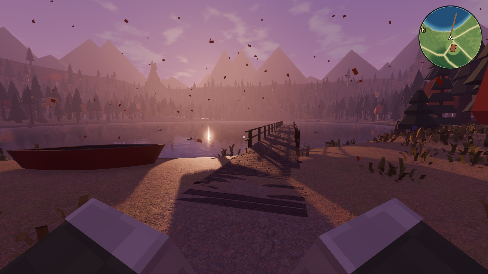
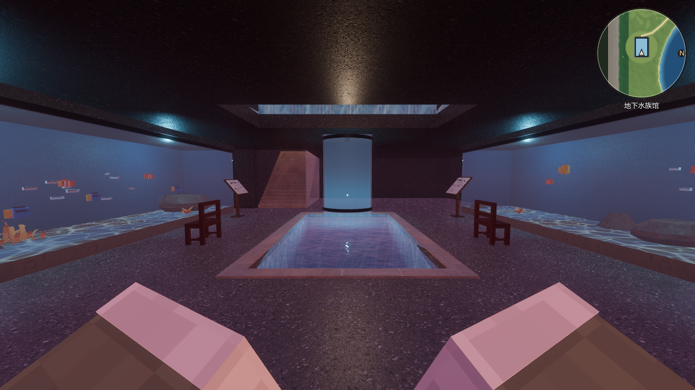
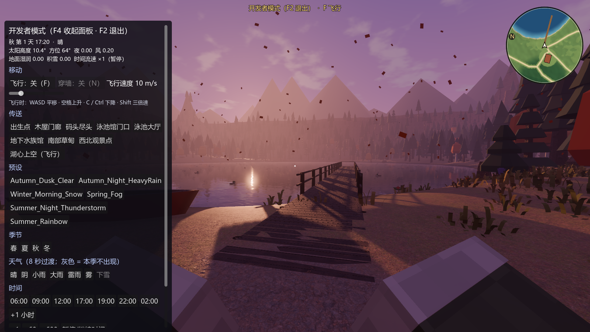
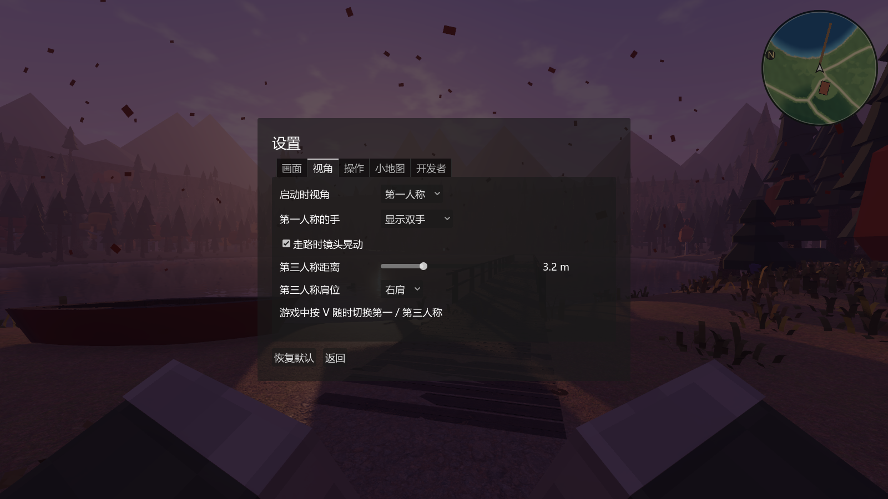
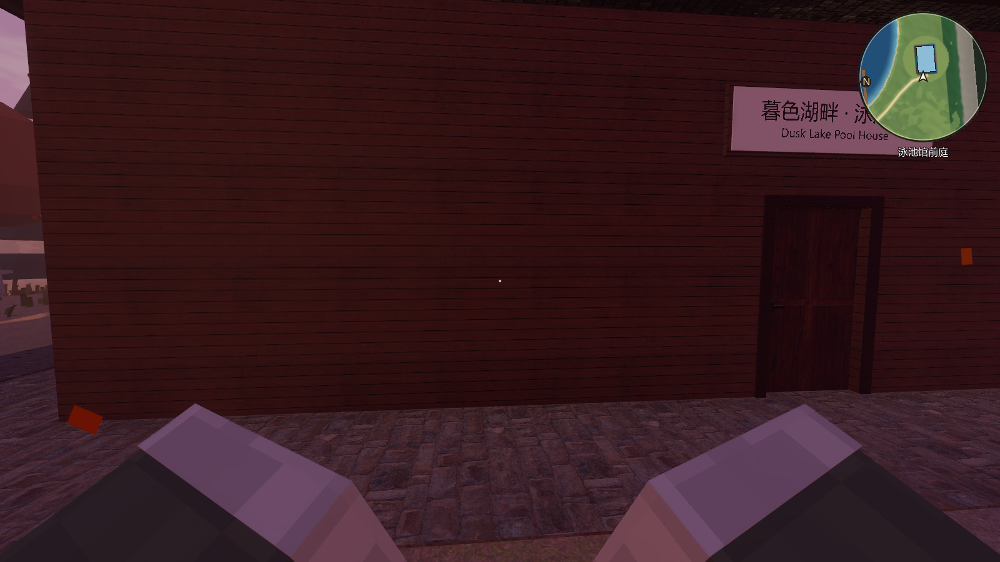

# M2 扩展：小地图、开发者模式、设置、第一人称的手 验收记录（2026-10-21）

## 圆形小地图（右上角，M 键开关）

- 玩家永远在圆心。默认随朝向旋转，前方朝上；设置里可以改成北朝上。圆周上的 N 标记始终指向北。
- 显示范围默认半径 60 m，设置里可调 25–150 m。圆下方显示当前区域名，比如“泳池馆前庭”“地下水族馆”。
- 底图：
  - 按地形高度、坡度和植被密度上色：湖是深浅不同的蓝，岸边是沙色，草地和林地是深浅不同的绿，陡坡是岩石色；
  - 按西北光加山体阴影；
  - 在后台线程烘焙成 256 × 256 的图（约 1 m/像素），缓存到 `user://`。布局文件不变，下次启动直接读缓存。
- 步道、码头、木屋和泳池馆每帧用矢量画，放大也清楚。

## 开发者模式（F2）

| 按键 | 作用 |
|---|---|
| F2 | 进入 / 退出开发者模式。进入时左侧出现开发者面板，退出时自动停止飞行、恢复碰撞、落地 |
| F4 | 开发者模式下收起 / 展开面板（收起后鼠标重新锁定，方便飞行） |
| F | 飞行开关：WASD 平移，空格上升，C / Ctrl 下降，Shift 三倍速 |
| N | 飞行时穿墙开关 |

开发者面板内容多，可以滚动：
- 飞行与穿墙开关，飞行速度 3–40 m/s。
- 传送：出生点、木屋门廊、码头尽头、泳池馆门口、泳池大厅、地下水族馆、南部草甸、西北观景点、湖心上空（自动开启飞行）。
  - 地点写在 `world_layout.json → dev_spots`。
- 原来 F4 天气面板的全部功能：
  - 天气预设；
  - 季节；
  - 七类天气（本季不出现的天气按钮是灰的）；
  - 时刻、时间流速（×1、×60、×600）和时间暂停。
- 显示：坐标信息（F3）、小地图、第一 / 第三人称。

普通模式下不能飞，也打不开面板。开发者模式不保存，每次启动都是普通模式。屏幕上方有“开发者模式”角标，飞行和穿墙时也会标出来。

## 设置（Esc → 设置）

改动立即生效，并保存到 `user://settings.json`，下次启动自动读取。“恢复默认”一键还原。

| 分页 | 选项 |
|---|---|
| 画面 | 视野 FOV 65–95°、渲染比例 50–100%、帧率上限、垂直同步、全屏 |
| 视角 | 启动时第一 / 第三人称、第一人称的手（双手 / 只右手 / 不显示）、走路镜头晃动、第三人称距离 1.5–8 m、第三人称肩位（左 / 右） |
| 操作 | 鼠标灵敏度、鼠标 Y 轴反转 |
| 小地图 | 显示、随朝向旋转（关闭 = 北朝上）、显示范围 |
| 开发者 | 开发者模式开关和说明 |

## 第一人称的手

- 第一人称能看到自己的双手，从画面左右下角伸进来，是方块人的手臂。袖子和肤色跟着外观实时变化：换短袖露出皮肤，换夹克就是夹克袖。
- 动作：
  - 走路时手臂跟着步子摆、轻微上下晃；
  - 跳起时抬手；
  - 按 E 开门时右手往前一伸；
  - 游泳时做划水动作。
- 实现：
  - 两条手臂是挂在相机下的第二个方块人模型，只显示手臂。
  - 整体缩小到 0.4 倍、离相机更近，透视上和正常大小一样，但手端离相机只有 0.21 m，在角色碰撞体（半径 0.35 m）以内，贴着墙也不会插进墙里。
  - 手臂放在单独的渲染层 5（`first_person_arms`）：第三人称和截图相机不画；手臂不投影子，也不接受阴影，不会被自己身体的影子罩住。
- 走路时镜头晃动是晃头部节点（相机挂在 SpringArm3D 下，位置每帧被改写），设置里可以关。

## 自动检查：44/44 通过

新增 4 项：

| 检查 | 结果 |
|---|---|
| 第一人称看得到双手：两只手端都在 16:9 画面内，离相机 0.21 m；第三人称不画；换上衣后手臂仍用专用材质和渲染层 | 通过 |
| 设置：FOV 限幅；第三人称距离、肩位、手的显示立即生效；保存后读回一致；恢复默认 | 通过 |
| 小地图：底图烘焙完成（湖心像素是蓝的，北部针叶林像素是绿的）；北朝上和随朝向旋转的坐标变换都对；可以关掉再打开 | 通过 |
| 开发者模式：普通模式按 F 不能飞；F2 打开面板；F 飞行 1.5 s 上升 13.4 m，悬停 1 s 漂移 0.08 m；穿墙关闭时被木屋正面玻璃挡住（x = 5.4），打开后穿过（x = −12.9）；9 个传送点全部到达；退出后恢复碰撞并落地 | 通过 |

另外：
- 测试开始时先恢复默认设置，不受本机设置文件影响。
- 新增 `DUSK_TEST_ONLY=_test_xxx` 环境变量，可以只跑某几项（全套约 8 分钟）。

## 性能（1920×1080，关闭垂直同步，RTX 5060 Laptop）

- 小地图的开销可以忽略：开着和关掉小地图各跑一次基准，两次之间的差别在测量波动范围内（±10–20%）。
- 各机位 100–175 FPS，表见 `docs/POOLHOUSE_FAUNA.md`。
- Benchmark 现在启动时强制关闭垂直同步，否则在 165 Hz 显示器上帧率会被封顶。

## 截图

| | |
|---|---|
|  第一人称的双手与小地图 |  地下水族馆（小地图下方显示区域名） |
|  开发者面板 |  设置 · 视角 |
|  泳池馆门口 | |
