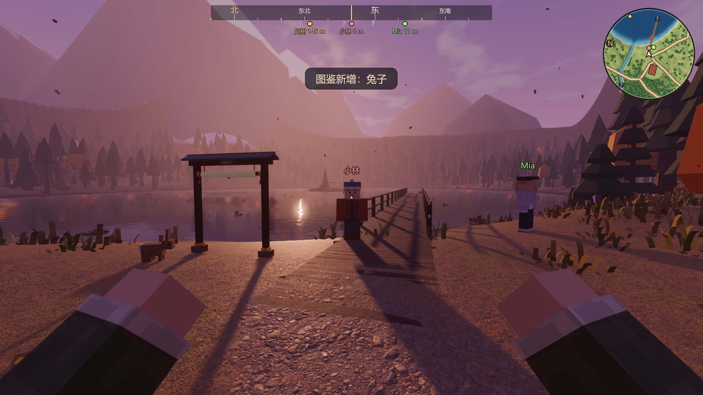
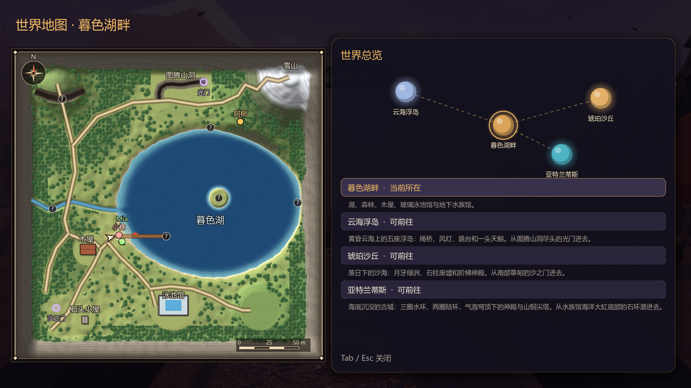
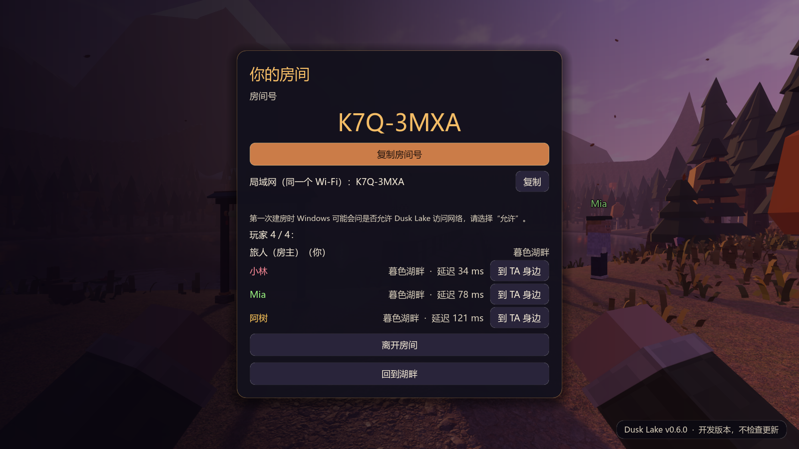
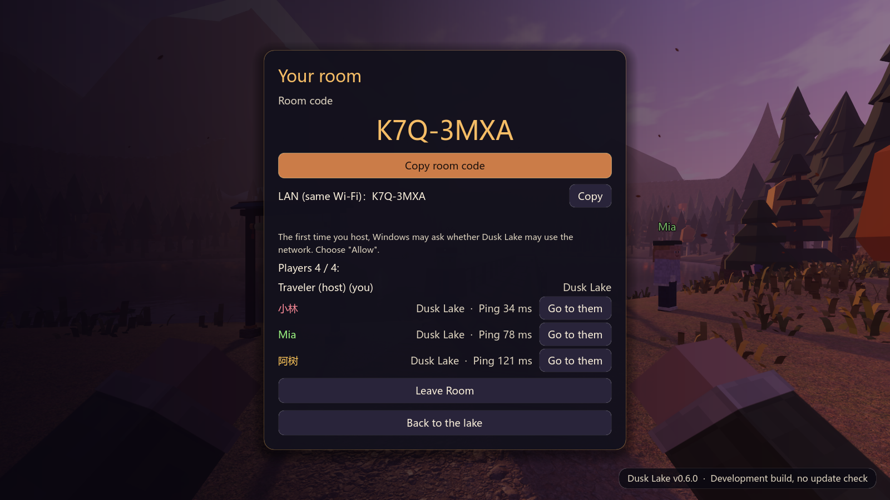

# 联机完善 + 流畅省 CPU（2026-11-03）

起因：用户说“继续完善一下游戏，多人模式，运行更流畅，没有卡顿，同时可以节省 cpu 占用，通过非视野区域简化加载等方式”。
分支 `feature/mp-smooth`（基于 v0.6.0 的 main = cb4961b），worktree `D:\个人世界\DuskLake-mp`。
测试机：RTX 5060 Laptop（8 GB 显存）、32 个逻辑核、15 GB 内存，高画质。

## 1. 联机

| 改动 | 做法 |
|---|---|
| 别人的人物走得匀 | 姿态包带算出这个位置时的物理时刻（`Net.sim_ms`，用发出那一刻的真实时间会把帧率起伏带进去）和速度向量。`RemotePlayer` 把收到的姿态按时刻排队，比对方晚 0.1 秒播放，在前后两个姿态之间插值（原来是每来一个包就朝它指数追赶，包到得忽快忽慢时人物一顿一顿）。时钟差取见过的最小值、慢慢往上漂，跟得上两台电脑的时钟漂移。包断了按速度往前推最多 0.25 秒再停住；两个相邻姿态隔 6 m 以上（对方传送）直接跳过去 |
| 站着不动少发 | 位置、朝向、俯仰、姿势、船、世界都没变时每 0.5 秒才发一次（动着时仍是 20 Hz）。4 个人挂机时房主不用每秒转发上百个包 |
| 流量压缩 | ENet 开区间编码压缩（两边必须一致，已包含在协议版本里） |
| 一起去别的世界 | 原来联机时谁都不能穿光门。现在房主穿光门，访客跟着去同一个世界（`WorldTravel.follow`：访客不存档、不看自己的开放状态）；访客自己穿门提示“联机时由房主带路”。房主在云海浮岛 / 沙丘 / 亚特兰蒂斯时有人加入，访客直接被带到那里。到了新世界访客的天气系统照样停下（以房主为准），再向房主要一次世界状态和门的状态。房主关房时访客如果在别的世界，自动回到自己的湖畔（访客不写存档，不会把别人的世界存进自己的存档） |
| 每个世界都有其他玩家和大厅 | 云海浮岛、沙丘、亚特兰蒂斯也建 `RemotePlayers`；暂停菜单的“多人房间”“回到主菜单”在这些世界里原来点了没反应，现在第一次点时才建大厅（平时省下它上千个界面节点）。`RemotePlayers` 新建时按房间名单把人补上；姿态里带世界，不在同一个世界的人先藏起来 |
| 看得到朋友在哪 | 每位朋友固定一种颜色：头顶名字、小地图彩点（圈外的贴着圆边指方向）、罗盘（不管多远都标，带名字和距离）、世界地图（彩点 + 名字，站得近时名字错开） |
| 房间页 | 每人一行：名字（TA 的颜色）、在哪个世界、延迟（房主每 2 秒量一次 ENet 往返时间并广播）、“到 TA 身边”按钮（站到 TA 的位置，面朝同一方向） |
| 协议 3 → 4 | 姿态格式变了（世界、发送时刻、速度向量），欢迎包多了房主所在的世界。和 0.6.0 互相连不上，会提示两边的版本号 |

| 湖畔上的朋友（头顶名字、小地图、罗盘） | 世界地图 |
|---|---|
|  |  |

| 房间页 | 房间页（English） |
|---|---|
|  |  |

## 2. 流畅与省 CPU

### 先测清楚

新工具 `devtools/CpuSpots.tscn` + `devtools/cpu_usage.ps1`：玩家（物理照常）依次站到 6 个机位，按玩家自己的设置跑（默认 60 帧上限），外面每 0.5 秒读一次游戏进程的 CPU 时间，算出每个机位的真实占用（100 % = 一个逻辑核满载）。`DUSK_CPU_OFF=动物,声音,…` 关掉一类再测，`DUSK_CPU_SET=键:值` 临时改设置。

| 发现 | 数据 |
|---|---|
| 60 帧时游戏占 1.6–2.0 个核 | 主线程渲染每帧只有约 4 ms，算下来每帧却花了约 30 ms 的 CPU 时间 |
| CPU 跟帧数成正比，跟画质、分辨率关系不大 | 30 帧 → 约 1.1 核；低画质、渲染比例 0.5 只少 10–25 % |
| 大头是引擎的工作线程池 | 默认开满 32 个线程，每帧把剔除、物理之类的小任务撒到 32 个线程上，线程唤醒和调度本身就吃掉一个多核。限到 4 个线程：60 帧时 0.6–0.9 核，帧率反而略高 |
| 会动的东西不能做遮挡体 | 第一版把漂着的独木舟也做成了遮挡体，引擎每帧重建遮挡结构，CPU 占用翻了十倍；遮挡体只给从不移动的建筑 |

### 改了什么

| 改动 | 做法 |
|---|---|
| 工作线程池 4 个线程 | `project.godot → threading/worker_pool/max_threads=4` |
| 切到后台降帧 | 窗口不在前台时帧率降到 15（设置 → 画面 → “切到后台时”：不降帧 / 30 / 15 / 10），最小化时 5 帧；不暂停游戏，联机房主在后台也照常同步。开发工具窗口不受影响 |
| 看不见的不画：按大小分档 | 静态合批时按部件大小分档：最长边不到 0.7 m 的小摆件 55 m 外不画、不到 2 m 的家具 110 m 外不画（都带淡出）；墙、屋顶、地板不受影响。湖畔 591 组合批网格带了可见距离 |
| 看不见的不画：建筑遮挡体 | 木屋、泳池馆、石头小屋、山洞本体里不透明的大块面（墙、地板、屋顶，最长边 ≥ 2 m 且第二长边 ≥ 1 m）的三角形同时做成遮挡体（共约 9900 个三角形）：屋外不提交屋里的家具，屋里、地下水族馆不提交墙外的小东西。窗洞、门洞没有三角形，透过去看得见的照常画 |
| 听不见的不放 | 定位声源（炉火、篝火、瀑布、仙境铃声……）在镜头比衰减距离还远时暂停解码和混音，走近了从停下的地方接着放 |
| 小动物 | 只有离镜头 28 m 内的投影；蝴蝶 45 m、地上的 80 m 外不画（原来都是 95 m）；下次什么时候更新只在更新时算一次（原来每个物理步每只都要取镜头、做视锥判断），各只错开帧 |
| 别人的方块人 | 镜头背后、离得远的动画降频（位置照常每帧插值） |

### 结果

**CPU 占用**（`cpu_usage.ps1`，1600×900，高画质，60 帧上限；100 % = 一个逻辑核。改前是同一时段 3 次的平均）：

| 机位 | 改前（main） | 只限 4 线程 | 本分支 |
|---|---|---|---|
| 湖岸出生点 | 174 % | 61 % | 62 % |
| 码头望木屋 | 175 % | 71 % | 65 % |
| 木屋室内 | 180 % | 87 % | 72 % |
| 北部林道 | 163 % | 79 % | 67 % |
| 地下水族馆 | 171 % | 66 % | 67 % |
| 石头小屋室内 | 161 % | 56 % | 56 % |
| **平均** | **171 %** | **70 %** | **65 %（−62 %）** |

切到后台（15 帧）、最小化（5 帧）时再按帧数比例往下降。

**帧率与绘制调用**（`Benchmark`，1920×1080，高画质，不限帧率）：

| 机位 | 绘制调用 改前 → 改后 | FPS 32 线程 → 4 线程（各两次交替取平均） |
|---|---|---|
| 湖岸出生点 | 1667 → 1453 | — |
| 码头望木屋 | 2501 → 2135 | 110.0 → 114.0 |
| 木屋室内 | 2653 → 2071 | 104.1 → 122.2 |
| 北部林道 | 2058 → 1607 | 121.0 → 138.8 |
| 地下水族馆 | 630 → 445 | 99.2 → 129.0 |
| 石头小屋室内 | 1233 → 800 | — |
| **合计** | **10742 → 8511（−21 %）** | |

**绕图一圈**（`MemProbe`，1600×900，新旧背靠背各一次）：

| 项 | 改前 | 改后 |
|---|---|---|
| 平均帧时 | 7.69 ms | 6.75 ms |
| p95 / p99 帧时 | 10.84 / 12.83 ms | 9.03 / 10.75 ms |
| 物理步平均 | 2.55 ms | 1.59 ms |
| 进入世界到第一帧 | 8.4 s | 7.9 s |
| 超过 33 ms 的帧 | 6 | 7 |

剩下的长帧和改前一样，是刚进世界和第一次下雪时现场编译渲染管线（之后有磁盘缓存，第二次启动起就没有了）。

## 3. 自动检查

- 新增 `_test_smooth_coop`：线程池 4；前台 / 后台 / 最小化的帧率上限；合批分档（细件 55 m）与遮挡体只给四座建筑（独木舟没有）；远处声源暂停、走近恢复；小动物近处投影、远处不投影；插值（缓冲中间、按速度外推、外推到头停住）；别的世界的姿态把人物藏起；协议 4 姿态格式校验与“没变就不发”的判断。
- 联机检查新增 8 项：访客走路时房主看到的人物每 0.1 秒速度都在 3.3–4.6 m/s（目标 4，不倒退）；站着不动 3 秒只发 6 个包；房主量到延迟并广播；房主去云海浮岛访客跟着到、访客自己穿门被拦、天气以房主为准；小地图能拿到朋友位置；房主回湖畔访客跟回；房主在云海浮岛时加入的访客直接到云海浮岛；房主关房后在别的世界做客的访客回到自己的湖畔。
- 自动检查 140/140、启动流程 6/6、联机 20/20。

## 4. 其他

- 截图工具拍照时临时打开小地图（不存盘）：本机设置里小地图是关着的（10-27 按 M 关的），之前的截图不受影响。
- 新的“切到后台时”设置和联机文字共 10 条英文翻译（共 790 条）。
