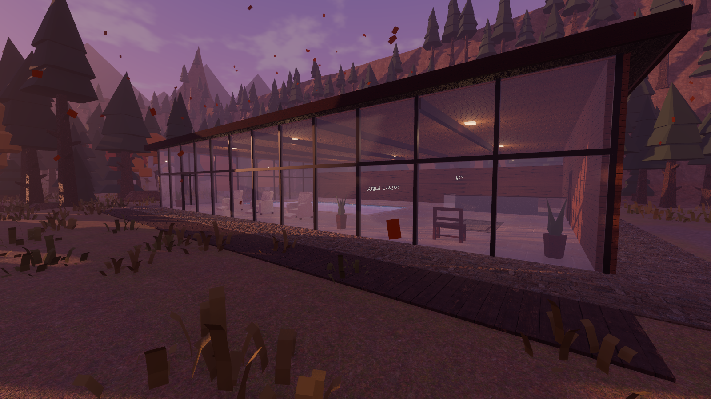
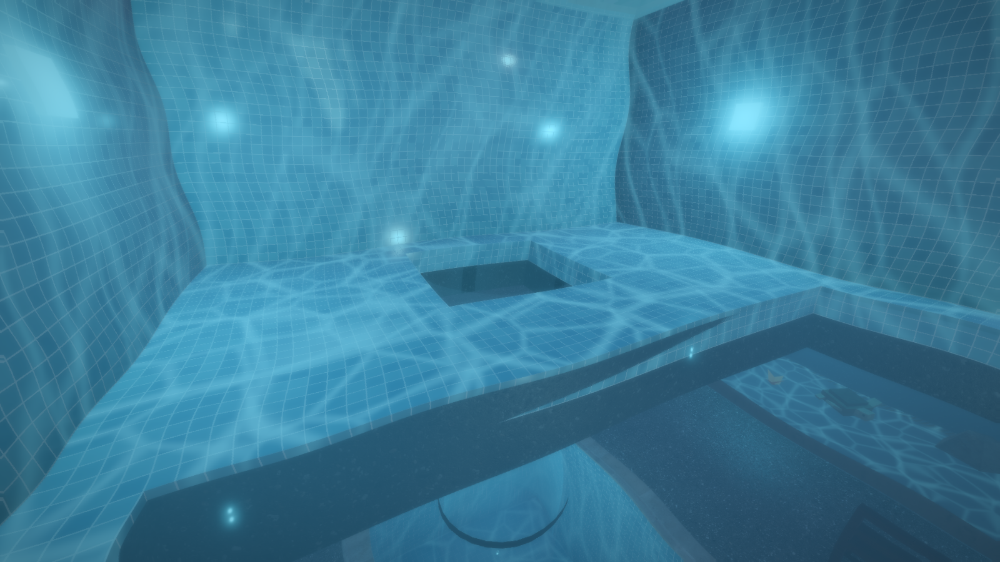
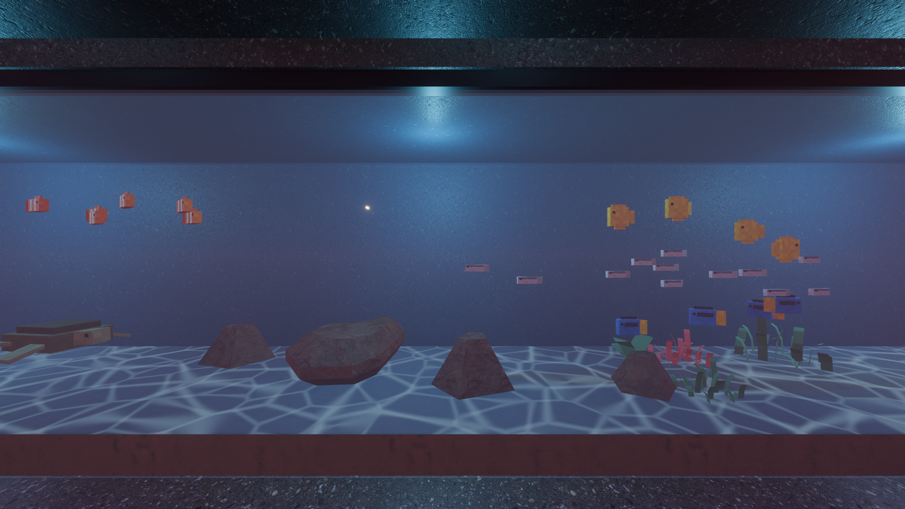
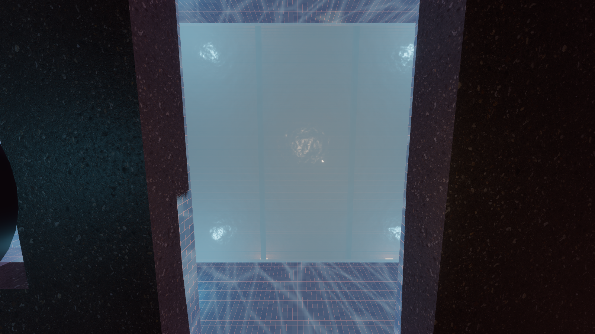
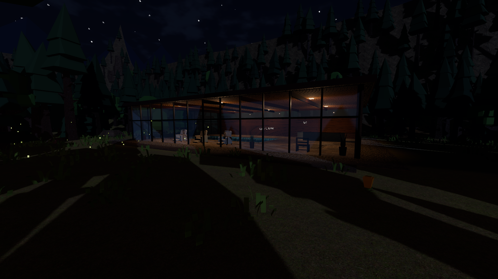
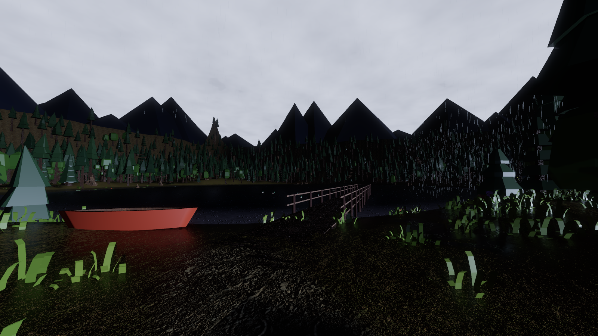
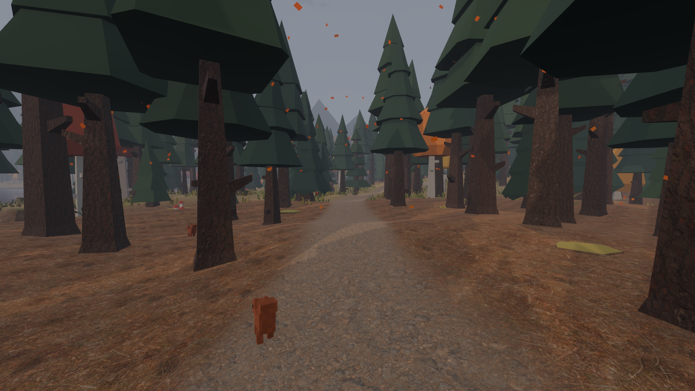
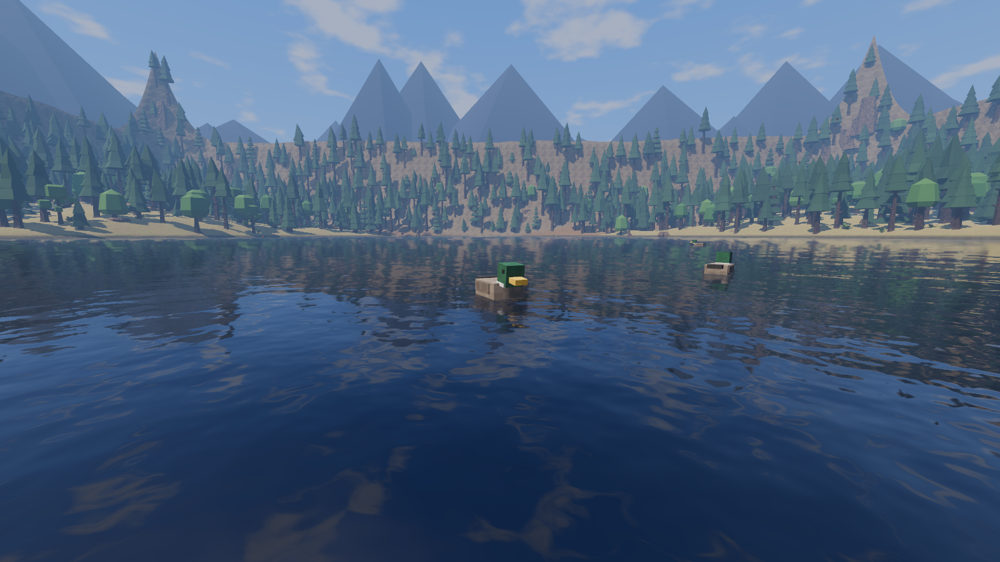
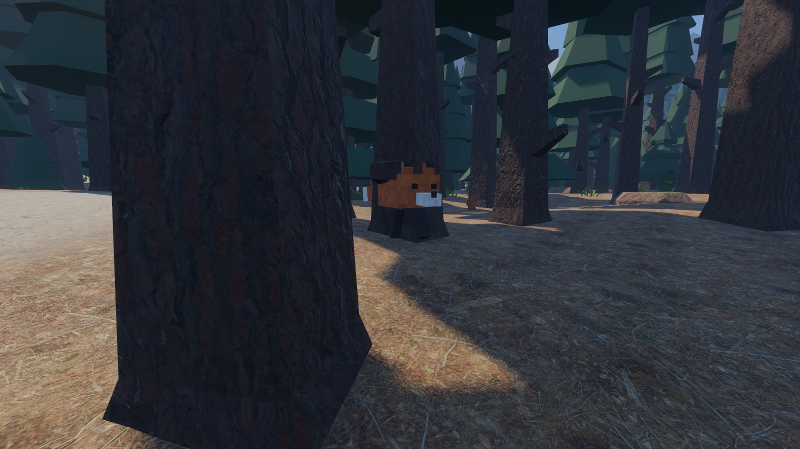
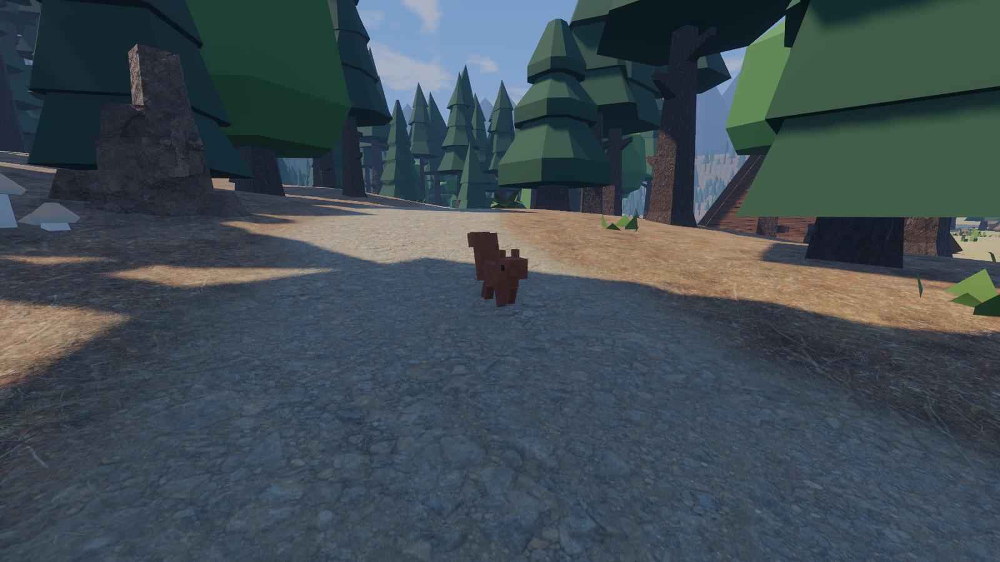

# M2 扩展：泳池馆与地下水族馆、小动物、天气细化 验收记录（2026-10-21）

## 泳池馆与地下水族馆

泳池馆在湖北岸的林间空地上，中心 (4, 84)，地面高 2.0 m。它和木屋一样跟室外同场景、同坐标系，从步道 `trail_poolhouse` 走过去推门就能进。

| 部分 | 说明 |
|---|---|
| 大厅（地上一层） | 24 × 16 m，层高 4.2 m。北面和东面是整面玻璃，西面和南面是木板墙，南墙上有高窗。另有平屋顶、木格吊顶、暖光筒灯、躺椅、绿植和地毯。正门在西墙，uid `poolhouse_front_door` |
| 泳池 | 13 × 6 m。深水区深 3.1 m，经斜坡过渡到 1.0 m 的浅水区，池边有台阶。马赛克瓷砖由着色器生成，水下池壁有流动焦散光纹和蓝色水下灯 |
| 通往水族馆 | 深水区池底开有 1.8 × 1.8 m 的洞口，下接直径 1.76 m 的竖直玻璃水管。水管穿过水族馆顶板，通到下潜池里：游下去出了管口就是水族馆，下潜池东侧有坡道上岸。池底另有一块 2.4 × 5.2 m 的玻璃观景窗，从水族馆抬头能看见泳池 |
| 楼梯 | 大厅西南角的楼梯井有玻璃栏板，两跑楼梯（各 20 级）中间有休息平台，下到地下 7 m |
| 地下水族馆 | 南北两侧各有一个 15.6 m 长的大缸，东端有一个水母缸。缸里有沙底和焦散光、礁石、珊瑚和海草，大厅放了长椅 |
| 区域 | `poolhouse`（大厅，室内）、`aquarium`（地下，室内）、`poolhouse_grounds`（室外场地） |

- 地下空间的实现：地形在建筑占地下方挖出一个坑（`world_layout.json → terrain.pits`，坑底 −9 m），坑口被建筑台基盖住。`WorldTerrain.height_at()` 在坑内返回坑底高度，所以地形碰撞和高度函数仍然一致。
- 建筑占地写在 `keepouts` 里，树、岩石、地被和动物都不会长进或走进建筑。

### 游泳

- 水体由 `WaterVolume` 节点描述（盒形或圆柱，可设有无水面），共三块：泳池、玻璃水管、下潜池。玩家身体中部进入水体就切换到游泳。
- 按键：
  - WASD 朝视线方向游；
  - 空格上浮，C 或 Ctrl 下潜；
  - Shift 加速，游速 2.2 m/s，加速时 3.4 m/s。
- 浮力让人漂在水面，眼睛露出约 0.35 m。不按下潜就会自己浮上来。
- 靠着池壁按空格可以爬上岸。
- 相机进入水面以下时，画面叠加水下滤镜：偏蓝绿、轻微折射晃动、四周压暗。
- 湖里仍然只能涉水（深 0.7 m 处停下），游泳只在泳池馆的水体里。

## 小动物

全部是方块像素风，部件写在 `data/animals/species.json`，和人物共用 `BlockyMesh` 生成网格。

| 动物 | 数量 | 行为 | 什么时候出来 |
|---|---|---|---|
| 兔子 | 9 | 一蹦一蹦地吃草，人走到 6 m 内就逃 | 白天、不下大雨；冬天换白毛 |
| 狐狸 | 2 | 在林中慢慢巡游，人靠近（9 m）就走开 | 昼夜都在，大雨时躲起来 |
| 松鼠 | 6 | 在林地里蹦跳，怕人 | 春夏秋白天、不下雨 |
| 绿头鸭 | 6 | 在湖面上游，人靠近就划开，夜里放慢 | 春夏秋 |
| 知更鸟 | 11 | 两群，在 17 m 高的树梢上方盘旋 | 白天，不下雨，雪不大 |
| 蝴蝶 | 14 | 在花丛间扑翅乱飞 | 春夏晴天的白天，风不大 |
| 萤火虫 | 3 群粒子 | 在草甸和湖边闪烁 | 春夏无雨的夜晚 |
| 水族箱 | 59 只 | 小丑鱼、蓝倒吊、黄高鳍刺尾鱼成群游；银色小鱼成群；海龟贴着缸底游；水母上下漂浮，自己发光 | 一直在 |

- 出没规则（季节、白天/夜里、雨、雪、风的上限）只读 `WorldState`。条件不满足时动物缩小消失，条件恢复后再出现。
- 每只动物有稳定的 `entity_id`（如 `rabbit_03`），为以后的存档和联机预留。

## 天气细化

| 内容 | 说明 |
|---|---|
| 雷暴 THUNDERSTORM | 新的第 7 类天气。春季权重 1、夏季 2、秋季 1，冬季不出现。乌云压顶、暴雨、大风。每 3–12 秒打一次闪电（常带二次闪），天空和云被照亮，同时有一盏瞬时的冷色方向光照亮地面，并发出 `EventBus.lightning_strike` 信号（留给 M3 的雷声） |
| 风 | 新增全局参数 `wind_strength` 和 `wind_direction`，强度随天气变化并带阵风。树冠、灌木、草丛改用 `foliage.gdshader`，随风摆动，雨天会变湿发暗，下雪时顶面积雪、草被雪埋住 |
| 雨后彩虹 | 雨停后约 40 游戏分钟内，如果天已放晴、太阳高度在 2°–40°，太阳对面 42° 处会出现彩虹，太阳越低越完整 |
| 水坑与涟漪 | 地面很湿时，平坦处会积出镜面水坑，能映出天空和树，下雨时有雨点涟漪。湖面和泳池水面下雨时也有涟漪 |
| 雨滴溅起水花 | 雨滴碰到地面或屋顶时，子发射器溅起小水花 |
| 落叶与花瓣 | 秋天飘落叶，春天飘花瓣。风越大越多、越斜，夜里和雨雪天变少。落叶只碰建筑上的“落叶挡板”，所以不会飘进泳池馆和木屋，林间照常飘落 |
| 新预设 | `Summer_Night_Thunderstorm`（夏夜 21:40 雷雨）、`Summer_Rainbow`（夏日 18:50 雨后放晴） |

## 自动检查：39/39 通过

新增 10 项，原有 29 项仍全部通过：

| 检查 | 结果 |
|---|---|
| 泳池馆：门外开门 → 大厅（`poolhouse`）→ 楼梯两跑下到水族馆（`aquarium`，地面 −7.00 m） | 通过，单帧最大位移 0.106 m |
| 泳池漂浮 → 池底洞口 → 玻璃水管 → 下潜池 → 坡道上岸进水族馆 | 通过，漂浮高度误差 0.00 m，途经三块水体，单帧最大位移 0.054 m |
| 深水区靠池壁按跳跃爬上岸 | 通过 |
| 6 种动物都已生成，entity_id 不重复 | 通过（兔 9、狐 2、松鼠 6、鸭 6、鸟 11、蝴蝶 14） |
| 作息：蝴蝶只在春夏晴天白天出来，狐狸夜里也在，鸭子冬天不在，兔子冬天换毛色；夜里运行时蝴蝶隐藏、狐狸可见 | 通过 |
| 兔子见人就跑（走到 1.4 m 内，1.6 s 后相距 7.1 m） | 通过 |
| 水族箱：3 个缸共 59 只，全部在缸内 | 通过 |
| 雷暴：冬天不允许；夏夜雷雨 15 s 内闪电 2 次；风 0.20 → 0.73 | 通过 |
| 雨后彩虹：`Summer_Rainbow` 下 rainbow = 0.99（太阳高度 11.9°） | 通过 |
| 秋天飘落叶、冬天不飘，建筑落叶挡板 4 个 | 通过 |

## 性能（`devtools/Benchmark.tscn`，1920×1080、MSAA 2×、关闭垂直同步，RTX 5060 Laptop）

| 机位 | 帧率 | 帧时 | 绘制调用 | 显存 |
|---|---|---|---|---|
| 湖岸出生点（秋暮晴） | 165 FPS | 6.1 ms | 801 | 875 MB |
| 码头望木屋 | 160 FPS | 6.3 ms | 2549 | 908 MB |
| 木屋室内 | 142 FPS | 7.1 ms | 2102 | 914 MB |
| 北部林道 | 149 FPS | 6.7 ms | 2278 | 914 MB |
| 秋夜大雨·木屋外 | 163 FPS | 6.2 ms | 1059 | 916 MB |
| 冬日下雪·湖岸 | 163 FPS | 6.1 ms | 1468 | 918 MB |
| 泳池馆大厅·秋日暮色 | 147 FPS | 6.8 ms | 1079 | 918 MB |
| 地下水族馆 | 130 FPS | 7.7 ms | 3176 | 918 MB |
| 夏夜雷雨·湖岸 | 165 FPS | 6.1 ms | 973 | 918 MB |

和 M2 相比，帧率下降主要来自三处：风摆植被着色器、新增的建筑与动物、地形水坑计算。所有机位仍在 130 FPS 以上。

## 截图

| | |
|---|---|
|  泳池馆外观（秋日暮色，落叶） |  泳池大厅 |
|  潜到池底，洞口通向水管 |  地下水族馆，中间是玻璃水管和下潜池 |
|  大鱼缸 |  从水族馆仰望泳池玻璃窗 |
|  夏夜泳池馆与萤火虫 |  夏夜雷雨（闪电瞬间） |
|  雨后彩虹 |  秋日林间落叶 |
|  兔子 |  湖上的鸭子 |
|  狐狸 |  松鼠 |
