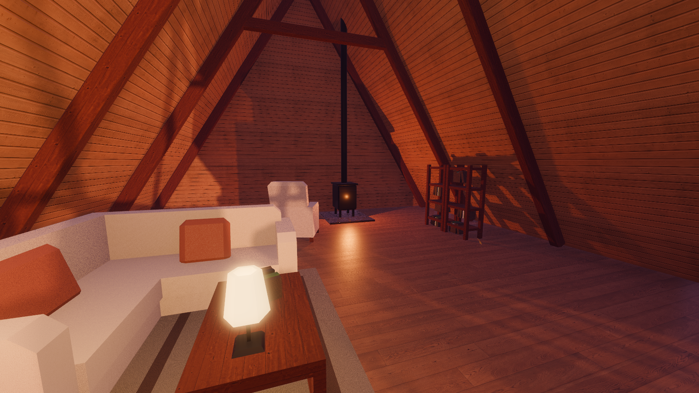
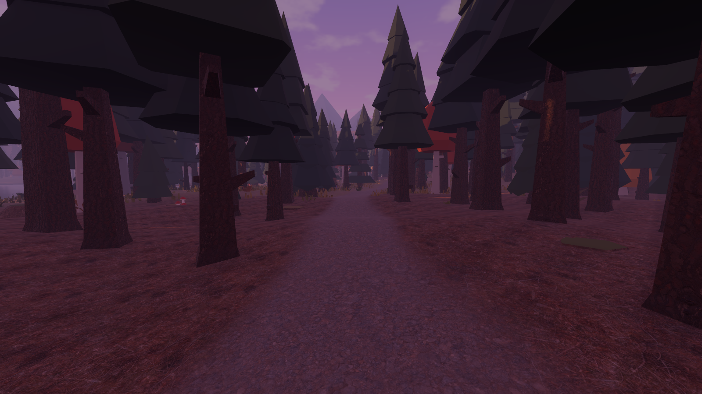
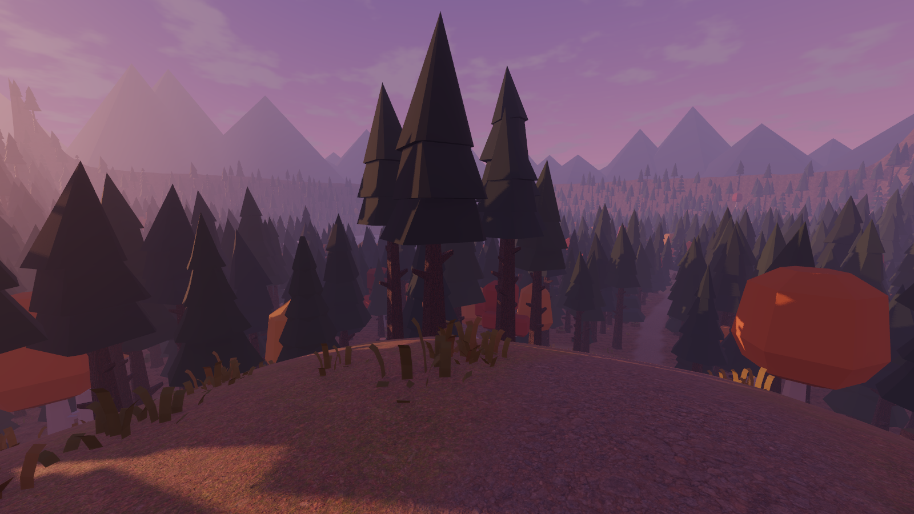
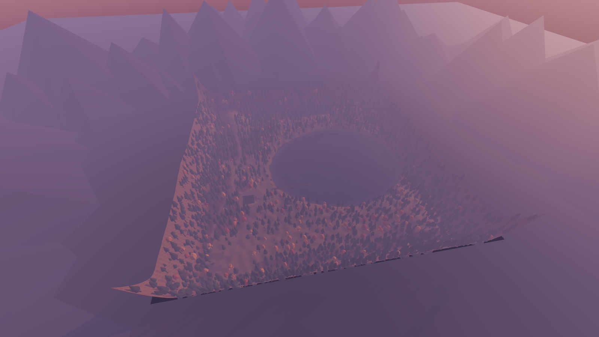

# M0 + M1 验收记录

- 日期：2026-10-20
- 引擎：Godot 4.7.2-stable (official)，Forward+，Jolt Physics
- 机器：Windows 11，NVIDIA GeForce RTX 5060 Laptop GPU（Vulkan 1.4）
- 自动检查：`godot --headless --path . --fixed-fps 60 res://tests/TestRunner.tscn` → **15 项通过，0 项失败**，退出码 0
- 导入：`godot --headless --path . --import` 无脚本解析错误
- 实机冒烟：窗口模式运行主场景 600 帧，日志无错误

## 规格 QA 用例

| 用例 | 结果 | 依据 |
|---|---|---|
| QA-01 从森林沿路走向木屋，不掉出地形、不被空气墙卡住；地图外侧自然封闭 | 通过 | 自动驾驶角色从北部针叶林 (−85, −70) 沿步道走 132 m 到木屋门廊，单帧最大位移 0.089 m（无瞬移），最低离地 −0.02 m（无穿地）；四个方向向地图边缘行走，均在 |113.7–114.8| m 处被坡度挡住，未越过 ±125 |
| QA-02 屋外穿过房门、关门、再返回室外，位置连续、相机无闪烁、场景不重载 | 通过 | 门外按 E 开门 → 走进屋（进入 `cabin_interior`）→ 屋内按 E 关门（仍在室内）→ 再开门走出（离开室内）；全程单帧最大位移 0.084 m，Main 实例与 current_scene 未变化 |
| QA-03 ~ QA-10 | 未开始 | 属于 M2–M4 |

## 其余自动检查

| 检查 | 结果 |
|---|---|
| `scripts/` 下 31 个脚本全部可加载 | 通过 |
| 全工程没有场景切换调用 | 通过 |
| 布局中 31 个坐标点均在 X/Z ∈ [−125, 125] | 通过 |
| Main 同时常驻 World / Cabin / Player | 通过 |
| 森林生成 2361 棵树、160 块岩石 | 通过 |
| 正门 uid = `cabin_front_door`，初始状态 closed | 通过 |
| 木屋位于 (−69, 2.4, 37) | 通过 |
| 地形碰撞与高度函数一致：400 个随机点最大偏差 0.035 m | 通过 |
| 出生点 (−50, 29) 落地稳定，朝向 70°（望向湖对岸） | 通过 |
| 湖中只能涉水到约 0.7 m 深（停在 y = −0.44） | 通过 |
| 码头可走到尽头；侧推与末端前推都留在甲板上（y = 1.00） | 通过 |

## 原始输出

```
=== Dusk Lake M0/M1 自动检查 · Godot 4.7.2-stable (official) ===
[PASS] 脚本全部可加载（31 个）
[PASS] 全工程未调用 change_scene_to_*（室内外同一场景）
[PASS] 布局坐标全部位于 X/Z ∈ [-125, 125]（31 个点）
[PASS] 木屋中心坐标 = (-69, 37)  —  (-69.0, 37.0)
[PASS] Main 同时常驻 World / Cabin / Player  —  World, Cabin, Player, HUD, PauseMenu, DebugOverlay
[PASS] 森林已生成  —  树 2361 棵，岩石 160 块
[PASS] 正门 uid = cabin_front_door 且已登记  —  closed
[PASS] 木屋位于布局坐标  —  -69.00, 2.40, 37.00
[PASS] 地形碰撞与高度函数一致  —  400 个采样点，最大偏差 0.035 m
[PASS] 出生点落地稳定（湖岸平台）  —  (-50.0, 1.06, 29.0)，朝向 70°
[PASS] QA-01 北部针叶林步道 → 木屋门廊，连续步行无卡死/穿地/瞬移  —  起点 (-85, -70) → 终点 (-62.3, 2.40, 37.0)，路程 132 m，单帧最大位移 0.089 m，最低离地 -0.02 m
[PASS] QA-02 门外开门 → 进屋 → 屋内关门 → 再开门出屋，位置连续、场景未重载  —  门外按 E：true → open；进屋后区域：cabin_grounds, cabin_interior；屋内关门：closed；单帧最大位移 0.084 m；Main 实例未变 = true
[PASS] 湖中只能涉水到深 0.7 m（MVP 不可深水游泳）  —  向湖心走 14 s 后停在 (-37.6, -0.44, 16.7)
[PASS] 码头可走到尽头，侧面与末端栏杆挡住落水  —  侧推后 (-12.0, 1.00, 25.1)，末端推后 (-1.4, 1.00, 26.0)
[PASS] QA-01 地图四边由陡坡自然封闭（不靠空气墙，已临时关闭树木碰撞）  —  (0,0,1)→ 停在 |113.8|；(-1,0,0)→ 停在 |114.8|；(0,0,-1)→ 停在 |113.7|；(1,0,0)→ 停在 |114.8|
=== 结果：15 项通过，0 项失败 ===
```

## 截图（`devtools/CaptureShots.tscn`）

| | |
|---|---|
|  湖岸出生点 |  码头望向木屋 |
|  木屋正立面 |  室内望向三角窗 |
|  室内铸铁炉与书架 |  北部针叶林步道 |
|  西北观景点 |  俯瞰（调试视角） |

## 已知问题

- （2026-10-21 已解决）灰盒几何与湖面倒影已在正式美术第一轮中替换，见 [ART_PASS.md](ART_PASS.md)。本页截图已更新为美术版。
- 西北观景点被近处树冠挡住一部分湖景。
- 帧率未测，QA-09 属于 M4；在确定目标硬件前不宣称 60 FPS。
- 按键在运行时注册，Godot 编辑器的“输入映射”面板里看不到它们。
