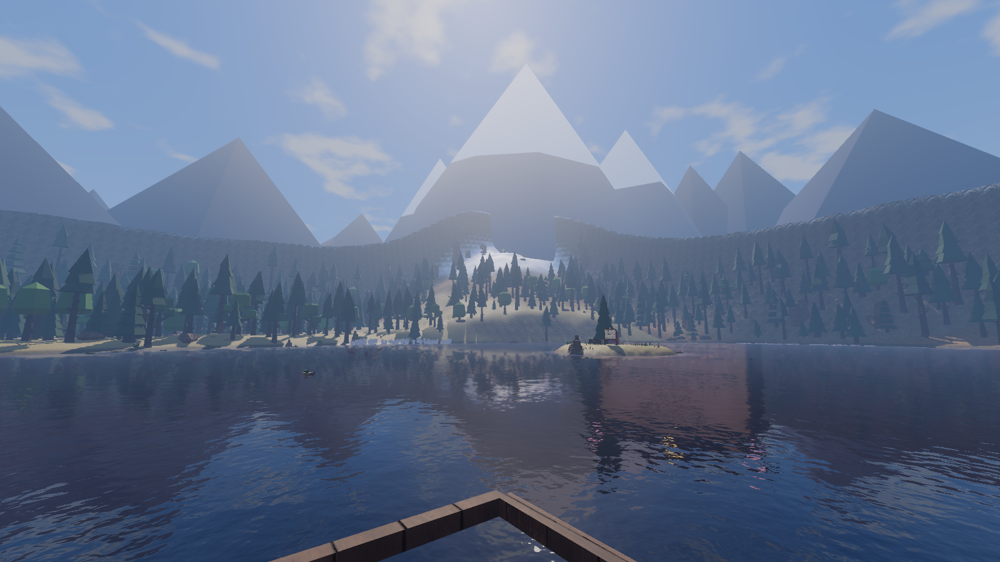
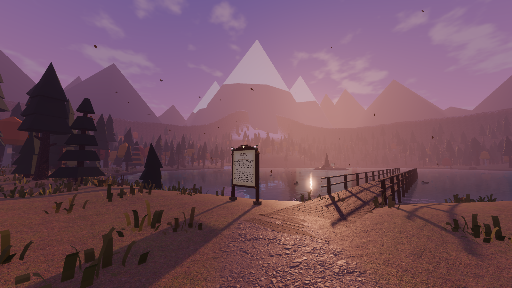
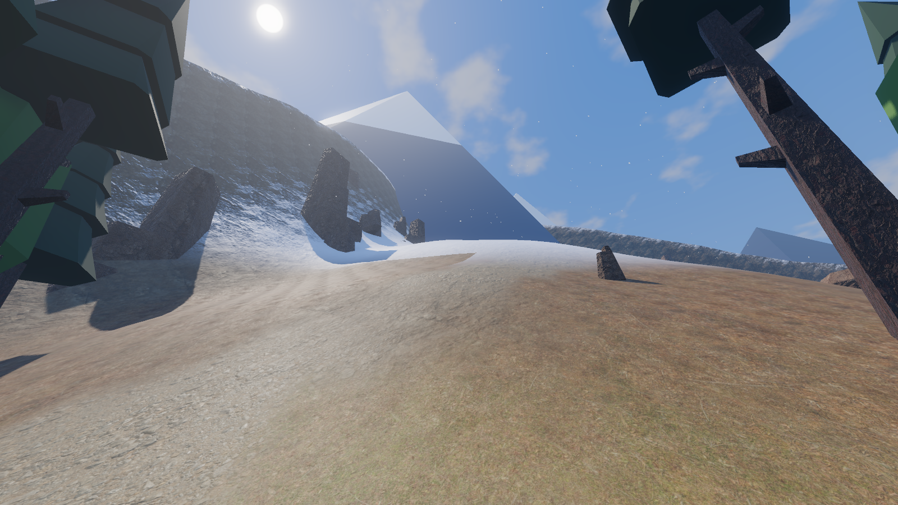
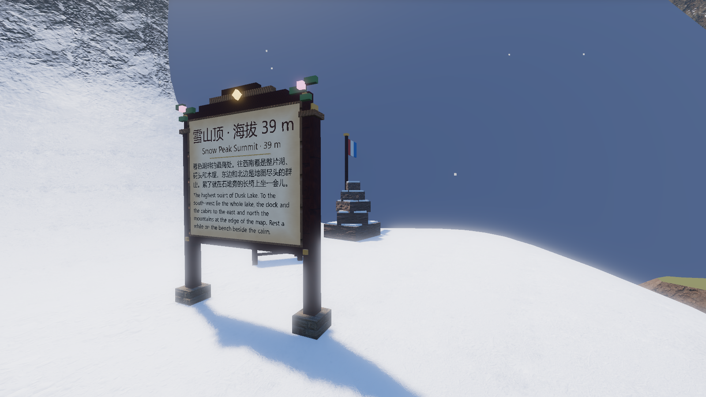
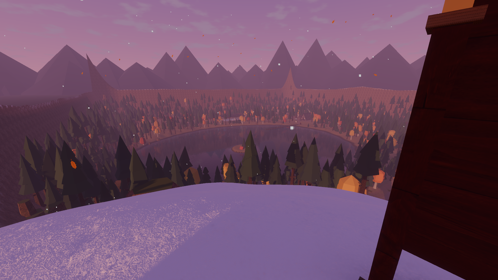

# v0.3.1：东北角的雪山（2026-10-21）

## 在哪、怎么上去

- 雪山在地图东北角（山顶 102, −108），从湖边、码头、出生点往东北看都能看见。
- 上山步道（雪山步道）：从北部林道（−80, −50）岔出，沿湖北岸往东，到山脚顺西侧山脊折返上山，全程约 200 m；岔口有立牌。
- 山上处处是能走的缓坡（最陡约 41°，人物能爬 45°），不走步道也能直接爬上去。
- 山顶：海拔 39 m（比湖面高 39 m），一块小平台上有：
  - 立牌“雪山顶 · 海拔 39 m”；
  - 一座层层垒起、每层落着薄雪的石堆，一根挂着红白蓝三色小旗的旗杆（旗随风摆）；
  - 一张面朝湖心的长椅，坐下能看整片湖、码头和木屋；
  - 山顶周围常年飘着小雪（不论季节、天气）。
- 开发者模式（F2）传送点“雪山顶”。

## 雪线、林线

- 地形高度 27 m 以上（`world_layout.json → terrain.snowline`，上下 3 m 渐变、边缘用噪声打散）终年积雪；太陡的岩壁不挂雪，露出岩石。夏天也是白的，冬天和全图的季节积雪叠在一起。
- 林线 21 m（`forest.treeline`）：以上不长树；雪线下方 2 m 以上不长草和花。
- 小地图和世界地图的底图里，雪线以上画成白色（小地图底图缓存版本升到 2，会自动重新烘焙）。

## 远处的主峰

地图里能爬的雪山是一座大雪山的“山肩”：边界外东北方向还有三座雪顶主峰（最高的一座高出地面约 190 m），从湖边看过去和山肩连成一片。主峰只是远景（无碰撞），岩石部分照常被远处的雾淡化，雪顶带一点自发光，隔着雾也是白亮的。数据在 `world_layout.json → snow_peak.backdrop`。

| 从码头望雪山（夏日午后） | 暮色里的雪山 |
|---|---|
|  |  |
| 山脊步道 | 山顶石堆、旗杆与立牌 |
|  |  |

## 地形取舍

- 山体是一个高 38 m、宽度（σ）31 m 的高斯山包，叠在地图边缘的陡坡上，原来东北角那个 7 m 的小山包并进了雪山。
- 山脚伸到湖的东北岸，那一小段湖岸比原来陡（坡度 0.49 → 1.06），是雪山直接落进湖里的岩岸；湖里本来就不游泳，绕湖步行不受影响。

## 自动检查与性能

- `TestRunner`：**75 / 75 通过**。新增 3 项：山顶高度、林线以上无树、地形雪线参数、主峰远景、山体坡度处处可走（最大 0.87）；沿步道连续走上山顶（区域 `snow_peak`，高度 39.4 m）；山顶长椅能坐、小雪在飘。
- 帧率（1920×1080，关垂直同步，同一时段和 main 对比）：

| 机位 | main | v0.3.1 |
|---|---|---|
| 湖岸出生点 | 119 FPS | 114 FPS |
| 码头望木屋 | 95 FPS | 90 FPS |
| 木屋室内 | 83 FPS | 78 FPS |
| 泳池馆大厅 | 76 FPS | 81 FPS |
| 地下水族馆 | 76 FPS | 80 FPS |
| 仙境林地·夏夜 | 103 FPS | 113 FPS |
| 雪山顶·望湖（新） | — | 96 FPS |
| 码头望雪山（新） | — | 129 FPS |

两边差别都在 ±5% 左右，属于两次运行之间的正常波动。
