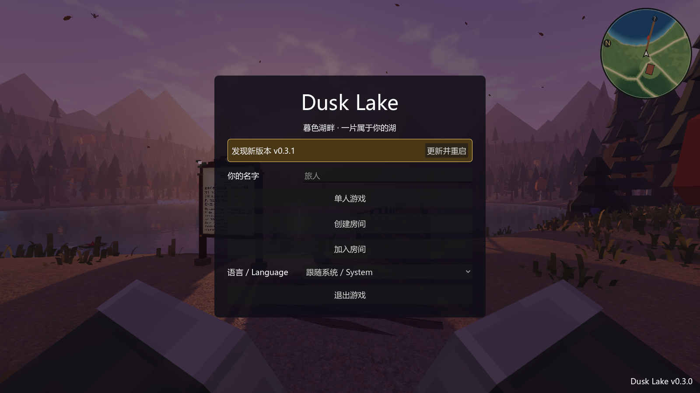
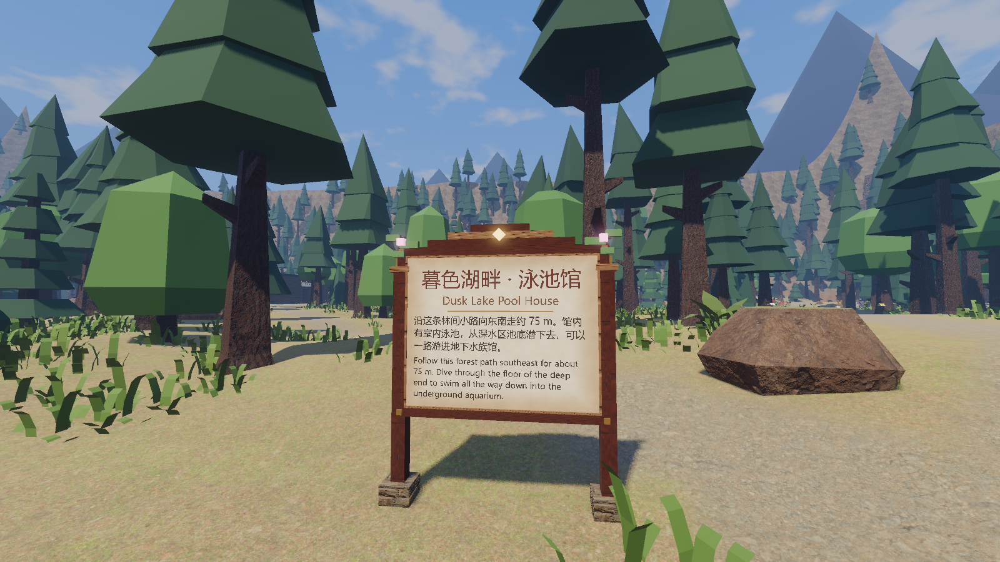
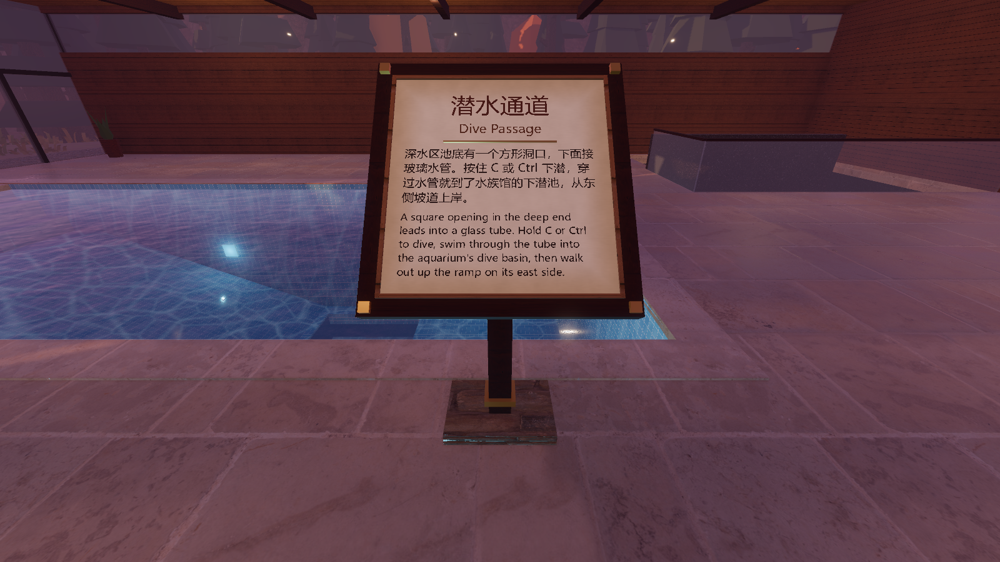
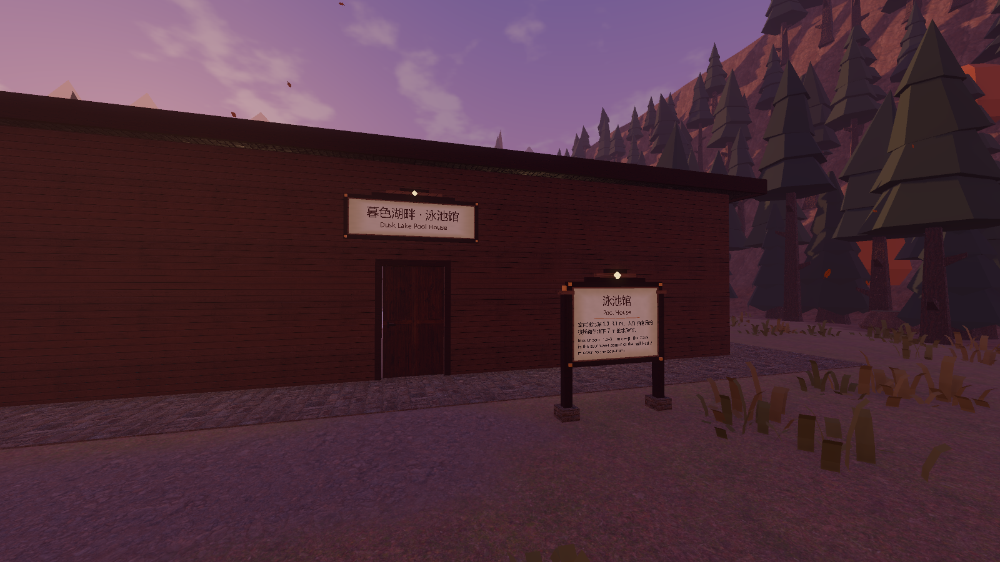
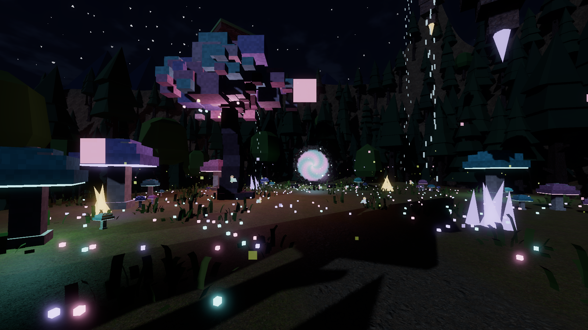
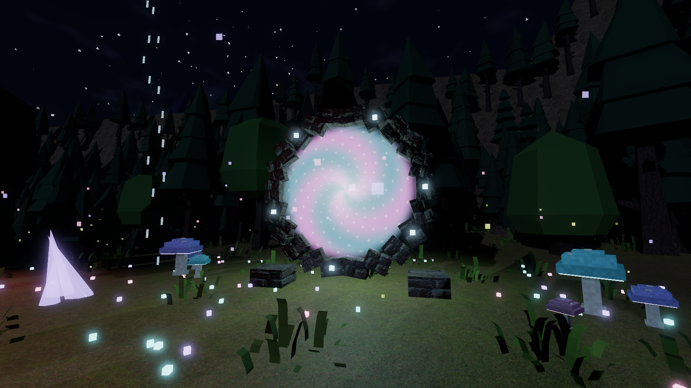
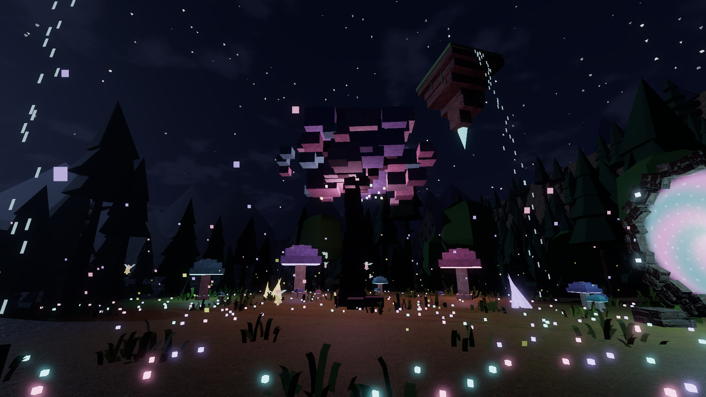
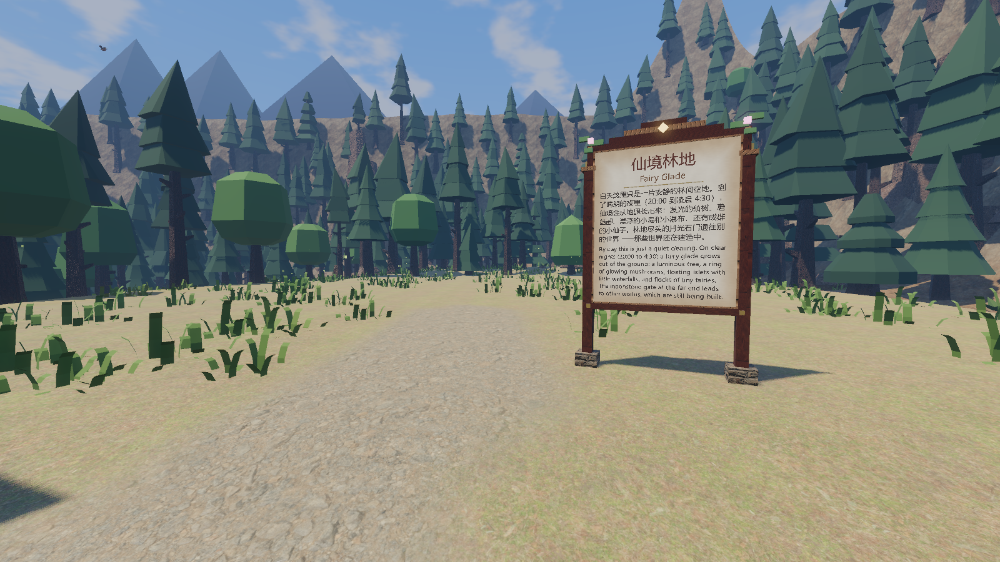

# v0.3.0：自动更新、新立牌、夜里的仙境林地、exe 发布（2026-10-21）

## 下载与自动更新

- 发布页：https://github.com/stloendays/Myworld/releases/latest ，下载 `DuskLake.exe`（单个文件，资源都打包在里面），放在任意文件夹双击运行。
- **自动更新**（`scripts/core/Updater.gd`，Autoload 名 `Updater`）：
  - 启动时到 GitHub Releases 查最新版本，比当前版本新就在大厅顶部出现金色横幅“发现新版本 vX.Y.Z · 更新并重启”，游戏里也会弹一句提示；
  - 点“更新并重启”：后台下载新的 `DuskLake.exe`，核对大小和 SHA-256（发布里附带 `DuskLake.exe.sha256`），然后退出，由一个 PowerShell 小脚本等游戏关掉、换上新文件、重新启动，旧文件自动删除。不需要安装程序；
  - 设置 → 关于：当前版本号、“启动时自动检查更新”开关、“检查更新”“更新并重启”“打开发布页”；
  - 只在导出的游戏里联网检查；编辑器里运行、自动检查里都不联网。
- 以后发新版本：把 `project.godot` 和 `export_presets.cfg` 里的版本号改大，导出 `dist/DuskLake.exe`，写 `DuskLake.exe.sha256`，在 GitHub 上建 `vX.Y.Z` 的 Release 并上传这两个文件，老版本下次启动就会提示更新。
- 联机要求两边版本一致；版本不同会提示，先更新到同一版本再一起玩。

| 大厅里的更新横幅 |
|---|
|  |

## 立牌重做

所有立牌（湖边、码头、泳池馆、鱼缸前、仙境入口）统一换成童话风木牌：

- 暖棕色厚木框 + 浅色内框，纸面是程序生成的羊皮纸（米色、细纤维、四边渐深），带一点自发光，夜里也读得清；
- 四角黄铜钉，中英文标题之间一条黄铜分隔线，中文标题深红褐、英文标题暖褐、正文深墨色；
- 立式牌和挂墙牌顶上有三级阶梯拱形牌头，中间一颗发光的菱形徽记，两个上角各有一小簇叶子和一朵发光的小花；
- 立式牌的柱子有石脚和柱帽，讲台牌是带石座和黄铜箍的单柱。

| 白天的步道立牌 | 泳池边讲台牌 | 泳池馆门口 |
|---|---|---|
|  |  |  |

## 仙境林地：只在夜里出现的特殊事件

- 位置：湖的东南方小山坡上（中心 76, 88），从泳池馆北侧沿新步道往东走约 80 m；入口有立牌。
- **白天**那里只是一片安静的林间空地和一块立牌。
- **晴朗的夜里**（20:00 到凌晨 4:30，没有雨、雪、雾、雷暴）仙境从地里长出来，屏幕上提示“东南方的林子里亮起了奇异的光……仙境林地出现了”；天亮或变天时缩回地下消失，碰撞和传送门一起关掉，地图上的标记也只在夜里出现。
- 里面有：
  - 一棵会发光的仙树（粉紫青三色方块树冠，枝下挂着十几盏会晃的小灯）；
  - 一圈大大小小的发光蘑菇（伞下菌褶发光）；
  - 四簇半透明的发光水晶，地上一片三种颜色的发光小花，飘着粉色、青色的光点；
  - 头顶三座漂浮小岛，岩体一层层收成尖、底下挂一颗发光水晶，挂着藤蔓，岛边有小瀑布落下，慢慢浮动转动；
  - 东端一座月光石门，门面是旋转的光，按 E“走进传送门”（其他世界还在建设中，会提示）；
  - 七只发光的小仙子在林间飞（也只在夜里出来）。
- 开发者模式（F2）里传送点“仙境林地”，时间选 22:00 就能看到。

| 夜里的仙境 | 月光石门 |
|---|---|
|  |  |
| 仙树与漂浮小岛 | 白天：只有空地和立牌 |
|  |  |

## 自动检查

`godot --headless --path . --fixed-fps 60 res://tests/TestRunner.tscn`：**72 / 72 通过**。新增：

| 检查 | 内容 |
|---|---|
| 自动更新 | 版本比较（0.10.0 > 0.2.9 等）、读取 GitHub 发布（跳过草稿和没有 exe 的发布）、下载核对（大小、SHA-256）、替换脚本（中文路径、单引号转义、是否重启）、自动检查里不联网 |
| 仙境是夜里的特殊事件 | 出现规则（晴夜出现，白天、雨夜、凌晨 5 点不出现）；白天隐藏且没有碰撞；22:00 长出来、有提示；仙树、蘑菇、水晶、3 座小岛、传送门都在；地面平整 |
| 走进仙境 | 沿新步道连续步行进入区域 `fairy_glade` |
| 传送门与天亮 | 对准传送门按 E 提示目标世界还在建设中；6:00 后仙境消失、碰撞关掉 |
| 小动物 | 7 种（含小仙子）都已生成 |

另外导出的 exe 已经实测：能正常启动，启动时会去 GitHub 检查更新。

## 性能

这次测帧率时这台电脑整体处在降频状态，同一时刻用没有改动的 main 测也一样低，所以只做同条件对比（1920×1080，关垂直同步）：

| 机位 | main | v0.3.0 |
|---|---|---|
| 湖岸出生点 | 49 FPS | 50 FPS |
| 码头望木屋 | 50 FPS | 52 FPS |
| 木屋室内 | 38 FPS | 38 FPS |
| 泳池馆大厅 | 33 FPS | 34 FPS |
| 地下水族馆 | 34 FPS | 35 FPS |
| 仙境林地·夏夜（新） | — | 45 FPS |

两者在误差范围内；夜里的仙境和别的机位差不多。
